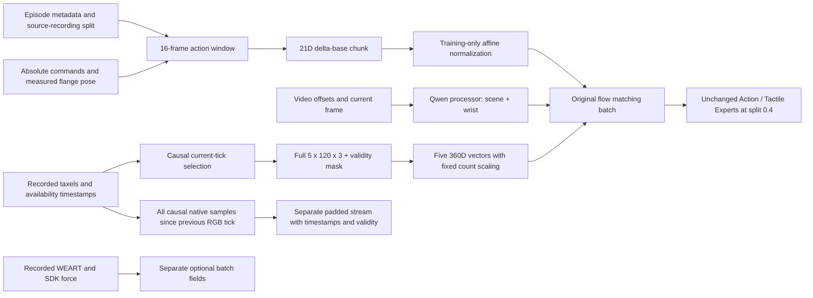

# TAPTIC dataset adaptation

Implemented on `mfincato/full-pipeline-studied`; `feat/TAPTIC` was inspected with
`git show`/`git diff` only. No checkout, merge or cherry-pick. Initial working
tree was clean. No architecture changes or training were performed.

## Reference-branch review (before implementation)

`feat/TAPTIC` commit `f4f2951` contains a primitive-level converter/loader,
18→21D delta-base action math and inverse reconstruction, source/hub layout
handling, native tactile lookup, train/val statistics, video decoding, XHand
VQ-VAE paths, training switches, tiny-model tests and earlier dataset audits.
Its audit concerns the **100-episode credit-card source**, not this export.

Reusable: `taptic/actions.py`, `constants.py`, `video.py` were selectively copied;
the processor, padding, FLARE and flow-matching collator in
`qwen_vla/taptic_dataset.py` was adapted. Reduced-size forward testing follows
the reference test approach, constructing models in memory without checkpoints.

Corrections needed: the reference loader reads a separate primitive NPZ export,
reduces touch to five SDK force vectors, optionally uses a VQ-VAE, reads touch
at `t+k`, and does not implement this export's `available_ns`, missing taxels or
synthetic-data provenance. Its clipped percentile action normalization cannot
exactly invert outliers. The model/VQ-VAE modifications in that branch were not
ported. No new converter or synthetic sensor data were needed.

## Actual source and inspection scope

Dataset: [mfincato/taptic_trex_style_midtrain_v1](https://huggingface.co/datasets/mfincato/taptic_trex_style_midtrain_v1),
Hub revision `31d33a627a70cff8752c621833fa07be7b71e25a`.
Despite the repository name, its current README/data describe the **version-2**
export. Verified local root:
`/home/mfincato-iit.local/midtrain_merge/derived/taptic_trex_style_v2`.
The nearby `taptic_trex_style_v1` is older and has 233,453 frames; it was rejected.

Matched local files against Hub Git blob IDs (small JSON files) or LFS SHA256:
`meta/info.json`, `tactile_raw/info.json`, main data parquet, episode metadata
parquet, and episode 0 native tactile parquet. Data SHA256:
`06293ea95c0f96402227dfe716b5f437f194e9c0d3d1a7afe0b580592feaf98f`;
episode metadata SHA256:
`a21c0f281b46e1b9349e859f366800f174f82bb3c7605ba81020c3295c94d436`.
No dataset download was necessary. Other video/tactile files were not all hashed.

[Machine-readable inspection](taptic_audit.json) includes every feature name,
shape, dtype, action/state ranges, all captions, task/split counts and sampled
sidecar diagnostics. All **213,507** action/state/haptic rows were checked for
finiteness. All 868 episode frame clocks/windows were checked. Tactile values
and timing were sampled in **one episode per source task** (nine total), not an
exhaustive raw-sidecar scan. Decoded videos and model tests use very small samples.

## Discovered schema

LeRobot `codebase_version=v3.0`, `robot_type=panda_ee`, **10 FPS**, 868 episodes,
213,507 frames, 59 task captions. Length min/median/max = **15 / 196 / 1860**
frames; mean 245.98. Nominal video duration is about 5.93 hours.
The built-in LeRobot split says `train=0:868`; the additional `suggested_split`
is the appropriate split: **782 train / 86 validation episodes**, grouped by
source recording. Several episodes are cuts of one recording; splitting these
independently would leak source recordings across validation.

| Feature | Stored dtype / dimensions | Verified meaning / units |
|---|---|---|
| `action` | float32 `[18]` | absolute commanded flange position 3 (m), orientation rotvec 3 (rad), 12 absolute XHand joint targets (rad) |
| `observation.state` | float32 `[40]` | Panda joints 0:7 (degrees), measured hand joints 7:19 (rad), SDK fingertip forces 19:34 (counts), measured EE pose 34:40 |
| `observation.images.left` | RGB video `[480,640,3]` | scene view, AV1/yuv420p, 10 FPS; slow view and optional FLARE targets |
| `observation.images.wrist` | RGB video `[480,640,3]` | sole fast wrist view; same encoding/FPS |
| `timestamp` | float32 scalar | nominal episode-relative `frame_index/10` seconds |
| `frame_index`, `episode_index`, `index`, `task_index`, `subtask_index` | int64 scalars | indexing and fine primitive labels |
| `annotation_review_required` | bool scalar | recorded annotation flag |
| `observation.haptics.force` | float64 `[3]` | recorded operator WEART stream, thumb/index/middle; units undocumented |
| haptics `valid`, `status`, `event_sequence`, `source_time_ns`, `local_time_ns`, `received_time_ns` | int64 `[3]` each | recorded status and timing |
| haptics `frame_mono_ns`, `frame_utc_ns`, `source_session`, `recording_id`, `sync_valid`, `sync_uncertainty_ns`, `stream_gaps`, `aligned` | int64 scalar each | recorded synchronization/provenance; invalid sentinels include -1 |

LeRobot metadata declares scalar fields as shape `[1]`; parquet stores scalars.
The adapter preserves scalar haptic fields as batch `[B]` and vector fields as
`[B,3]`. Haptic forces are finite, range 0–0.68; 562,517 of 640,521 finger validity
entries are one. 188,904 frames have `aligned=1`; 24,603 have `aligned=0`.
These are logged operator signals, not robot forces or risk labels. Their
validity/status/sync flags remain attached; no synchronization or physical
calibration is fabricated.

Source tasks and frame counts (all splits):

| Task | Episodes | Frames | Raw taxels |
|---|---:|---:|---|
| clearing_table | 171 | 23,440 | recorded |
| dosing_pipette | 50 | 18,097 | recorded |
| fruit_in_the_basket | 158 | 27,876 | missing |
| grasp_plastic_glass | 99 | 16,628 | recorded |
| insert_credit_card | 97 | 32,422 | recorded |
| insert_game_object_cylinder | 98 | 24,603 | missing |
| split_cups | 100 | 24,974 | recorded |
| unscrew_the_bottle | 47 | 26,713 | missing |
| wiping_table | 48 | 18,754 | recorded |

Each episode has a recorded caption, e.g. “Grasp the blue cloth with your right
hand and wipe the whiteboard with it.” Other captions describe reach, grasp and
lifting, placing specific objects, insertion, cup extraction, dispensing and
unscrewing. All 59 exact captions are retained in the audit JSON and used by the
loader; no primitive instruction is generated by this adapter.

## Verified action contract

Recorder code (`lerobot_robot_panda/panda_ee.py`, `ee_safety.py`), Hub README,
and independent FK on `panda.urdf` establish:

- Position: `panda_link8` flange point in Panda base coordinates, metres; no
  XHand tool offset. Orientation: `r=rotvec(Rx(pi)^T R_base)` in radians,
  the recorder's `gripper_down` representation, not Euler angles.
- Action pose is an absolute commanded target; the state pose is measured.
- Hand order: thumb bend/rota1/rota2, index bend/rota1/rota2, middle1/2,
  ring1/2, pinky1/2, all absolute radians. Source feature names are validated.
- Measured reference at frame t: `(p0,R0)`, where
  `R0=Rx(pi) Rot(state[t,37:40])`.
- Chunk k=0..15: translation `R0.T @ (action[t+k,:3]-p0)`; rotation
  `R0.T @ Rx(pi) @ Rot(action[t+k,3:6])`; store its first two **columns**, then
  the twelve absolute hand targets. Output `[16,21]`. No absolute-to-delta
  hand conversion; k=0 is the measured-to-commanded tracking error.
- `reconstruct_chunk` converts this representation back to native absolute
  `[16,18]` commands. Round-trip position and rotation tests pass at 1e-6.

FK verification samples all nine source tasks, comparing degrees-based Panda
joint FK to recorded measured flange position and orientation, tolerance 1e-6.
Action targets themselves have no independent actuator ground-truth trace;
the commanded semantics are established by recorder code and dataset provenance.

## Tactile contract and timing

`tactile_raw/info.json` explicitly orders `values` as thumb, index, middle,
ring, little; taxel 000..119 within each finger; x,y,z within each taxel.
Stored vectors are float64 `[1800]` in inspected sidecars, representing SDK
integer counts. They reshape to **`[5,120,3]`** without reordering. SDK
`data_type.hpp` defines Fx/Fy as int8 and Fz as uint8. Counts→N calibration,
physical fingertip-axis orientation and taxel spatial geometry are undocumented.

The separate sidecar `force` `[15]` is **recorded SDK `calc_force`**, not a sum
invented from taxels. Its frame-associated samples equal state[19:34] in all six
native episodes sampled. `joints` has twelve measured radians. Other recorded
fields include sequence, read start/end, reset sequence, read-error/drop counts,
last command sequence/time/filtered joints/target. Optional command data and
pre-roll frame associations can legitimately be null/NaN; these fields are not
returned as numerical policy inputs. The complete sample schema is in the audit.

**565 native episodes:** shared CLOCK_MONOTONIC frame `observation_ns` and
sample `read_end_ns`. Sampled median intervals ~13.08–13.10 ms (~76.4 Hz), not
nominal 80 Hz. Sampled frame medians ~100 ms, but gaps reach 9.613 s; tactile
reads include reset gaps up to ~547 ms. Latest causal tactile age medians
~6.3–6.7 ms, sampled maxima <14 ms. No read errors/drops in sampled episodes;
reset sequences do change.

**303 legacy episodes:** no recorded taxels or hardware clock. Sidecars contain
zero taxel placeholders and synthetic high-rate interpolation. The adapter
**drops every `interpolated=True` row**, uses only the recorded 10 Hz SDK force
samples, and marks all taxels invalid. Clocks are explicitly marked nominal.
Interpolation `available_ns` can be later than `read_end_ns`; both must be ≤
the observation tick. Zero placeholders never become valid recorded taxels.

Video alignment uses each episode's metadata `videos/<camera>/from_timestamp`
plus frame_index/10; seek/decode checks PTS within half a frame. Policy RGB,
actions and causal touch share the same frame anchor. Actual camera exposure
clock/latency is not logged, so physical exposure-level synchronization cannot
be certified. Nominal timestamps hide teleoperation pauses; monotonic clocks
are used to reject action windows crossing gaps >150 ms. All 16 target actions
stay in one episode. Future FLARE frames are targets only and also must remain
inside an uninterrupted episode window.

No tactile history is passed to the policy in this baseline. The current
sample is selected causally, with no interpolation and no pre-episode history.
The latest sample at the first episode observation is allowed as its initial
observation. No reset-spanning history can enter the model.

The original sidecars remain the persistent, complete native-rate recording;
they have never been overwritten or downsampled. The adapter now additionally
returns `tactile_stream`: **every recorded sample becoming available between
the previous RGB observation and the current one**, at its original irregular
timestamps (~76.4 Hz for native episodes). Both SDK forces and all taxels are
retained without averaging, interpolation, fixed-size windows or truncation.
At the first frame only the latest causal initial observation is returned;
pre-roll stays in the source sidecar. Reset sequences and read-error/drop counters
remain attached to each sample instead of silently joining reset histories.

This prepares data access for future fast ticks, but does not introduce a fast
tick scheduler or alter model forward. A future consumer replaying an earlier
fast tick must further select `available_ns <= fast_tick_ns`; the whole interval
is only available by its final RGB observation. Legacy episodes retain their
recorded 10 Hz SDK forces and nominal timestamps, with invalid taxels; the
adapter never manufactures 76 Hz measurements for them.

## Adapter and batch fields

`qwen_vla/taptic_dataset.py` is a separate loader; original JSON and LeRobot
loaders retain their behavior. Training selects it using `--data_format taptic`.
It validates action dimensions, schema, split/statistics identity, current-tick
tactile (`--tactile_delay_offsets 0`), disabled VQ-VAE/codes/deformation paths,
and the fixed 6/10 Euler split (τ_split=0.4). Resume auto-detection cannot silently
turn the incompatible VQ-VAE path back on.

| Batch fields | Shape / use |
|---|---|
| `input_ids`, `attention_mask`, `pixel_values`, `image_grid_thw`, `n_slow_images` | actual Qwen processor output; one slow + one fast image, no fabricated second wrist |
| `norm_actions`, `noisy_actions`, `target`, `eps_r` | `[B,16,21]`; original flow-matching construction |
| `timesteps`, `time_r`, `delay_k` | `[B]`; delay always zero |
| `tactile_taxels` | raw counts float32 `[B,5,120,3]`, full resolution |
| `tactile_f6s`, `tactile_f6s_delayed` | scaled taxels float32 `[B,5,360]`; same current tick |
| `tactile_valid` | bool `[B,5]`; false for missing taxels |
| `sdk_force`, `sdk_force_valid` | recorded `[B,5,3]` and `[B]`; separate from policy taxels |
| `tactile_stream.sdk_force`, `tactile_stream.taxels` | raw recorded `[B,N,5,3]` and `[B,N,5,120,3]`, native temporal resolution |
| stream `read_end_ns`, `available_ns`, `sequence`, `reset_sequence`, `read_errors`, `dropped` | int64 `[B,N]`; original timing, identity and quality counters |
| stream `taxel_valid`, `clock_is_nominal` | bool `[B,N,5]` and `[B,N]`; missing taxels / nominal legacy clocks explicit |
| stream `lengths`, `sample_mask` | int64 `[B]` and bool `[B,N]`; right padding to the batch maximum N, never a measurement |
| `recorded_haptics` | dict of original haptic tensors and validity/sync metadata |
| `state_raw` | optional normalized measured `[B,21]`: absolute xyz, rotation columns, hand joints |
| `flare_pixel_values`, `flare_grid_thw` | optional future target images, never included in observation tokens |
| `tactile_deforms`, `tactile_deforms_delayed`, `tactile_codes`, `tactile_f6_history` | None |
| `contact_features`, `contact_risk` | None: no justified contact threshold/risk labels supplied |
| `meta` | episode/frame, observation/sample availability ns, action timestamps, clock provenance |

Raw taxels are divided by fixed representable component scales `[128,128,255]`,
with no learned statistics, pooling, clipping, subsampling or calibration. The
existing `ActionEmbedder` accepts `tacf6_dim=360`; five tokens each retain one
finger's complete 360 channels. `modeling_vla.py` and the MoT model are unchanged.
The historical `tactile_f6s` name is a compatibility key, not a claim of six axes.
Validity masks are explicit batch metadata; the unchanged model receives neutral
zeros for missing touch and has no new missing-modality token. SDK forces,
WEART signals, contact features and risk do not enter model forward.

Actions and optional state use separate affine min/max statistics derived from
training episodes only. No clipping: denormalization exactly reverses the
float32 transform, including validation outliers; BF16 batches incur normal
quantization error. Constant channels get a safe width of one. Statistics store
training episode IDs and a SHA256 identity of info/data/episode metadata and are
checked against the selected dataset scope. The native all-episode LeRobot stats
are not used. The supplied [training statistics](taptic_train_stats.json) cover
**177,763 valid chunks using the 782 training-episode split**. One 15-frame
training episode contributes no full chunk: usable training/validation episodes
are 781/86; validation has 18,882 chunks. Across all episodes 196,645 windows
are valid and 3,842 candidate windows cross a >150 ms gap. Frame indices and
nominal timestamps had zero inconsistencies. `normalize_actions` and
`denormalize_actions` are paired APIs; `reconstruct_chunk` then returns native
absolute commands. The existing bimanual deployment script is not a Panda
hardware deployment wrapper and is outside this adaptation task.



## Files

- New adapter: `qwen_vla/taptic_dataset.py`.
- Reused reference math/constants/video: `taptic/{actions,constants,video}.py`;
  new `taptic/__init__.py`, `data.py`, `inspect_dataset.py`.
- Modified `scripts/midtrain.py`: opt-in loader, 360D vector width, config guards and TAPTIC checkpoint metadata.
- New `tests/taptic/test_adapter.py`, `scripts/smoke_taptic.sh`.
- This report, `docs/taptic_audit.json`, `docs/taptic_train_stats.json`, and
  `docs/taptic_test_results.txt`.

## Exact validation commands

From the repository root on this workstation:

```bash
export TAPTIC_PYTHON=/home/mfincato-iit.local/trex-venv/bin/python
export TAPTIC_ROOT=/home/mfincato-iit.local/midtrain_merge/derived/taptic_trex_style_v2
export TAPTIC_PROCESSOR=/home/mfincato-iit.local/midtrain_merge/derived/tiny_qwen3vl_test
export TAPTIC_PANDA_URDF=/home/mfincato-iit.local/lerobot_plugins/lerobot_robot_panda/lerobot_robot_panda/urdf/panda.urdf
bash scripts/smoke_taptic.sh
```

`TAPTIC_PROCESSOR` needs local official Qwen3-VL config/tokenizer/processor files,
not pretrained weights. Tests construct tiny random real Qwen/MoT modules in
memory. Without the root/processor environment variables, real-data tests skip
explicitly. Set the URDF variable to include independent FK verification.

Reproduce the audit and all-training-episode statistics (CPU, no training):

```bash
OMP_NUM_THREADS=2 MKL_NUM_THREADS=2 OPENBLAS_NUM_THREADS=2 CUDA_VISIBLE_DEVICES='' \
  "$TAPTIC_PYTHON" -m taptic.inspect_dataset --root "$TAPTIC_ROOT" \
  --out /tmp/taptic_audit.json --stats /tmp/taptic_train_stats.json
```

Only small JSON outputs are written. Use a suitable output filesystem if moving
this command to a machine with a full root partition.

Training configuration, for a later authorized training run (not launched):
`--data_format taptic --lerobot_root "$TAPTIC_ROOT" --taptic_stats docs/taptic_train_stats.json
--action_dim 21 --action_chunk 16 --use_tactile_vec 1 --use_tactile_deform 0
--use_tactile_code 0 --use_tactile_vqvae 0 --tactile_delay_offsets 0
--cascaded_total_steps 10 --cascaded_split_step 6 --frame_stride 1`.
Other original trainer options, model checkpoint and resources remain required.
FLARE/state can be enabled through the existing options. Pretrained bimanual
21D/62D action-head incompatibility must be handled explicitly when selecting
weights for future training; no checkpoint migration was done here.

## Results and remaining limits

The smoke suite covers real episode loading, mixed native/missing-taxel
collation, `[B,16,21]` actions, tactile dimensions, finite tensors, causal clocks,
episode/gap bounds, reversible normalization, inverse action reconstruction,
source-disjoint splits, rejection of leaking stats/configs, independent FK,
original Action Expert velocity/partial-flow forward, Tactile Expert velocity
forward, and original LeRobot loader collation at `[B,16,62]`. Original loader,
shared utility and model source files are also checked unchanged against HEAD.
Additional native-stream tests verify exact equality against every sidecar sample
in a real frame interval, mixed native/legacy padding, empty intervals, exclusion
of future and synthetic rows, and preservation of reset/error/drop counters.

An initial model test failed because official flow methods cast to BF16 while
the tiny CPU model was FP32. Using CPU BF16 autocast fixed the test harness;
no model behavior was changed. Final result: **10 passed in 5.53 s**, recorded in the test-results file. No optimizer steps, full training, GPU tests, full-size pretrained-model
forward, distributed-loader test or deployment validation were performed.
Environment: Python 3.12, torch 2.10.0, transformers 4.57.1, LeRobot 0.5.2,
PyAV 15.1.0, pytest 9.0.3; this differs from the pinned Python 3.10/torch 2.6
manifest, so pinned-environment execution remains unverified.

Remaining data questions: counts→N calibration, fingertip axes/taxel geometry,
physical RGB exposure timing, haptic force units/sync interpretation, and a
scientifically valid contact/risk definition. Missing raw taxels cannot be
recovered from the three legacy tasks. Raw-sidecar validation beyond the nine
sampled episodes remains a larger audit; the loader rejects nonfinite selected
samples and inconsistent schemas/clocks when encountered. Contact derivations,
adaptive handover, risk tokens/head, cache ladder and early replanning are absent.
