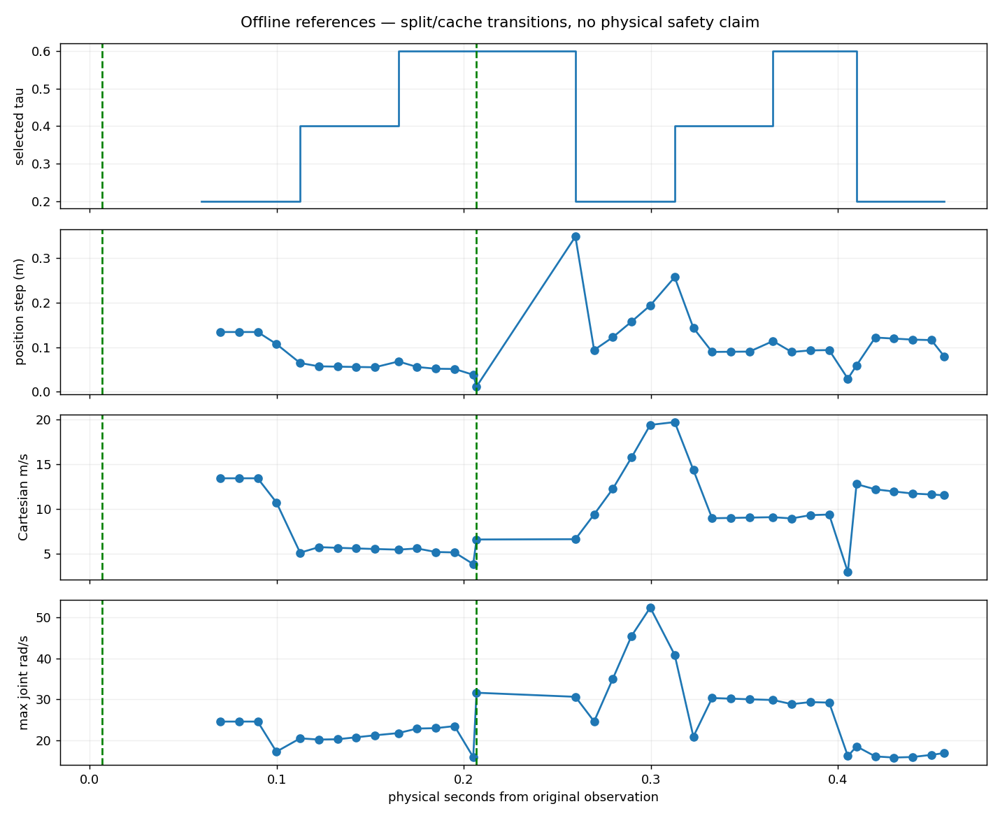

# TAPTIC time-aware action executor — offline validation

Date: 2026-11-20. Branch: `mfincato/risk_gated`. All newly selected real-data
examples use **episode 59**. Existing regression fixtures retain their original
episodes. No hardware commands, pretrained checkpoints, training, branch changes,
commits or pushes were performed.

## Verified representation and timing; unresolved actuation semantics

Inspected `qwen_vla/taptic_dataset.py`, `taptic/actions.py`, `taptic/data.py`,
`taptic/inference.py`, `docs/taptic_review/REPORT.md`, and
`docs/taptic_approach_a_strategy1/REPORT.md` before implementation. Reused their
conversion conventions, train-only normalization, original model classes,
immutable cache ladder, online tactile extractor and diagnostic model/context
helpers. No earlier file was modified by this task.

The adapter uses measured state at row `t` as reference and commanded targets
`action[t:t+16]`, **including row t**. Its metadata contains
`action_timestamps_ns = observation_ns[t:t+16]`, with actual recorder clocks,
not nominal `timestamp = frame_index/10`. A fast-tick prediction keeps this same
time vector and original measured reference; it never shifts action[0] to F or S.

The source 18D targets are base-frame flange position (m), recorded gripper-down
rotation vector (rad), absolute XHand joints (rad). The 21D model representation
is local translation 3 + two rotation columns 6 + absolute joints 12. The flange
is `panda_link8`, not an inferred fingertip/tool centre. The existing FK suite
independently validates the recorded base/gripper-down convention.

**Ambiguity explicitly retained:** row association is verified; a Panda command
send/apply timestamp, actuator deadline, and exact camera exposure clock are not.
The fact that commanded poses resemble state[t+1] more closely does not prove
that the label belongs at t+1. Sidecar `command_ns` concerns hand commands and
cannot establish a Panda end-effector application deadline. We therefore select
an explicit **recorded-row reference-label convention** for offline analysis.
These timestamps are not claimed to be measured physical actuation times.
Deployment must supply a verified controller target schedule; the executor does
not invent one from slow-cache construction time.

The constructor requires `timing_semantics='recorded_row'` (first target equals
original observation time) or `'controller_target'` (externally provided verified
controller deadlines). Unknown semantics, absent identities, pre-observation
targets, noninteger/decreasing/repeated timestamps, unavailable/expired chunks,
and gaps exceeding the declared maximum are rejected. The default gap cutoff,
150 ms, matches the TAPTIC adapter's eligible-window policy.

## Timing contract and reconstruction

All ns timestamps use one declared monotonic clock; a string identity check is
not a clock synchronization service. Require:

```text
observation_ns <= S <= actual_cache_ready_ns <= prediction_available_ns
u[0] < u[1] < ... < u[15]
prediction_available_ns <= u[15]
recorded_row: u[k] = actual observation_ns[t+k], u[0] = observation_ns
valid application: max(u[0], prediction_available_ns) <= t_exec <= u[15]
```

The nominal clocks remain independent:

```text
physical time      S            S+50ms       S+100ms      S+150ms      S+200ms
slow schedule      build cache  |             |             |        build next cache
fast schedule                   predict       predict       predict  ...
compute                         F --available  F --available  F --available
recorded targets   u0-------u1 (~100ms)-------u2 (~200ms)------- ... -------u15
reference query                  select/interpolate using t_exec, not chunk index 0
numerical flow                   2/4/6 Euler steps for tau .2/.4/.6, no physical tick
```

For measured reference `(p0, rv0)` at the original observation time:

```text
R0 = Rx(pi) Rot(rv0)
p[k] = p0 + R0 dp[k]
dR[k] = GramSchmidtColumns(action21[k,3:6], action21[k,6:9])
R[k] = R0 dR[k]
hand[k] = action21[k,9:21]  # absolute radians
```

Reject zero/parallel rotation columns, nonfinite data or invalid shapes. Do not
rebase onto a subsequently measured pose. For adjacent actual timestamps, use
alpha = `(t_exec-u[k])/(u[k+1]-u[k])`, linear base position, shortest-arc quaternion
SLERP (`xyzw`), and linear hand joints. Exact timestamps return exact stored
physical waypoints. Never interpolate the six rotation numbers linearly.

`PhysicalTrajectory.as_actions21()` verifies the inverse mapping for valid
rotation columns. Arbitrary random 6D network outputs are projected by the
adapter's Gram-Schmidt convention: a 6-to-3 dimensional rotation projection is
not invertible for arbitrary nonorthonormal columns. The original immutable
21D prediction is retained separately, unchanged; no exact inversion of this
projection is claimed.

## API and executor policy

New module: [`taptic/action_executor.py`](../../taptic/action_executor.py).

`TimedActionChunk` owns a finite, denormalized `[16,21]` array backed by immutable
bytes, immutable reference pose tuples, target times, S, original observation,
actual cache-ready and prediction-available times, episode/cache identity,
selected split, normalization/configuration/model version, physical frame,
clock identity, sensor segment, and declared maximum waypoint gap. It does not
normalize, clip, actuate, change the learned representation, or batch multiple
robots. Model output batch size must be **one** at the bridge.

```python
from taptic.action_executor import (
    TimedActionChunk, ActionExecutor, Limits, Transition,
)

# Existing ApproachAInference fast-tick result, original SlowAnchor, actual
# completion timestamps and the adapter's real row times must come from caller.
chunk = TimedActionChunk.from_prediction(
    result, anchor,
    prediction_available_ns=actual_prediction_completion_ns,
    target_ns=item['meta']['action_timestamps_ns'],
    normalization_id=stats_sha256, config_id=action_config_sha256,
    model_version=checkpoint_sha256,
    timing_semantics='recorded_row', clock_id=recording_clock_id,
    sensor_segment=contact_segment,
)
executor = ActionExecutor(
    configured_limits,  # Limits(...): required finite application-specific values
    Transition(duration_ns=60_000_000, validation_step_ns=5_000_000),
    max_delivery_delay_ns=20_000_000,  # optional application policy
)
executor.reset(episode=59, sensor_segment=contact_segment)
accepted = executor.submit(chunk, received_ns=actual_receipt_ns)
reference = executor.command(t_exec=intended_application_ns)
if reference.accepted:
    xyz = reference.command.position
    xyzw = reference.command.quaternion_xyzw
    hand = reference.command.joints
    # Hardware-specific controller conversion is outside this module.
```

`from_prediction` accepts existing `status='ok'` results, validates the reference
and anchor time, and rejects missing predictions, batch mismatch, inference start
before cache readiness/after cache expiry, and results dated after declared
completion. It does **not** measure completion for the caller. The older wrapper
and its original zero-latency diagnostic remain unchanged; do not reuse that
assumption as an actual ready timestamp. A production scheduler must attach real
ready/completion times before using this bridge.

`submit` and `command` return `ExecutionResult(accepted,status,command,
retained_previous)`. Construction errors raise `ValueError`; runtime plan/query
rejections return structured status. Calls must be serialized and event time
cannot decrease. Duplicate command times are rejected; commands already returned
are immutable and are never revised. Equal receipt/query times are allowed.

Newer predictions may change split with the same cache, but cannot change its
reference/timestamps/readiness. New cache identities require a later slow anchor.
Earlier slow caches, old/duplicate prediction availability and incompatible
model/normalization/configuration/frame/clock/timing identities are rejected.
The optional delivery-age bound checks `receipt - prediction_available_ns`.

With a valid old plan, transitions evaluate **old and new at the same physical
time**, then blend position/joints linearly and orientation by SLERP over the
configured duration. Each update starts from the currently accepted composite
plan, including an unfinished previous blend. At the transition start the old
value is preserved exactly. Completed blends are compacted to avoid retaining a
whole episode of dependency chains. A future first controller target preserves
the old plan until the handoff; insufficient overlap is rejected. Zero duration
disables blending and checks direct time-aligned jumps. No Euler count enters
these timings. Transition duration is a policy parameter, not validated optimal.

A rejection retains the old plan only through its explicit target horizon.
Missing new predictions require no special fabricated chunk: query the previous
plan while it remains valid, then receive `expired`. Episode/segment mismatch
invalidates the plan and latches a reset requirement; `reset` also clears history
and temporal ordering. The caller must signal boundaries promptly, including
when no new model prediction arrives. There is no sensor reset detector inside
the action executor and no risk-triggered replan.

## Limits, validation scope and rejection

Required `Limits` include an axis-aligned base workspace, per-joint position
bounds, Cartesian/angular/joint velocity, Cartesian/angular/joint acceleration,
and maximum position/angular/joint command changes. Invalid positive bounds are
rejected. No silent clipping or guessed Panda/XHand default limits exist.

Before committing a plan, evaluate the remaining horizon at declared waypoints,
all transition knots, the final target, and a bounded 5 ms validation grid by
default. Validate positions and finite-difference motion from available command
history. Acceleration uses velocity midpoint intervals on irregular timestamps;
angular increments are expressed in the base frame. Actual emitted references
are checked again against the last two **successfully emitted** references.
Rejection does not advance that command history. Oversized validation horizons
are rejected before allocating a large grid.

These are **discrete checks**, not a proof of continuous bounds between grid
samples. Piecewise linear/SLERP trajectories can change velocity at knots and
linear blend weights do not guarantee velocity continuity at blend boundaries.
First commands have no measured velocity history; acceleration needs two prior
references. No jerk bound, collision avoidance, reachability/IK, joint torque,
controller tracking or physical robot safety guarantee is provided. Bounds must
be verified for the actual controller before physical integration.

## Episode 59 numerical evidence

Episode **59**, task **dosing_pipette**, object **pipette**, source episode
**61**, training split, **473 frames**, native tactile.
Full-episode actual frame interval min/median/max:
**[93.686751, 100.13447, 107.454753] ms**. New anchors use frames
**71 and 73**, with scheduled S exactly **200 ms** apart,
selecting the latest causally available recorded frame.

| Check | Actual standalone replay result |
|---|---:|
| Maximum reconstructed base-position error | 4.1340458834e-10 m |
| Maximum reconstructed orientation geodesic error | 2.79524913624e-09 rad |
| Maximum valid 21D round-trip error | 2.95779585269e-08 |
| Tiny random-model predictions | 7, stacked shape `[7, 16, 21]` |
| Selected levels | `[0.2, 0.4, 0.6]` |
| Slow cache builds | 2 |
| Offline command references | 37 |
| Plan rejections under diagnostic bounds | 0 |
| Missed scheduled inference ticks in this run | 0 |
| Future tactile read/availability accesses detected | 0 |
| Cache contents / weights unchanged | True / True |
| Original source files unchanged | True |
| Random chunks outside recorded episode envelope | 7 / 7 |
| Maximum sampled Cartesian speed | 19.683018 m/s |
| Maximum sampled angular speed | 36.083929 rad/s |
| Maximum sampled joint speed | 52.398931 rad/s |

First observation is **1216549348972022 ns**, S is
**1216549355822182 ns**, so the first recorded target precedes S by
**6.850160 ms**. Cache readiness in this run is
**1216549388842483 ns**. These values are not relabeled to eliminate latency.

The native tactile queue is consumed only through each inference-start cutoff F.
Read and availability cutoffs are checked; current taxels are held fixed within
that continuation. Splits are deliberately cycled `.2/.4/.6` for branch coverage,
**not selected from a calibrated risk rule**. Existing contact gate regression
runs separately. Two-layer H=64 random original T-Rex experts use a local tiny
Qwen config/processor and full native taxel tokens `[1,5,360]`. There are no
pretrained weights. All nine-forward/eight-update ladder snapshots are checked
bitwise after continuations; source parquet SHA-256 and model weights are checked.

The diagnostic maps measured CPU wall durations into the historical replay clock
(`ready=S+context/build duration`, `available=F+continuation duration`). It skips
missed ticks explicitly. This is a replay latency convention, not historical
compute latency or a real-time guarantee. Models and data items are prepared
offline; no camera transport or controller latency is simulated. CPU contention
can change completion times, reference counts, plotted samples and speed extrema;
a repeated run need not be numerically identical in these timing-dependent fields.

**All random predictions are diagnostic only.** The script declares permissive
bounds (workspace/joints ±100, velocity 10000, acceleration 1e14, etc.; exact values
saved in summary), intentionally allowing arbitrary random-model paths to be
visualized. These are not hardware limits. Every chunk exceeds the episode's
recorded position/joint envelope (position margin 2 cm, joint margin 0.05 rad),
which itself is only an empirical diagnostic and not a safety boundary. Large
speeds demonstrate why temporal alignment/blending alone cannot make random
predictions executable on a real robot. Dedicated tight-bound tests verify actual
rejection, including rejection of an overly rapid blended transition.

## Figures and artifacts

- [Cartesian trajectories](replay/position.png): all x/y/z components.
- [Orientation trajectories](replay/orientation.png): base rotation-vector display;
  computation uses quaternion SLERP (rotation-vector plots can have chart wraps).
- [XHand trajectories](replay/joints.png): all 12 absolute joint targets.
- [Transitions and motion diagnostics](replay/transitions.png): split, position
  increment, Cartesian speed and maximum joint speed; green marks slow caches.
- [Summary](replay/summary.json), [anchors and actual target timestamps](replay/anchors.json),
  [prediction events](replay/events.json), [source hashes](replay/source_hashes.json),
  [stored predictions/references](replay/references.npz).

Black points are retrospective recorded targets; orange crosses are random-model
waypoints; faint orange lines are interpolated references, never measurements;
blue points/lines are emitted offline command references after transition checks.
Green dashed lines mark scheduled slow builds. The plotted record is short and
is not a manipulation outcome evaluation.



## Exact files added and reproducible commands

Only these new paths belong to this task:

- `taptic/action_executor.py`: immutable timing contract, spatial reconstruction,
  inverse, interpolation, receding-horizon transitions and structured validation.
- `tests/taptic/test_action_executor.py`: temporal/spatial/transition/limit tests
  and real native episode-59 model replay.
- `scripts/replay_taptic_action_executor.py`: episode-59 CPU diagnostic and figures.
- `docs/taptic_action_executor/`: this report, logs, numeric evidence and figures.

All earlier modifications/untracked work remain intact, including ladder,
Approach A, online contact, gate, original loaders and model code. Preservation
hash evidence is in [preservation.json](preservation.json).

From the repository root:

```bash
export TAPTIC_ROOT=/home/mfincato-iit.local/midtrain_merge/derived/taptic_trex_style_v2
export TAPTIC_PROCESSOR=/home/mfincato-iit.local/midtrain_merge/derived/tiny_qwen3vl_test
export TAPTIC_PANDA_URDF=/home/mfincato-iit.local/lerobot_plugins/lerobot_robot_panda/lerobot_robot_panda/urdf/panda.urdf
export TAPTIC_PYTHON=/home/mfincato-iit.local/trex-venv/bin/python
export OMP_NUM_THREADS=2 MKL_NUM_THREADS=2 OPENBLAS_NUM_THREADS=2 CUDA_VISIBLE_DEVICES=''

"$TAPTIC_PYTHON" -m pytest tests/taptic/test_action_executor.py -q --tb=short
"$TAPTIC_PYTHON" -m pytest tests/taptic -q -s --tb=short
"$TAPTIC_PYTHON" scripts/replay_taptic_action_executor.py \
  --root "$TAPTIC_ROOT" --processor "$TAPTIC_PROCESSOR" \
  --out docs/taptic_action_executor/replay
```

The diagnostic is intentionally episode-59-only. Missing real-data environment
variables explicitly skip the single new real-data test; no skip is reported as
a real-data pass. Unit tests need NumPy/SciPy/pytest; real replay also uses the
existing project dependencies. No network access/checkpoint download is required.

## Test results and remaining limitations

Final full run: **117 passed in 27.41 s**, no failures or skips:
[complete execution log](test_results.txt). This comprises **73 earlier tests**
and **44 new executor tests**. The new real-data test loads only episode 59 and
runs the tiny random Action/Tactile Experts at all three splits. The independent
standalone replay above produces the saved plots/artifacts. The focused-suite
run passed **44 tests in 8.69 s**: [executor_test_results.txt](executor_test_results.txt).

Coverage includes exact and irregular target times, future availability,
expired/before-horizon trajectories, 50 ms fast updates, 200 ms slow updates,
late/decreasing/duplicate events, episode and latched sensor resets, original
reference pose, valid SO(3), shortest-arc SLERP, hand interpolation, immutable
inputs, valid-action inverse reconstruction, identity/reference changes,
transitions repeated before previous blends finish, future-dated first controller
targets, insufficient overlap, missing predictions, delivery age and recorded
gaps. Tight synthetic bounds explicitly reject position/joint/Cartesian/angular
velocity/Cartesian/angular/joint acceleration/jump violations and rapid blended
transitions. Previous baseline, multisplit forward/backward, cache immutability,
fixed-.4 equivalence, gate and causal tactile regressions all remain in the run.

Development failures resolved: three initial tests used an incompatible SciPy
single-axis Euler array shape; explicit `[N,1]` angles corrected those fixtures.
The first replay correctly rejected a hardcoded sensor segment 0 when the native
extractor's initial valid segment was 1; the replay now initializes the executor
from the actual extractor segment. No bypass of boundary validation was added.

Environment: Python 3.12.13, torch 2.10.0+cu128, transformers 4.57.1, CPU with two
threads and CUDA hidden. This does not validate the pinned Python 3.10/torch 2.6
environment, a full pretrained T-Rex model, CUDA latency or physical control.

Remaining work, in priority order:

1. Establish Panda/XHand controller target-time semantics, synchronize clocks,
   verify camera/state availability and record actual send/apply timestamps.
   Keep recorded-row timing for offline reference analysis only until then.
2. Obtain verified flange/tool transforms, workspace/IK/collision constraints,
   per-joint mechanical limits, controller-specific velocity/acceleration and
   tracking bounds; provide real measured reference history and reset events.
3. Choose controller query cadence and transition policy using trained-model
   trajectories. Add analytic or conservatively bounded continuous motion checks
   if required; current grid/history checks do not supply that guarantee.
4. Integrate actual inference completion times, deadline misses and delivery
   delays with a serialized scheduler and hardware-specific low-level controller
   adapter. Add controller acknowledgement and watchdog semantics separately.
5. Validate trained weights first in simulation/controller replay, including
   stale-plan handling and normalization/version changes, before robot tests.

No model architecture, attention masks, training losses, split gate or cache
ladder implementation changed in this task. No full training or hardware
integration was attempted, and no real-time, manipulation-performance or
physical-safety result is claimed.
