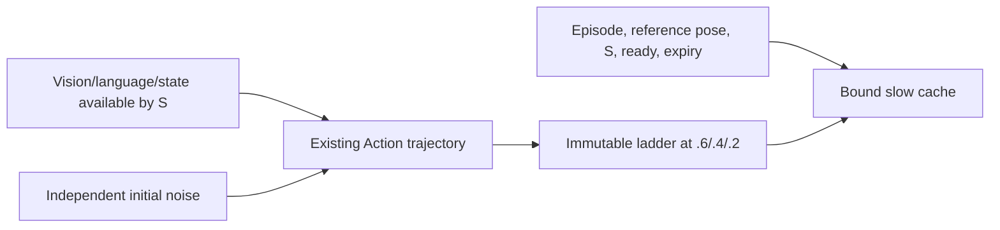
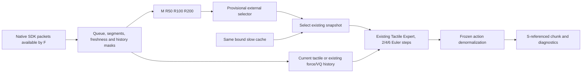
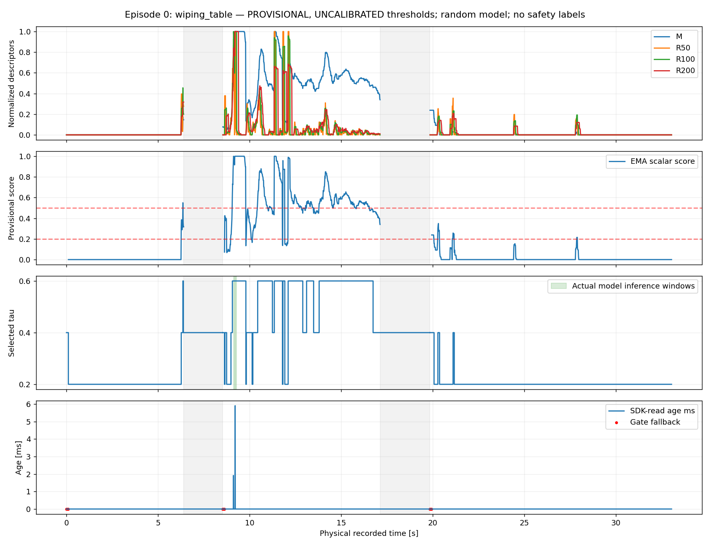

# TAPTIC Approach A + Strategy 1: causal split-gated inference

Implemented on `mfincato/risk_gated`, based on commit `05c9328` plus the existing
uncommitted cache-ladder work. No branch switching, merge, cherry-pick, pretrained
download, GPU experiment or full training. The learned experts, MoT attention
masks and original losses are unchanged. No risk token/head/auxiliary loss,
contact-aware Action input, WEART input or risk-triggered early replanning exists.

## 1. Review and scope

Reviewed the adapter, multi-split, contact-analysis, cache-ladder and architecture
reports together with their code. The architecture report establishes why
Approach A can choose a different immutable Action snapshot without changing its
KV or recomputing its trajectory: current contact descriptors are consumed only
by an external selector. They are never neural conditioning tokens.

`docs/taptic_fast_tick_replay/REPORT.md` did **not** exist. Section 5 below defines
the explicit minimal replay contract used here. Replay is inference-only;
fast-tick ground-truth action alignment and action-error metrics are unsupported.

All pre-existing code, tests and artifacts are preserved byte-for-byte. This
phase adds files only; it does not modify the existing ladder implementation.

| Added file | Purpose |
|---|---|
| `taptic/online_contact.py` | Native sample schema, frozen training scales, availability-ordered online features and quality masks. |
| `taptic/split_gate.py` | Configurable fixed/provisional scalar selector, EMA/hysteresis/dwell, fallbacks and debug state. |
| `taptic/inference.py` | Slow/fast wrapper around existing ladder APIs; reference pose, readiness/expiry/episode/weight identity and action denormalization. |
| `scripts/replay_taptic_approach_a.py` | Reproducible native-data CPU replay, bounded tiny-model inference, CSV/NPZ/JSON and plots. |
| `tests/taptic/test_approach_a.py` | Online/offline numerical checks, temporal faults, gate state and real tiny-model end-to-end checks. |
| `docs/taptic_approach_a_strategy1/` | This report, test evidence, preservation/reproducibility evidence and real replay artifacts. |

The pre-existing standalone offline analysis remains the reference implementation;
the online module has no dependency on analysis plotting or model training code.
The diagnostic script and tests import that reference for numerical comparisons.

## 2. Strategy 1 remains unchanged

Training still supports a uniform selection from `{0.2,0.4,0.6}`, one split per
batch, synchronized across distributed ranks, with fixed nominal delta_tau=-0.1.
The original velocity target `epsilon-actions`, Action loss and tactile loss are
preserved. **No training decision depends on contact features or gate state.**

Use `--cascaded_split_mode multi --cascaded_splits 0.2 0.4 0.6` for Strategy 1.
Fixed mode remains available/default; the baseline configuration is
`--cascaded_split_mode fixed --cascaded_split_step 6 --flow_time_precision fp32`.

| Selected tau | Action prefix steps in selected path | Tactile Euler steps |
|---:|---:|---:|
| 0.2 | 8 | 2 |
| 0.4 | 6 | 4 |
| 0.6 | 4 | 6 |

The ladder actually computes **eight Action updates and nine Action forwards**
once per slow build, regardless of the later selected prefix. Tick diagnostics
distinguish `action_steps` (selected path) from `slow_action_euler_updates` (8).
Physical fast ticks do not advance the denoising step index across calls.

## 3. Causal contact descriptors

Each `NativeSample` contains one recorded SDK aggregate `[5,3]`, read-completion
and actual availability timestamps, episode, software sequence/reset/error/drop
counters, native/valid/boundary flags, and optional full taxels. Arrays are copied
on ingestion schema construction. Timestamps are integer nanoseconds;
`available_ns >= read_ns` is required. No calibrated force, normal/shear convention,
slip signal or danger/intervention label is assumed.

Let `m_if=||F_if||_2`, and `d_if=max(m_if-m_(i-1)f,0)` only for adjacent reads
within a valid segment. At physical cutoff F, using only samples whose read and
availability times are <= F:

```text
M(F)   = max_f clip(m_latest,f / qM_f, 0, 1)
U_Wf(F)= sum_{F-W < read_i <= F} d_if / (W in seconds)
R_W(F) = max_f clip(U_Wf(F) / qU_Wf, 0, 1), W=50,100,200 ms
```

These are the offline analysis's definitions, not `||F_i-F_(i-1)||/dt`, centered
windows or future interpolation. Between reads the last magnitude is held;
window edges follow the actual **physical fast timestamp**, not the previous
read timestamp. The first increment of a new segment is zero and not a derivative
across a reset. Identical payloads at distinct read times are retained valid
zero increments. No 10 Hz, 70 Hz or other regular tactile grid is imposed.

### Normalization

Real replay loads frozen `docs/taptic_risk_analysis/train_normalization.json`:
per-finger magnitude q99 from **512 native training episodes**, and per-window,
per-finger q99 of positive variation/W values conditioned on positive values.
The loader verifies every recorded fitting ID is native/train in actual metadata
and checks the analysis source identity against the adapter's current identity.
No validation/test fitting, threshold optimization or learned calibration occurs.

Magnitude scales, SDK count units:
`[154.793411,88.690473,51.478151,49.809638,63.403470]`.
100 ms positive-variation scales, SDK counts/s:
`[220.228158,314.037035,253.968502,282.320945,430.285459]`.
All 50/100/200 ms scales and fitting IDs are saved again in
[replay/contact_normalization.json](replay/contact_normalization.json).
Constructor-supplied explicit scales support controlled unit experiments;
production callers should use the provenance-checked loader.

### Quality and delayed/out-of-order data

- Samples are queued by **availability**, then read time. Future packets may be
  buffered but have no effect on current features. Available/read cutoffs are
  both enforced by requiring availability >= read and consuming only available rows.
- New segments begin at resets, sequence discontinuities, changed error/drop
  counters, >50 ms read gaps (configurable), invalid/nonfinite/non-native samples,
  explicit recorder boundaries and episode changes.
- A late packet whose read timestamp is no newer than the already consumed read
  is discarded and counted; previous outputs are never revised. This is a
  deliberate availability-order online policy. Exact offline-reference comparisons
  below use the actual native recordings with read-time availability. For truly
  out-of-order arrivals, one must compare against this same online discard policy,
  not a hindsight read-sorted derivative.
- Exact duplicate IDs/payloads are ignored and counted. Conflicting duplicates
  are rejected. Value repetition alone is never deduplicated or invalidated.
- Freshness defaults to <=50 ms since the **software read**, not hardware acquisition.
  True acquisition age/firmware update frequency remains unknown.
- Windows require a same-segment predecessor at or before F-W. Partial-window
  outputs are zero placeholders, with explicit `feature_valid` and fractional
  `coverage`. Missing/stale/invalid observations cannot become measured no-contact.
- History retains the longest window's predecessor and at least 64 native rows
  by default. The existing 16-sample VQ history builder can use that history;
  left padding is exposed separately and never contributes synthetic contact increments.
- Negative/decreasing/float physical timestamps are rejected. Equal cutoffs are
  supported; a selector evaluation is idempotent only for the same observations.
  Changed arrivals at an already evaluated physical tick require a new timestamp.

`at(F)` returns M/R50/R100/R200, raw five-finger magnitudes/variation rates, sample
age/availability age, last read/availability times, masks/coverage, segment/reason
and late/duplicate/invalid counters. The serial event-loop API is not a concurrent
sensor middleware implementation; callers must serialize ingestion/tick calls.

## 4. Provisional split selector

`SplitSelector(GateConfig(...)).select_split(features,quality,tick_ns)` returns
the selected split **and** raw score, EMA score, transition/fallback reason,
features and state. The scalar convenience API is
`select_split(features,quality,config,tick_ns=F,state=selector)`; retain `state`
for temporal smoothing, otherwise the convenience call is intentionally stateless.

Supported modes:

- `fixed`: 0.2, 0.4 or 0.6; no contact-based choice.
- `magnitude`: scalar M.
- `rate`: maximum R_W over configurable `rate_windows`.
- `combined`: `1-(1-M)*(1-max_W R_W)`, as explored offline.

Two configurable thresholds divide score bins; `levels` assigns **any permutation**
of the three splits to those bins. High score therefore need not map to 0.6.
The supplied increasing mapping is an **engineering hypothesis**, not evidence
that high force warrants more tactile computation or implies danger. The score
is not a probability or a trained risk prediction.

Optional per-evaluation EMA uses `ema_alpha` (1 disables smoothing); it is not a
fixed physical time-constant filter under irregular ticks. Hysteresis adds a
margin to upward crossings and subtracts it from downward crossings in score-bin
space. Minimum dwell uses actual elapsed nanoseconds, never Euler iterations.

If any feature used by the chosen scalar lacks fresh/full history, or the model's
tactile observation is missing/nonfinite, adaptive selection immediately uses
`fallback_split` (default 0.4), bypassing hysteresis/dwell and clearing EMA.
Unused partial windows do not force a fallback. Segment changes reset temporal
smoothing. Fixed mode keeps its requested level independently of feature history;
missing tactile/cache validity still prevents inference in the wrapper.

The real replay configuration is deliberately provisional:

```json
{
  "mode": "combined",
  "thresholds": [0.2, 0.5],
  "levels": [0.2, 0.4, 0.6],
  "rate_windows": [100],
  "ema_alpha": 1.0,
  "hysteresis": 0.03,
  "min_dwell_ns": 20000000,
  "fallback_split": 0.4
}
```

These values are explicitly declared rather than inferred from action errors,
validation/test outcomes or a fitted intervention label. Alternative configuration
files can be supplied with `--gate-config`. No threshold is endorsed as optimal.

## 5. Minimal physical replay contract

`SlowAnchor` binds an episode, slow time S, reference observation time, declared
context availability, cache-ready time, expiry, measured flange position and
recorded gripper-down rotation vector. The reference is copied into immutable
tuples. The wrapper uses:

```text
observation_time <= context_available_time <= S <= cache_ready_time < expiry
valid fast inference: same episode, ready <= F < expiry
```

Slow context/noise enters one Action ladder call, with no contact-feature input.
Every fast call consumes all packets available by F, selects a saved level and
restarts its tactile flow from that saved state, holding current tactile fixed
throughout the numerical steps. Split changes do not alter or rebuild Action KV.

Cache identity includes episode/S/cache counter and model identity/parameter
version/device/dtype signature. Parameter/device changes block continuation;
frozen action normalization and the original measured reference stay attached to
the run. This is not a cryptographic detector of arbitrary `.data` mutations;
callers must not mutate model buffers/normalizers during a cache lifetime.

Resets/sequence/gap/invalid-data segment changes conservatively block subsequent
use of that cache until the **next externally scheduled slow tick**. Although
Approach A's Action KV has no new contact dependency, this physical replay rule
prevents crossing a sensor reset with an old anchor. It is not a risk-triggered
replan. Expired/not-ready/missing-cache or stale/missing tactile returns
`actions=None` with a reason; no invented zero observation is fed to the expert.
An invalid partial feature window with a fresh valid tactile observation can
still run the fallback split. No automatic Action rerun is triggered.

### Actual diagnostic replay timing assumptions

The missing replay report means these are **explicit minimal assumptions**, not
previously validated hardware recommendations:

1. Use the existing adapter to retrieve only current frame images/state. As a
   conservative recorder-availability proxy, set S to
   `max(observation_ns,add_frame_ns)` for that frame. Camera exposure and real
   middleware arrival timing remain unverified.
2. Keep the measured pose at `observation_ns` as the chunk reference, even though
   S is a few ms later. The four replay anchors have recorder delays of about
   1.20, 1.17, 8.95 and 8.86 ms. Do not relabel that pose as measured at F.
3. Scheduled cache expiry is the earlier of S+100 ms and the next recorded slow
   frame's availability proxy. Only two slow anchors per episode are built in the
   lightweight diagnostic. Outside those intervals, features/gate still run but
   no model predictions are made.
4. Historical replay uses **logical ready=S**, a zero-compute-latency assumption.
   CPU wall computation is logged but is not added to recorded timestamps.
   Therefore this experiment does not establish deadline feasibility. The API
   supports later ready times and tests that early fast calls are blocked; real
   deployment must supply the actual/conservative completion time and scheduler.
5. Physical diagnostic ticks occur at native packet availability times plus
   selected slow events; no tactile resampling or new sensor measurements are
   created. Delayed/missing/out-of-order behavior is separately fault-tested.

### Action frame and unavailable targets

The returned **denormalized `[B,16,21]` chunk** stays in the measured slow-anchor
delta-base representation: local translation, relative rotation columns, absolute
XHand joints. It is not automatically converted to native `[B,16,18]` robot
commands and nothing is sent to hardware. The original 10 Hz slot interpretation
does not shift when F advances. In particular, already elapsed slots are not
newly supervised fast-tick actions; a real controller still needs a remaining-slot
selection/interpolation/expiry policy.

TAPTIC has approximately 10 Hz full robot targets, not 76 Hz Panda labels.
No higher-rate targets are invented. `action_error_supported=False` is saved,
and `ApproachAInference.action_error(...)` raises `NotImplementedError`.
Neither split selection nor threshold choice uses random-model imitation error.

## 6. Data flow and APIs





Typical use (all times must belong to the same declared physical clock):

```python
from taptic.online_contact import ContactNormalization, NativeSample, OnlineContactExtractor
from taptic.split_gate import GateConfig
from taptic.inference import ApproachAInference, SlowAnchor

scales = ContactNormalization.from_analysis(
    "docs/taptic_risk_analysis/train_normalization.json",
    source.episodes, source.identity,
)
extractor = OnlineContactExtractor(scales, gap_ns=50_000_000, stale_ns=50_000_000)
gate = GateConfig(mode="combined", thresholds=(0.2,0.5), rate_windows=(100,),
                  levels=(0.2,0.4,0.6), hysteresis=0.03,
                  min_dwell_ns=20_000_000, fallback_split=0.4)
pipeline = ApproachAInference(model.eval(), extractor, gate, dataset.action_stats)
pipeline.start_episode(episode_id)
extractor.ingest(initial_native_history)   # only actual same-episode packets

anchor = SlowAnchor(episode_id, S, observation_time, context_available_time,
                    cache_ready_time, expiry_time, measured_xyz, measured_rotvec_gd)
with torch.no_grad(), torch.autocast("cpu", dtype=torch.bfloat16):
    pipeline.slow_tick(anchor, inputs_embeds=slow_embeds,
        position_ids=latent_position_ids, noise=initial_noise,
        fast_embeds=fast_embeds, state_embeds=state_embeds)
    result = pipeline.fast_tick(episode_id, F, samples=new_native_packets)
    if result["actions"] is not None:
        chunk = result["actions"]     # [B,16,21], S frame, diagnostic only
    print(result["contact"], result["gate"], result["status"])
```

Default `TaxelObservation` uses the adapter's full five 360-D taxel tokens with
the existing `[128,128,255]` scaling. `SDKForceObservation(frozen_force_stats,
history_length=16,use_history=True)` instead builds the existing normalized SDK
input and raw padded VQ history. Configure extractor `keep_samples` to at least
the model's history length. No new tactile encoding network is introduced.
The real-model/replay checks here use the taxel path; SDK observation/history
construction and the existing force/VQ suite pass, but no trained force/VQ
gate evaluation is claimed. Existing single-split APIs are unmodified.

## 7. Actual executed tests and native replay

Tests use original reduced random T-Rex/Qwen/MoT classes on CPU and actual
TAPTIC observations, with no full pretrained checkpoint. Existing ladder tests
cover FP32 endpoints, all three independent single-split equivalents, complete
KV contents and public-export immutability. New wrapper tests cover actual
chunks `[2,16,21]`, bitwise fixed-.4 equivalence, selected tactile steps `[2,4,6]`,
same cache identity, timestamp faults and input-dependent selection.

The controlled real-model gate test uses synthetic force descriptors with real
taxels to force coverage of all split branches. The separate diagnostic below
uses **both real SDK descriptors and real tactile observations**.

Numerical agreement:

| Check | Result |
|---|---:|
| Irregular/repeated/reset synthetic stream, 70 cutoffs | Max absolute raw variation-rate difference 3.979039320256561e-13 counts/s |
| Native episodes 0 and 48, 13,524 window/cutoff comparisons | Max absolute difference 1.1368683772161603e-12 counts/s |
| Full/partial window validity masks | Exact match |
| Fixed .4 wrapper output vs equivalent existing ladder API | Bitwise identical |
| Action cache after risk changes / repeated continuations | Bitwise preserved |

Window differences are FP64 summation-roundoff differences; agreement assertions
use absolute tolerance 1e-9 counts/s. No bitwise feature-equality claim is made.
The real model uses B=2 in the controlled test and B=1 in the standalone replay.

Native replay results, with provisional configuration above:

| Episode / verified task | Diagnostic ticks | Gate transitions | Gate fallbacks | Model chunks |
|---|---:|---:|---:|---:|
| 0 / wiping_table | 2,153 | 30 | 24 | 16 |
| 48 / dosing_pipette | 2,359 | 23 | 16 | 17 |
| Total | **4,512** | **53** | **40** | **33** |

There are **four slow builds**, frames 71/72 in each episode. Stored action
arrays have shape **`[33,1,16,21]`** and all entries are finite. Actual model
windows select .6 for wiping's 16 chunks and .2 for pipette's 17 chunks; .4 is
covered by the controlled real-model regression and other tests. Whole-episode
gate diagnostics select .2/.4/.6 **2,889 / 393 / 1,230** times. These are feature
occupancies, not evidence of split quality. Of all ticks, 1,068 have no scheduled
cache and 3,411 are outside cache expiry; they produce no action chunk.

The replay verifies all saved KV layers after each prediction, all model
parameters unchanged, and all four read source files unchanged by SHA-256.
Recorded wall times are CPU diagnostics only and vary with other processes.
The replay was repeated with the same seed: action chunks are bitwise equal and
all non-timing CSV diagnostics are identical; see [reproducibility.json](reproducibility.json).

Artifacts:

- [Replay summary](replay/summary.json), [gate config](replay/gate_config.json),
  [slow anchors](replay/slow_anchors.json), [contact scales](replay/contact_normalization.json).
- [All tick diagnostics](replay/ticks.csv): physical/anchor times, quality, four
  features, raw/EMA scores, split, transitions/fallbacks, selector state, nominal
  and actual Action counts, tactile steps, status and wall timings.
- [Predicted chunks and episode/timestamps](replay/actions.npz).
- [Episode 0 plot](replay/episode_000000.png) and
  [episode 48 plot](replay/episode_000048.png). All plots explicitly label
  **PROVISIONAL, UNCALIBRATED** thresholds and random models. Lines break across
  segment/gap boundaries; gray marks missing spans, green marks actual model
  inference windows. Most of the trace is feature/gate diagnostics only.



## 8. Reproduction and test results

From the repository root, using the existing local data/config environment:

```bash
export TAPTIC_ROOT=/home/mfincato-iit.local/midtrain_merge/derived/taptic_trex_style_v2
export TAPTIC_PROCESSOR=/home/mfincato-iit.local/midtrain_merge/derived/tiny_qwen3vl_test
export TAPTIC_PANDA_URDF=/home/mfincato-iit.local/lerobot_plugins/lerobot_robot_panda/lerobot_robot_panda/urdf/panda.urdf
export TAPTIC_PYTHON=/home/mfincato-iit.local/trex-venv/bin/python
export OMP_NUM_THREADS=2 MKL_NUM_THREADS=2 OPENBLAS_NUM_THREADS=2 CUDA_VISIBLE_DEVICES=''

# New feature/gate/replay tests only.
"$TAPTIC_PYTHON" -m pytest tests/taptic/test_approach_a.py -q -s --tb=short

# Full existing + new TAPTIC suite.
"$TAPTIC_PYTHON" -m pytest tests/taptic -q -s --tb=short

# Native diagnostic with tiny random model. No weights are downloaded.
"$TAPTIC_PYTHON" scripts/replay_taptic_approach_a.py \
  --root "$TAPTIC_ROOT" --processor "$TAPTIC_PROCESSOR" \
  --episodes 0 48 --slow-ticks 2 \
  --out docs/taptic_approach_a_strategy1/replay
```

**Executed: 73 passed in 21.91 seconds**, including all 57 pre-existing tests and
16 new Approach A checks. There were no failures or skips. Preservation hashes
confirm all **158 pre-existing files unchanged**; see [preservation.json](preservation.json).

Full actual results are in [test_results.txt](test_results.txt); the final test
summary is also captured in [test_evidence.json](test_evidence.json). Environment:
Python 3.12.13, torch 2.10.0+cu128, transformers 4.57.1, CPU, two threads.
This does not validate the pinned Python 3.10/torch 2.6 environment or CUDA.

Coverage includes irregular timestamps, equal payloads, invalid/nonfinite/native
masks, stale observations, missing/partial histories, gaps/resets/sequence/error/
drop boundaries, late read discards, episode changes, no future input, all scalar
modes/mappings, smoothing/hysteresis/dwell/fallback, duplicate ticks, cache
readiness/expiry, changed model weights and unsupported action-error requests.
All pre-existing tests remain included. No full pretrained evaluation is claimed.

## 9. Remaining limitations and next experiments

- The gate is an untrained engineering proxy. No manipulation, safety, slip
  prevention, intervention prediction or optimal split result is established.
- Real replay uses a recorder-availability proxy and zero logical build latency.
  It does not implement a real-time control scheduler, camera transport/exposure
  synchronization, concurrent sensor middleware or actuator execution.
- Expired-slot handling, full Panda fast-tick targets and a justified offline
  action-error protocol remain unresolved. Keep this replay inference-only.
- The existing ladder's unpadded-context/eval/ten-step/FP32 restrictions remain.
  Full model memory/latency and three-cache storage must be measured on properly
  allocated hardware. The ladder has extra build cost compared with fixed .4.
- SDK counts, repeated payloads, unknown sensor acquisition age, reset behavior
  and unverified axes/calibration limit physical interpretation. Missing model
  modalities block predictions; no WEART or fictitious measurement substitutes.
- Per-finger/global/recording-balanced normalization and alternate mapping/window
  hypotheses need independent evaluation. The existing validation data have
  already been explored; reserve separate source recordings for final conclusions.
- Before trained-model experiments, freeze the data/source identities, learned
  checkpoint, normalization and gate config. Compare fixed .2/.4/.6, fixed .4
  baseline and gated inference using paired noise/observations. Evaluate temporal
  chunk continuity, actual deadlines and controller-valid remaining slots.
  Define a genuine computation-benefit/contact-context target before calibrating
  thresholds. Do not interpret random-model action errors as utility labels.

No commit or push was performed. The original fixed baseline and uniform
multi-split training remain available unchanged.
