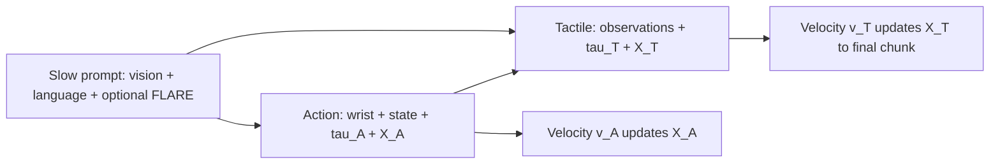
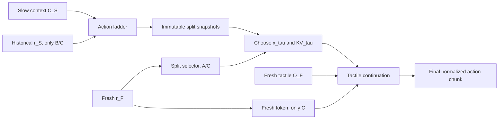

# TAPTIC: causal attention, cache dependencies and contact conditioning

Investigation date: **20 November 2026**. Branch: **`mfincato/risk_gated`**.
Inspected HEAD: `05c932853ac5984ac7128561de2583c34b568262`, **plus the existing
uncommitted cache ladder and review/risk-analysis work**. This is a report-only
investigation. No production source, model, loss, mask, test or launcher was
edited; no training, checkpoint download or GPU job was run.

## 1. Decision and evidence boundaries

**Architectural hypothesis — recommendation:** start with **A + Strategy 1**:
retain the existing multi-split objective and Action cache ladder, and evaluate
causal contact features as a separate selector at physical fast ticks. This
preserves the Action Expert's conditioning contract and permits new tactile
measurements to affect every continuation without invalidating a slow snapshot.
It does **not** establish that large force should select larger tau, that adaptive
selection improves manipulation, or that 2/4/6 tactile forwards meet a physical
deadline. Those are **Requires empirical validation**.

If explicit feature conditioning later helps, first test a tactile-only feature
token with independently sampled splits. Escalate to C only if Action-side
conditioning has a measured benefit sufficient to justify stale slow-risk
conditioning and cache invalidation. B and C are design alternatives, not
implemented capabilities.

Four evidence labels are used throughout:

- **Verified from original code:** the pinned upstream `full-pipeline` source.
- **Verified from TAPTIC code:** current working-tree implementation and the
  inference-only CPU checks repeated for this report.
- **Architectural hypothesis:** consequences/designs for proposed inputs or gates.
- **Requires empirical validation:** learned behavior, task benefit, calibration,
  runtime feasibility or untested execution environments.

### 1.1 Provenance and prior work

Both local `full-pipeline` and `origin/full-pipeline` resolve to upstream commit
`b23eafe564a1457cd4eacb889aaf6fbf29a29034`. Original references below mean
`git show b23eafe:<path>`, not today's upstream HEAD. No branch switch or fetch
was needed. Upstream links use that immutable commit; current-source links are
relative to this report and line references refer to this investigation's tree.

The requested reports were reviewed in order:

| Existing report | What is already complete / how to interpret it now |
|---|---|
| [Adapter review](../taptic_review/REPORT.md) | Panda/XHand shapes, action frame, source clocks and causal-interface review. Statements that no ladder or FP32 fix exists describe that earlier stage. |
| [Multi-split report](../taptic_multisplit/REPORT.md) | FP32 integer flow grid, uniform batch-wide split sampling, timestamp/quality handling and tiny-model training checks. Its no-ladder statement is also historical. |
| [Risk exploration](../taptic_risk_analysis/REPORT.md) | Offline SDK magnitude and trailing variation features; no calibrated danger/slip labels, online gate or risk token. |
| [Cache ladder report](../taptic_cache_ladder/REPORT.md) | Three owned snapshots and continuation API, with independent pre-ladder references and CPU tests. Implementation is present in the working tree. |

The current force-history/VQ-VAE path also exists; see
[force/VQ-VAE notes](../taptic_force_vqvae.md). It is an additional tactile input
path, not the proposed contact-risk token. The old `tactile_f6` name can denote
`[5,360]` taxels or `[5,3]` SDK forces in TAPTIC, depending on configuration.

**Verified from original code / TAPTIC code:** removing comments, docstrings and
standalone explanatory strings gives identical executable ASTs for upstream and
current `qwen_vla/modeling_qwen3vl_mot.py`. Thus attention/routing/mask behavior
below is original, while solver precision, metadata, cloning in tactile training,
multi-split selection, data adaptation and ladder APIs must be distinguished.

### 1.2 Source map

| Claim / function | Original source | Current source |
|---|---|---|
| Q/K/V and SDPA, `Qwen3VLAttentionMoT` | [MoT lines 154–270](https://github.com/ZhuoyangLiu2005/T-Rex/blob/b23eafe564a1457cd4eacb889aaf6fbf29a29034/qwen_vla/modeling_qwen3vl_mot.py#L154-L270) | [modeling_qwen3vl_mot.py](../../qwen_vla/modeling_qwen3vl_mot.py), same lines |
| Mask, `build_causal_mask` | [lines 432–478](https://github.com/ZhuoyangLiu2005/T-Rex/blob/b23eafe564a1457cd4eacb889aaf6fbf29a29034/qwen_vla/modeling_qwen3vl_mot.py#L432-L478) | Same lines |
| Positions and cache routing | [lines 519–628](https://github.com/ZhuoyangLiu2005/T-Rex/blob/b23eafe564a1457cd4eacb889aaf6fbf29a29034/qwen_vla/modeling_qwen3vl_mot.py#L519-L628) | `_extend_position_ids` 519–561; `forward` 563–628 |
| Action partial trajectory / endpoint refresh | [modeling_vla.py lines 642–763](https://github.com/ZhuoyangLiu2005/T-Rex/blob/b23eafe564a1457cd4eacb889aaf6fbf29a29034/qwen_vla/modeling_vla.py#L642-L763) | [modeling_vla.py](../../qwen_vla/modeling_vla.py), partial wrapper 671–683; shared trajectory 748–920 |
| Tactile inference / training | [lines 765–885](https://github.com/ZhuoyangLiu2005/T-Rex/blob/b23eafe564a1457cd4eacb889aaf6fbf29a29034/qwen_vla/modeling_vla.py#L765-L885) | `tactile_flow_continue` 922–1023; `tactile_flow_train_step` 1029–1103 |
| Actual training sequence / losses | [midtrain.py lines 1623–1765](https://github.com/ZhuoyangLiu2005/T-Rex/blob/b23eafe564a1457cd4eacb889aaf6fbf29a29034/scripts/midtrain.py#L1623-L1765) | [midtrain.py](../../scripts/midtrain.py), context 1645–1759; Action loss 1765–1771; tactile cache/pair/loss 1773–1851; FLARE 1858–1932 |
| Request-driven slow / fast execution | [test.py lines 486–709](https://github.com/ZhuoyangLiu2005/T-Rex/blob/b23eafe564a1457cd4eacb889aaf6fbf29a29034/scripts/test.py#L486-L709) | [test.py](../../scripts/test.py), `_run_slow` 488–616; `_run_fast` 619–675; `predict` 682–731 |
| Ladder ownership and split lookup | Not present | [cache_ladder.py](../../qwen_vla/cache_ladder.py), `capture` 48–74, exports 76–122, ladder 125–140; wrapper APIs in `modeling_vla.py` 685–746 |

## 2. What causal attention actually means

### 2.1 Tensor operations, rather than expert names

**Verified from original code.** Tokens are routed by contiguous index ranges
into Latent, Action or Tactile modules. There is no learned sparse expert router.
At every decoder layer, each stream has its own pre-attention RMSNorm, Q/K/V
projections, Q/K head RMSNorms, output projection, post-attention RMSNorm and
MLP (`Qwen3VLDecoderLayerMoT`, lines 283–355). They share head geometry so their
attention tensors can be concatenated.

For expert e and normalized hidden token h:

```
Q_e = RMSNorm_q,e(reshape(W_q,e h))    [B, Hq, L_e, d]
K_e = RMSNorm_k,e(reshape(W_k,e h))    [B, Hkv, L_e, d]
V_e = reshape(W_v,e h)               [B, Hkv, L_e, d]
Q,K = RoPE(Q,K); V is not rotated
attention = softmax(Q K^T / sqrt(d) + M) V
```

Q/K/V are concatenated in `[latent | action | tactile]` order (lines 216–240).
Per-layer cache update appends **rotated K and unrotated V**, not Q or final
post-MLP hidden states (242–246). Grouped-query attention repeats KV heads
(250–251); SDPA receives the explicit additive mask (252–258). The attribute
`self.is_causal=True` at line 164 is not what enforces causality: the SDPA call
does not pass `is_causal`; `build_causal_mask` supplies the restriction.

With P cached tokens, N newly supplied tokens and key index j:

```
M[i,j] = 0       if j <= P+i
         -inf   otherwise
```

The mask is `[1,1,N,P+N]`, or `[B,1,N,P+N]` with padding. This is **ordinary
sequence-position causality across and within expert segments**. Expert-level
one-way flow follows from token order. There is no separate fully bidirectional
Action block, Tactile block or special cross-expert visibility table.

Padding is an additional key mask: zeros in the supplied 2D mask become `-inf`,
short masks are extended with ones, and each new query's own diagonal is restored
to zero even if it is padding (mask lines 452–476). This diagonal exception
prevents fully masked padded queries. It does not make padded keys valid for
other queries. Visibility tables below describe unpadded tokens.

### 2.2 Token inventory, actual ordering and routing

**Verified from original code / TAPTIC code.** The common prompt is slow
image(s), task text, then wrist image(s), with chat/image delimiters. The split
is at the first fast image's `vision_start`; all trailing prompt tokens remain
with the fast suffix. See upstream `split_slow_fast_embeds` 894–943, current
1112–1170; upstream server `test.py` 507–545, current 511–549; TAPTIC collator
`taptic_dataset.py` 286–293.

```
Latent-routed: [prompt prefix / slow image patches / language | FLARE queries?]
Action-routed: [fast image brackets + patches + trailing prompt | state? | tau_A | X_A[0:C]]
Tactile-routed, in a later cached pass:
               [VQ codes? | tactile vectors? | deformation tokens? | tau_T | X_T[0:C]]
```

Vision/language are **token contents**, not two extra experts. Likewise there
is no separate set of generic “Latent Expert tokens” beyond its routed prompt
and optional learned FLARE query tokens. Action/Tactile timestep and noisy-action
tokens use their respective expert projections even though both experts use
the same `t_embedder` and `x_embedder` (`modeling_vla.py` 102–107, 811–817,
999–1001, 1073–1080). Optional robot state uses one embedded token. Optional
codes/vector/deformation blocks occur in that order (`_embed_tactile_observations`,
490–534; original 469–513).

### 2.3 Training visibility matrix: Action loss forward

**Verified from original code.** Rows are queries; columns are keys. `Y` means
the entire earlier block is permitted, `C` means self and preceding positions
within that block, `—` means blocked. `I` means actual prompt ordering determines
visibility through `j<=i`. Optional absent blocks contribute zero tokens.

`V_s` = slow image tokens, `W_s` = slow prompt language/delimiters, `F` = FLARE,
`V_f` = fast image tokens, `W_f` = trailing prompt tokens, `S` = state,
`t_A` = Action flow-time token, `X_A` = noisy action chunk tokens.

| Query \ Key | V_s | W_s | F | V_f | W_f | S | t_A | X_A |
|---|---|---|---|---|---|---|---|---|
| V_s | C | I | — | — | — | — | — | — |
| W_s | I | C | — | — | — | — | — | — |
| F | Y | Y | C | — | — | — | — | — |
| V_f | Y | Y | Y | C | I | — | — | — |
| W_f | Y | Y | Y | I | C | — | — | — |
| S | Y | Y | Y | Y | Y | C | — | — |
| t_A | Y | Y | Y | Y | Y | Y | C | — |
| X_A | Y | Y | Y | Y | Y | Y | Y | C |

Tactile observation/time/chunk tokens are **absent** from this forward, not
merely masked. For the usual content order, task words follow slow patches and
can read them; slow patches cannot read later task words. Headers/delimiters
can lie before images, so treating all language as one uniformly later block
would be inaccurate. The same applies to fast image brackets and trailing text.

This matrix is also the mask pattern of the first Action inference forward.
The Action training forward is single-step at a sampled noisy state and uses
`use_cache=False`; it is not the cache later handed to tactile training.

### 2.4 Training tactile forward and fast inference visibility matrix

**Verified from original code**, with TAPTIC ownership differences in section 4.
Let `L` be the whole saved latent prefix (vision, language and optional FLARE),
`A_c` the saved Action suffix (fast vision/trailing text, state, t_A, X_A),
`O` the new tactile observation block, `t_T` the new flow-time token, and `X_T`
the new noisy-action chunk. This matrix applies both to the tactile training
forward and to **each** denoising forward of fast inference:

| Query \ Key | L cached | A_c cached | O new | t_T new | X_T new |
|---|---|---|---|---|---|
| L cached | No query | No query | No query | No query | No query |
| A_c cached | No query | No query | No query | No query | No query |
| O new | Y | Y | C | — | — |
| t_T new | Y | Y | Y | C | — |
| X_T new | Y | Y | Y | Y | C |

Expanding `O` gives the additional conditioning-token interactions:

| Query \ Key | Codes | Vectors / taxels / SDK force | Deformation |
|---|---|---|---|
| Codes | C | — | — |
| Vectors | Y | C | — |
| Deformation | Y | Y | C |
| t_T or X_T | Y | Y | Y |

All new tactile tokens can read **all cached** vision/language/latent/Action
tokens, including every cached Action chunk index, because all cache slots
precede the new queries. The first tactile output chunk token can therefore
read Action-side representations of later chunk indices. The cascade is not an
autoregressive guarantee with respect to physical action horizon. This is not
future-observation leakage by itself: the Action cache was generated from slow
observations and noise, not future demonstration inputs.

During subsequent Action inference forwards only Action queries exist; they
read all saved `L` and a causal prefix of the rebuilt Action suffix. During
subsequent tactile forwards old tactile suffix KV is cropped, so there is no
attention to a previous denoising iteration's tactile suffix. Within one fast
call `O` is fixed, while `t_T` and `X_T` change.

### 2.5 Are training and inference masks identical?

**Verified from original code / TAPTIC code:** the same mask builder and
sequence-causal rule are used. Actual shapes and operands differ: full Action
training has no past cache; Action reuse has a latent cache; tactile training
and inference have a latent+Action cache. Training contains a separately
generated frozen Action trajectory, not a single joint differentiable
Latent/Action/Tactile forward.

There are material qualifications:

1. Initial Action forward receives the padding mask; subsequent cached Action
   forwards and tactile forwards omit it (`modeling_vla.py` 823–849, 1007–1015,
   1090–1098). Stored padded keys can consequently become visible later.
   This is inherited behavior, not a new TAPTIC mask design. The ladder rejects
   zero-containing input masks (710–713), which bounds its supported use to
   unpadded/equal-length contexts; this does not repair padded training/fixed API.
2. Attention dropout is `config.attention_dropout` in training and zero in eval
   (MoT 256), so the same structural mask need not give the same values.
3. TAPTIC uses selected split metadata/FP32 time; upstream uses its fixed
   configuration and BF16 recurrence. Mask equality does not imply time/input
   distribution equality.

### 2.6 Position IDs and order

**Verified from original code.** `prepare_inputs_embeds` inserts visual tower
outputs at image-pad slots (original 414–444, current 435–465). Those embeddings
already result from image processing; the MoT token mask alone says nothing
about each visual embedding's upstream spatial receptive field.

The original Qwen helper computes prompt M-RoPE IDs; the wrapper falls back to
plain `[B,L]` IDs if unavailable (original 446–467, current 467–488). The normal
callers slice IDs to the **slow prefix**, then append FLARE IDs. The MoT extends
each axis from **that axis's maximum**: `p[d,b,new k] = max_l p[d,b,l] + k`.
Tactile offsets start after `n_action_in_cache`. Actual M-RoPE shape is
`[3,B,L]`, despite comments saying `[B,3,L]`. `cache_position` is separately
`arange(P,P+N)` and controls sequential cache slots; the mask uses lengths,
not M-RoPE numeric coordinates (MoT 535–561, 582–625).

Consequences:

- Reordering tokens changes visibility even if their semantic modality is the
  same. A risk token after all Action chunk tokens cannot condition the Action
  velocity outputs in that forward.
- Appended fast wrist-image tokens get newly generated sequential positions;
  their original full-prompt spatial M-RoPE coordinates are discarded by these
  callers. The visual tower embeddings remain image-derived. This occurs in
  both original training and inference, not only TAPTIC.
- The comment that all three appended M-RoPE axes get “the same sequential
  value” is stronger than the arithmetic: offsets match, but axis maxima may
  differ. Equal IDs across axes require equal prefix maxima.
- FLARE queries precede fast wrist images and cannot attend them. They see the
  slow prefix and earlier FLARE queries. Future image **targets** are encoded
  separately under no-grad for the cosine loss; they are not appended as input
  image features (upstream trainer 1710–1759; current 1858–1926).

### 2.7 Diagrams versus code

No claim about an uninspected paper diagram is needed. An abstract diagram of
`Latent -> Action -> Tactile` is consistent with forward expert ordering but
omits causal restrictions **inside** each stream, fast vision routed through
Action modules, frozen cached queries, and the separate Action/tactile copies
of noisy-action and time tokens. A diagram implying bidirectional intra-expert
attention, fresh fast-tick wrist images, or tactile writeback into Action KV
would not describe this implementation. The `final_layer_tactile` constructor
comment says “residual” (current 106), but its output is a velocity integrated
from `x_split`, not an additive residual added to a clean Action prediction.



Arrows indicate permitted conditioning directions; every newly evaluated block
also has lower-triangular internal attention. At fast ticks L and A are keys and
values only, not active queries.

## 3. KV lifecycle and the two physical clocks

### 3.1 Slow-tick execution trace

**Verified from original code / TAPTIC code.** The request server is a useful
trace, not a hard-real-time scheduler (`scripts/test.py`, source map above).

1. Receive task, head/slow and wrist/fast images, optional robot state. Encode
   images and text once, split contiguous prompt, build positions, append FLARE
   queries if enabled. Optional `state_fast` is embedded **here**. Sample noise.
2. First Action velocity evaluation at tau=1 processes `[L | A]` and stores
   each layer's KV. `L` includes every latent-routed prompt token and FLARE query;
   `A` includes wrist/trailing text/state/time/chunk tokens.
3. Update noisy state by Euler. For each next Action evaluation crop the whole
   previous Action suffix, retain `L`, rebuild `[fast,state,tau_A,X_A]`, run
   Action queries against the latent prefix, then update state again.
4. Refresh the Action suffix at the endpoint without another Euler update.
   Save `x_split`, KV, positions, Action length and split. The option name
   `refresh_clean_kv` is misleading: for nonzero tau this is a **partially noisy**
   state. Disabling it can hand over pre-update KV with post-update state.
5. The old server stores one snapshot (current 592–609). The ladder API instead
   captures three levels in one trajectory; the server does not call it yet.

What depends on changing Action state? Time/chunk embeddings and their per-layer
KV must be refreshed. Earlier fast-image/state tokens cannot attend later time/
chunk tokens, so they are structurally independent of that changing state in
eval mode. The code nevertheless recomputes the **whole Action suffix** each
step. Only the latent KV is reused during the Action trajectory. Cached Q,
attention probabilities and a standalone final latent hidden-state tensor are
not saved as the handover payload.

### 3.2 Fast-tick execution trace

**Verified from original code / TAPTIC code.** At physical fast time F:

1. Obtain current tactile vectors/deformation and optionally causal history or
   VQ codes. Server `_run_fast` accepts tactile only: an incoming new wrist image
   or `state_fast` in a fast request does not refresh the saved slow cache.
2. Select a ladder snapshot explicitly (new API) or use the fixed server
   snapshot. Clone its latent+Action KV; initialize `x` from its saved BF16
   `x_tau`, promoted to FP32 in revised integration.
3. Embed tactile observations once for this call. For each remaining numerical
   step concatenate `[O,tau_T,X_T]`, append per-layer tactile KV, predict velocity
   from the last C tokens, and update `x`. Crop that tactile suffix before the
   next iteration. Saved latent+Action KV stays fixed throughout.
4. Return BF16 normalized chunk at tau=0; server denormalizes. This is the whole
   resulting action chunk, not `Action_prediction + tactile_residual`.
5. The next physical fast call starts again from the selected saved `x_tau`.
   It can supply updated tactile and another split. It does not advance the
   preceding call's final chunk through another piece of the same flow.

```
slow time S: C_S, initial noise -> {x_s, KV_L(S), KV_A(S,x_s,s)} for each s
fast time F: choose s, hold O_F fixed for this call
x_0(F) = Euler_T(x_s; KV_L(S), KV_A(S,x_s,s), O_F, tau=s ... 0)
```

Here tau is a **dimensionless flow variable**, S/F are physical observation
times, and chunk index is an action-horizon position. Neither ten Euler updates
nor SDK reads at about 76 Hz defines the physical inference rate.

```mermaid
sequenceDiagram
  participant Sensor
  participant Slow as Slow Action trajectory
  participant Saved as Owned ladder
  participant Fast as Tactile continuation
  Sensor->>Slow: Images/state available at S
  Slow->>Saved: x_0.6, KV_0.6; x_0.4, KV_0.4; x_0.2, KV_0.2
  Sensor->>Fast: Tactile available at F1
  Saved->>Fast: Selected state + cloned working KV
  Fast->>Fast: Fresh numerical integration to zero
  Sensor->>Fast: Updated tactile available at F2
  Saved->>Fast: Restart selected saved state + working KV
  Fast->>Fast: Fresh numerical integration to zero
```

### 3.3 Attention, frozen representations and gradients are different

**Verified from original code.** The causal mask restricts forward information
flow. It does not detach tensors. A downstream loss could differentiate through
earlier keys/values if a graph were retained, even though earlier queries cannot
attend later tokens.

The actual slow solver is decorated with `no_grad`, so tactile training receives
a frozen Action trajectory. Its current clone helper uses `detach().clone()`
(537–563; original 516–542). Original tactile inference already cloned; original
`tactile_flow_train_step` used the supplied cache directly (835–885). TAPTIC
clones in training too (1059), preventing append mutation of the caller cache.

Tactile loss trains tactile expert weights and its observation embedder, plus
the **shared** action/time embedders used for fresh tactile tokens. It does not
backpropagate through the detached Action cache into Action expert weights.
Updating shared embedders changes future Action computation after an optimizer
step, so “no Action gradient through cache” is not equivalent to an eternally
unchanged Action network. Training freezes visual/deformation/VQ encoders;
upstream trainer 1426–1433 and current corresponding parameter-freeze loop.
Already saved inference caches also become incompatible with changed weights.

## 4. Audit of the existing ladder

### 4.1 Capture consistency

**Verified from TAPTIC code.** `forward_flow_action_ladder` calls the shared
trajectory for eight Action updates with endpoint refresh (685–718).

| Tau | Action updates from 1 | Capture location | Tactile updates to 0 |
|---:|---:|---|---:|
| 0.6 | 4 | At loop i=4, after computing KV for x_0.6, before its next Euler update | 6 |
| 0.4 | 6 | At loop i=6, after computing KV for x_0.4, before its next Euler update | 4 |
| 0.2 | 8 | Final endpoint refresh for x_0.2, no extra Euler update | 2 |

Lines 851–858 capture intermediate caches; 873–919 refresh/capture the final
one. The fresh velocity evaluation used at 0.6/0.4 is shared with the continuing
Action trajectory, so capture adds no forward at those two levels. Total:
**9 Action forwards, 8 Euler updates**. Independent partial runs use 5+7+9=21
forwards; one fixed 0.4 run uses 7. The ladder therefore costs more than one fixed
0.4 slow call and stores more KV. Selecting 0.6 later does not reclaim the
Action work already spent building 0.4/0.2.

### 4.2 Stored representation and ownership

**Verified from TAPTIC code.** Each snapshot captures:

- BF16 `x_tau`, plus a separate FP32 integration accumulator. The network KV
  corresponds to the BF16-embedded state and FP32 time input, not a hypothetical
  full-FP32 network computation. Continuing the Action trajectory retains its
  unrounded FP32 accumulator; tactile continuation preserves the pre-existing
  BF16 handover boundary.
- Owned per-layer `[latent | Action]` K/V, including fast image/trailing prompt,
  optional state, time and chunk slots. There are no tactile tokens in a saved
  snapshot. Higher-layer Action KV represents causal context already processed
  by preceding layers; it is not just a copy of the input noisy-action embedding.
- Latent/Action position IDs, token counts, dimensions, Handover object and
  schedule/precision/length metadata. Full positions and sequential cache slots
  are computed by export properties. Final hidden activations and Q are not
  stored. See `cache_ladder.py` 48–122.

`capture` clones/detaches cache/state/positions; frozen dataclasses and copied
public exports protect ordinary API use. Continuation reads private saved
storage but clones before cropping/appending (`modeling_vla.py` 737–746, 964).
Thus updated tactile does not mutate any snapshot. The snapshots are independent
**in storage**, but statistically correlated: they share one initial noise,
conditioning and trajectory. Python private fields are not a security boundary.

### 4.3 Repeated verification in this investigation

**Verified from TAPTIC code / executed checks:** existing inference-only ladder
tests were rerun, with bytecode and pytest cache writing disabled:

```bash
PYTHONDONTWRITEBYTECODE=1 \
TAPTIC_ROOT=/home/mfincato-iit.local/midtrain_merge/derived/taptic_trex_style_v2 \
TAPTIC_PROCESSOR=/home/mfincato-iit.local/midtrain_merge/derived/tiny_qwen3vl_test \
OMP_NUM_THREADS=2 MKL_NUM_THREADS=2 OPENBLAS_NUM_THREADS=2 CUDA_VISIBLE_DEVICES='' \
/home/mfincato-iit.local/trex-venv/bin/python -m pytest \
  tests/taptic/test_cache_ladder.py -q -s --tb=short -p no:cacheprovider
```

Result: **19 passed in 5.17 s**, no skips. No optimizer step or checkpoint save
is present in this test file. Existing broader suite results (57 passed) remain
historical evidence in the ladder report; that broader suite was not rerun here.

The fixture uses two copies of native episode 0/frame 71, CPU BF16 autocast,
random reduced two-layer model with nonzero heads, and real updated taxels
available 89.606878 ms after S. It has 86 latent + 89 Action tokens, two KV layers,
179,200 KV bytes per snapshot. These are test-fixture sizes, not deployment costs.

| Tau | State max abs vs independent partial | KV max abs | Final chunk max abs |
|---:|---:|---:|---:|
| 0.6 | 0 | 0 | 0 |
| 0.4 | 0 | 0 | 0 |
| 0.2 | 0 | 0 | 0 |

The independent reference loads pre-ladder method bodies from commit `05c9328`,
not upstream BF16 integration and not the new shared trajectory helper
(`test_cache_ladder.py` 27–36, 123–179). It additionally rebuilds Action KV from
each exported state/time against a latent-only prefix (150–157). This is strong
local numerical equivalence evidence, not just metadata assertions.

Repeated continuation, interleaved split selection and mutation of public
exports leave saved states and every layer's KV bitwise unchanged; updated real
taxels change outputs by max **0.015625** normalized units at each split
(184–218). Optional fast/state tokens, 1D IDs, FP32/legacy fixed-API regression,
invalid inputs and eval-only use are covered (221–297). The fixture explicitly
checks nine forwards, eight velocities and FP32 state accumulation (91–110).

### 4.4 Compatibility and coverage limits

**Verified from TAPTIC code:** the ladder preserves original one-way cached
conditioning and endpoint refresh assumptions; it does not require a new
attention mask. Its numerical reference is the revised single-split API. Original
BF16 recurrence reaches about 0.39453125 after six steps; revised FP32 indexing
uses nominal 0.4. Bitwise equivalence to original BF16 is only the explicit
legacy-mode fixed API comparison, not a claim about the new ladder's FP32 output.

Remaining limitations / **Requires empirical validation**:

- Unpadded eval, ten steps and FP32 integration are required. The actual server
  still invokes a fixed partial call; there is no adaptive server deployment.
- Tests exercise tiny random CPU models, duplicated B=2 observations and two
  layers. No trained full-size model, CUDA/pinned-environment equivalence,
  production latency, memory peak or task quality is established.
- Real-data ladder tests use taxels. Force/VQ-VAE options are forwarded, but
  real force/VQ-VAE ladder-specific behavior is not independently demonstrated.
- Metadata checks length/schedule; they do not certify episode, physical
  timestamp, robot reference pose, weights/version, normalization, device or
  arbitrary caller-provided state/cache equivalence. Public construction/capture
  is not a proof checker for arbitrary external tensors.
- Three full KV copies are stored, including duplicate latent prefixes. There
  is no asynchronous early snapshot return, cache expiry or physical scheduler.

## 5. Risk/contact conditioning alternatives

Let `C_S` be slow observations, `r_S` causal features ending at S, `r_F` features
ending at F, and `O_F` current tactile. Here “risk” is shorthand for uncalibrated
contact features, not physical danger probability. Existing magnitude and
positive-variation/50/100/200 ms windows use SDK count units; they are offline
features, not currently wired into either expert.

### 5.1 Dependency comparison

**Architectural hypothesis.** Assume new tokens are trained and placed before
the chunk tokens they must condition.

| Alternative | Slow Action ladder dependency | Fast continuation dependency | When r_F changes |
|---|---|---|---|
| A: select split only | `Ladder(C_S, noise)` | `T(snapshot[g(r_F)], O_F)` | Choose another existing level if appropriate; no Action invalidation |
| B: condition Action | `Ladder(C_S, r_S, noise)` | `T(snapshot[g(r_F)], O_F)` if selection is also used | Ladder remains valid **as conditioned on r_S**; it cannot become an r_F-conditioned Action trajectory without recomputation |
| C: condition both and select | `Ladder(C_S, r_S, noise)` | `T(snapshot[g(r_F)], O_F, r_F)` | Rebuild tactile suffix each call; slow cache deliberately retains r_S unless slow replanning is triggered |

For B without adaptive selection, replace `g(r_F)` by a fixed split; its
staleness conclusion is unchanged. A selector by itself never edits the Action
velocity field. It changes which x_tau/KV and how many tactile steps produce the
output. Even with identical tactile input, different splits can yield different
chunks; switching splits can introduce discontinuities and deserves temporal
consistency evaluation.

### 5.2 Where an Action risk token could go

**Architectural hypothesis.** A practical candidate is an **Action-routed**
token between state and tau_A:

```
[L | fast vision / trailing text | state | r_S | tau_A | X_A]
```

It can read L/fast/state; time and all chunk tokens can read it. Earlier
fast/state tokens cannot read it. Putting it at the start of the Action block
would also condition those later visual/state representations. Putting it into
the latent prefix instead would make cached latent representations after it
risk-dependent and could alter FLARE conditioning; that is a larger design
change. Putting it after X_A would fail to condition the Action predictions.
None of these placements exists today.

Adding a token need not change the **triangular rule**, but does require
consistent construction in Action loss, no-grad cache generation, partial/full
inference, validation and ladder capture. Counts, routing ranges, prediction
slices, extended positions, cache crop lengths and handover metadata must include
it. The current ladder hardcodes `n_action=n_fast+n_state+1+n_chunk`; it cannot
represent an extra independent risk slot without adaptation. Earlier insertion
shifts subsequent positions. A 2D key-padding mask must describe the new layout
correctly, and any padding support requires separate treatment. A new feature
embedder/normalization and checkpoint contract would also be needed.

**Critical invalidation rule:** replacing a cached risk token's K/V alone is
insufficient. Later hidden states at deeper layers have already attended the old
token, and every Action Euler update used the old conditioning. All affected
Action suffix representations **and x_tau at each level** must be regenerated
to claim equivalence to a run conditioned on new risk. Depending on token
placement, the unchanged latent prefix can be reused in principle; the current
public ladder build does not accept an external latent-prefix-only cache.

### 5.3 Slow risk and fast risk are separate observations

**Architectural hypothesis.** The same feature definition and possibly shared
embedder can serve both experts, but two timestamped **instances** are needed
when S differs from F. `r_S` remains historical slow conditioning; `r_F` is the
fresh observation. C is coherent if explicitly trained as
`p(actions | C_S,r_S,O_F,r_F,S,F)` under that two-clock contract. It is not
coherent to label the old cached token as current risk or overwrite it in place.

One token at S could be read by both experts through the cache without temporal
contradiction, but then both see only slow risk. One token appended freshly at F
can condition Tactile, but earlier cached Action queries cannot read it. A
new tactile-routed risk token should precede X_T; place it before tactile
observations if those representations should also read it. Its inclusion changes
tactile counts/positions and requires training support. For simplicity hold
`r_F`/`O_F` fixed throughout all Euler steps of one physical tick.



### 5.4 Balance and open empirical questions

| Aspect | A | B | C |
|---|---|---|---|
| Fast tactile reactivity | Existing current-tactile path plus split changes | Current tactile path; Action risk frozen at S | Current tactile and explicit r_F plus split changes |
| Action compute on risk change | None | Needed if Action must reflect new risk | Optional deliberate early replan; otherwise historical r_S is retained |
| New learned input / retraining | None for a hand-calibrated selector | Action risk input and all construction paths | Action and tactile risk paths, two-clock training |
| Complexity | Lowest; gate calibration/replay still needed | More cache dependencies, benefit uncertain | Highest; richest explicit contact context |
| Main failure | Proxy chooses unhelpful split; discontinuities/deadline misses | Stale risk biases action prior; token ignored or shortcuts | Conflicting old/new risk, duplicated features, coverage/data-alignment burden |

**Requires empirical validation:** whether risk tokens alter useful predictions,
are ignored, duplicate force/VQ information or exploit task correlations. Code
establishes a permitted computational path, not learned attention magnitude or
task benefit. No monotonic relation between tau and correction quality is proven.

## 6. Training strategies and unchanged flow targets

### 6.1 Actual existing training contract

**Verified from original code / TAPTIC code.** For demonstration action chunk a
and independent Gaussian noise epsilon:

```
x_tau = (1-tau) a + tau epsilon
u_tau = epsilon - a
L_A = MSE(v_A(x_tau,tau,conditioning), u_tau)
```

Action time is sampled over essentially the full unit interval, not restricted
to the selected upper integration segment. A separate independent-noise Action
rollout constructs the no-grad endpoint KV. Tactile training discards that
rollout's returned x_split and constructs a fresh ground-truth interpolation
with `eps_r`, then predicts the same target `eps_r-a` for a sampled time in
`(0,tau_split]`. See original trainer 1646–1705; current 1773–1851;
`flow_matching.py` 66–74. The original and TAPTIC time draws are transformed
Beta(1.5,1), not uniform in flow time (`taptic_dataset.py` 266–275).

The resulting train/inference mismatch already exists: tactile training sees
ground-truth interpolation with independent noise, whereas inference starts
from the actual Action-produced handover and follows its own evolving states.
Cache coherence does not eliminate this distribution gap. It is a limitation to
measure, not a reason to replace the target speculatively during this task.

Total current objective is `L_A + lambda_T L_T + lambda_F L_FLARE` when enabled
(trainer 1928–1932). SDK-force TAPTIC uses per-sample validity-masked tactile MSE
(80–89, dataset 281–284); the taxel path does not use that SDK-only loss mask.
FLARE is an optional future-representation target loss, not a risk label.

### 6.2 Strategy comparison

**Architectural hypothesis** for proposed strategies; existing Strategy 1
selection/target operations are **Verified from TAPTIC code**.

| Criterion | 1. Uniform multi-split, risk only at inference | 2. Risk-conditioned split during training | 3. Risk tokens with independently sampled splits |
|---|---|---|---|
| Core losses | Existing L_A, L_T, optional FLARE | Same, with selected split controlling cache endpoint and tactile time range | Same flow losses can train new feature embeddings; optional FLARE |
| Gate/risk loss required? | No for a separate calibrated rule | No for fixed causal mapping; learned selector needs an independent utility/cost target or optimization objective | No risk-label loss just to consume observed features; learned gate/head needs its own justified objective |
| Flow target validity | Unchanged epsilon-a | Unchanged epsilon-a if the same interpolation path is used | Unchanged epsilon-a conditioned on extra observed features |
| Risk alignment | r_F selects from a cache built at S | Define whether gate uses r_S or r_F; training must match deployment choice | Action receives r_S, Tactile r_F; sample splits independently of both |
| Leakage risk | Future feature windows or evaluation-driven calibration leakage | Using maximum future contact/duration/eventual outcome as the observation-time gate input | Feeding r_F into Action cache supposedly built at S, centered histories or future VQ windows |
| Split coverage | All levels sampled, uniformly per batch in current code | Deterministic risk mapping can starve splits and particular risk/split combinations | Marginal split coverage retained; rare contact regimes still require coverage checks |
| Distribution consistency | Supports all splits, but inference selects subsets correlated with contact | Matches a frozen causal gate in principle; gate revisions or fast-tick choice changes create support gaps | Supports factorial risk/split ablations if data cover features; current loader lacks S-to-F replay |
| Likely failure modes | Average training loss masks regime-specific weakness | Gate confounds split with task/contact; poor counterfactual generalization; rare regimes undertrained | Shortcut/task correlation, stale slow token, invalid-feature ambiguity, token ignored |

All strategies inherit the Action-rollout versus tactile-interpolation mismatch.
Conditioning on risk does not change the derivative of the prescribed straight
flow path; that is why the target remains valid. It changes the conditional
velocity to be learned and the sampled conditional distribution.

For Strategy 2, a per-example split is not a trivial substitution into today's
trainer: selection is **one split per batch, synchronized across ranks**
(`flow_matching.py` 51–63; trainer 1638). Different rollout lengths/cache metadata
within one batch require grouping or another explicitly validated batching
design. A causal probabilistic mapping with a nonzero floor for every split,
stratified batches or evaluation of all splits can preserve support, but those
are future experimental choices, not implemented behavior.

For Strategy 3, Action's supervised loss and its no-grad cache rollout must get
the same correctly timestamped slow-feature input. Tactile's fresh feature input
must match its physical observation cutoff. Shared risk embedders would receive
gradients from fresh token use, not through detached cache entries. Feature
validity/age must be represented intentionally; zero-valued missing features
must not silently mean measured no-contact. Normalization is fitted only on
training source recordings and frozen for validation/deployment.

### 6.3 Physical-time alignment and future-information leakage

**Verified from original code:** upstream default JSON midtrain loader chooses
`delay_k` from `{0,4,8,12}` and takes tactile/history ending at `frame_t+delay_k`
(upstream `midtrain.py` 761–814). This intentionally simulates later tactile
conditioning while preserving the old slow anchor. It is not causal **at
frame_t** if presented as an observation there. The positional mask cannot
detect the difference. This describes that loader, not every original data path.

**Verified from TAPTIC code:** the adapter uses same-anchor tactile for current
training (`norm_tac_d=norm_tac`, `taptic_dataset.py` 277–278). Native-force
history ends at that anchor, and stream selection checks read completion and
availability (`taptic/data.py` 131–140). This avoids future tactile at the
anchor, but does not train the full distribution of delayed F>S updates to one
S cache. Native sidecar observations do not supply complete 76 Hz Panda action
labels. Future replay must define which part of the S-anchored 10 Hz target chunk
is still executable at F, its coordinate frame and remaining-action masks.

For any strategy, future demonstration actions and future FLARE targets are
legitimate **targets**. They become leakage only if their unavailable information
enters the observation/conditioning/gate input. Retrospective event peaks,
event duration and eventual outcomes in the offline risk report cannot be used
as observation-time features. Trailing 50/100/200 ms variation is causal only
when the entire contributing history was available by the correct S or F.

## 7. What causal attention does and does not guarantee

| Claimed property | Does the triangular mask guarantee it? | Additional requirement |
|---|---|---|
| Earlier tokens cannot read later token slots in that forward | Yes, subject to the explicit padding diagonal exception | Preserve contiguous routing/order; inspect actual input construction |
| Temporal causality between robot observations | No | Availability/read cutoffs, episode and clock identity, causal history, no future interpolation |
| Causality between slow and fast ticks | No | Require S<=F; use the cache actually available at F, account for compute/transport latency and forbid retrospective use of next slow cache |
| Prevention of future-information leakage | No | Keep future labels separate, fit normalizers on train only, causal feature/VQ extraction, source-recording split separation |
| Correct use of newly arriving tactile | No | Gather current valid tactile at F, pass it into a new continuation, hold it fixed within that call, train matching observation timing |
| Saved cache independent of later tactile measurements | Not from the mask alone | Build without later inputs and preserve ownership/no mutation; causal order prevents a forward dependency, cloning protects stored bytes |
| No gradient to earlier experts | No | no_grad/detach and explicit parameter-sharing policy |
| Safe/useful actions, feasible fast frequency | No | Trained-model outcome and hardware runtime evaluation |

For the current ladder, independence from **later measurements as inputs** is
verified by construction and immutability tests. It is not statistical
independence between slow and future contact signals, and does not imply that
cached context remains physically up to date.

Future physical execution additionally needs cache identity/expiry, reset/gap
handling, current feature masks, chunk-frame/reference-pose consistency and a
policy for late, missing or out-of-order measurements. Existing model APIs take
tensors rather than timestamps; they cannot enforce these invariants themselves.

## 8. Staged plan, assumptions and unresolved questions

The following is a proposed plan; **no step is implemented by this report**.

1. **Freeze and document the baseline.** Retain current fixed-split and uniform
   multi-split behavior, solver precision and ladder contract. Record checkpoint,
   normalization, tactile input mode and source revision. Resolve padded cached
   inference and the intentional/unintentional wrist-position convention as
   separate compatibility decisions before broadening supported batching.
2. **Define physical replay before a gate.** Specify slow anchor/cache-ready time,
   fast observation cutoffs, action horizon/frame, reset/expiry policy and invalid
   feature handling. Test multiple causal fast observations against one immutable
   cache, including late reads and pauses. Avoid treating the whole interval
   ending at the next RGB frame as available to earlier fast ticks.
3. **Evaluate fixed levels with the same trained model and paired noise.** Measure
   0.2/0.4/0.6 quality, tactile perturbation response, chunk continuity and
   latency/memory on appropriately allocated hardware. Include fixed 0.4, all
   fixed levels and Action-only controls. More tactile steps is a compute
   allocation, not a validated safety ordering.
4. **Calibrate A offline.** Compare magnitude and all three trailing variation
   windows, validity/age and held/reset behavior against independently defined
   intervention/computation-benefit annotations or held-out task outcomes.
   Preserve training-only fitting and source-recording-disjoint evaluation.
   Consider hysteresis/dwell constraints only as measurable gate ablations;
   do not publish an arbitrary tau threshold as established risk calibration.
5. **Test feature conditioning incrementally.** First compare explicit fresh
   tactile-only features against the existing raw-force/taxel/VQ context, with
   independent split sampling (Strategy 3 variant). If useful, separately ablate
   B and C using distinct r_S/r_F and a declared early-replanning policy. Rerun
   full cache coherence/ownership tests after any later token-layout change.
6. **Compare training-selection strategies only after defining the gate.** For
   Strategy 2, retain exploratory support at every split and report risk-by-split
   coverage, not only global counts. Compare paired outcomes and computational
   budgets to Strategy 1; keep final source recordings untouched by gate tuning.

Unresolved / **Requires empirical validation**:

- Which features predict the benefit of extra tactile computation, as distinct
  from contact intensity, object identity, tare state or failure?
- Does the trained Tactile Expert respond effectively to F>S observations and
  changing splits, given current same-anchor TAPTIC supervision?
- Does Action risk conditioning help beyond fresh tactile conditioning, and how
  quickly does its old slow value become harmful? What warrants early replanning?
- Can complete fast continuations, observation preprocessing and cache cloning
  meet the desired deadline? What is the peak memory with three full-size caches?
- Are appended fast-image sequential positions an intended architectural choice,
  and how should padding be supported without breaking existing checkpoint
  behavior? Code inspection identifies behavior, not the authors' intent.
- What physical acquisition times, SDK calibration and axes can be verified?
  Existing read times/counts do not establish force in newtons, normal/shear,
  slip, danger or independent sensor updates at every software poll.

## 9. Investigation validation and preservation

Validation performed here: original/current MoT executable AST comparison;
line-by-line mask, routing, position, cache and training/inference call tracing;
19 existing CPU ladder tests with bitwise independent-reference equivalence at
all three splits; final preservation/hash and report-link checks. No new model
module, gate, token, loss, test or training run was created.

SHA-256 comparison of all **157 pre-existing tracked and untracked nonignored
files** found no changes. The only added file is this report, including its three
Mermaid diagrams. All relative report links resolve. Branch and HEAD remained
unchanged; no commit or push was performed.

The architectural recommendation is deliberately bounded: the code supports
reusable Action snapshots with fresh tactile continuation and explicit split
selection. Whether a contact-dependent selector or contact-conditioned Action
Expert improves TAPTIC remains an experimental question.
