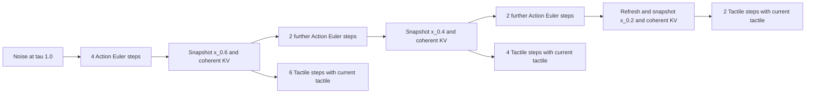

# Action Expert cache ladder: implementation and CPU validation

Implemented on `mfincato/risk_gated`, starting from commit `05c9328`. The newer
TAPTIC force/VQ-VAE path and launcher in that commit are preserved. Existing
uncommitted review/risk-analysis work is also preserved. No branch switch,
merge, checkpoint download, GPU job, full training or robot command occurred.
The new ladder tests perform inference only; existing regression tests include
their previously implemented tiny random-model optimizer checks.

## Result and split convention

One Action Expert trajectory now produces three coherent handover snapshots:

| Snapshot tau | Action steps reaching it | Tactile steps to zero |
|---:|---:|---:|
| 0.6 | 4 | 6 |
| 0.4 | 6 | 4 |
| 0.2 | 8 | 2 |

The requirement's phrase assigning 6/4/2 tactile steps to tau=0.2/0.4/0.6 is
reversed. The implementation uses the mathematically consistent mapping above,
with ten total numerical steps and nominal delta_tau=-0.1.

**Executed validation: 57 passed in 19.60 seconds.** This includes 19 new ladder
tests and all 38 existing TAPTIC tests (adapter, multi-split, force/VQ-VAE and
the pre-existing risk-analysis unit tests). There were no test failures or skips
in the full run. This is a CPU correctness result, not a pretrained performance
or latency result. Full output: [test_results.txt](test_results.txt).
Machine-readable results: [test_evidence.json](test_evidence.json).

## Files changed

| File | Change |
|---|---|
| `qwen_vla/cache_ladder.py` (new) | Frozen ladder/snapshot containers, strict split selection, owned tensors and KV storage, copied public exports and schedule/token metadata. |
| `qwen_vla/modeling_vla.py` | Shared private Action trajectory implementation; existing partial API delegates to it unchanged numerically; new ladder build/continuation APIs and snapshot capture points. |
| `qwen_vla/__init__.py` | Exports `ActionCacheLadder` and `ActionHandoverSnapshot`. |
| `tests/taptic/test_cache_ladder.py` (new) | Real native-data CPU tests, independent pre-change references, KV rebuild checks, time schedules, immutability, updated tactile, optional context tokens and invalid inputs. |
| `scripts/smoke_taptic.sh` | Adds ladder tests to the existing adapter/multi-split smoke launcher. |
| `docs/taptic_cache_ladder/` (new) | This report, complete test output, numerical evidence and preservation hashes. |

No constructor, learned parameter, MoT backbone, dataset loader, normalization,
training loss, training configuration, force/VQ-VAE implementation or existing
test was changed. SHA-256 verification confirms **148 other existing files
unchanged**, including the earlier uncommitted artifacts; see
[preservation.json](preservation.json). The three intentionally modified existing
files are the model wrapper, package exports and smoke launcher.

## Capturing one coherent trajectory

The existing integer-indexed FP32 Euler solver remains the implementation used
by both single-split and ladder inference. The ladder runs Action velocities at
indices 0 through 7, for eight out-of-place FP32 state updates.

At index 4 (tau=0.6) and index 6 (tau=0.4), the normal forward computes KV for
the current action state and flow time. The snapshot copies this cache and state
**before** the velocity update. The same forward supplies the next Action
velocity, so capture introduces no extra model forward at these levels.

After index 7 updates the state to tau=0.2, one final forward refreshes the KV
for that endpoint. It does not perform an Euler update. Result:

- **8 Action Euler updates + 1 final cache refresh = 9 model forwards.**
- Three independent partial runs would use **5+7+9=21 forwards**.
- The existing fixed tau=0.4 partial call still uses **6 updates + 1 refresh**.

The complete ladder always computes eight Action updates, even if the caller
later selects tau=0.6. Only the selected *mathematical trajectory* comprises ten
updates: 4 Action + 6 Tactile, 6+4, or 8+2. Extra Action work to build the other
levels still consumes compute. Thus the ladder is not claimed to be cheaper than
one fixed-split run: relative to the fixed tau=0.4 slow tick, construction adds
two Action forwards and stores three caches. No GPU speedup claim is made.



## Snapshot contents and ownership

`ladder[0.4]` returns an `ActionHandoverSnapshot`. Each snapshot owns:

- `x_tau`: the noisy action chunk at the existing **BF16 API boundary**.
- `integration_state_fp32`: the unrounded **FP32 Action solver accumulator**.
- Complete per-layer KV for `[latent | fast/state/time/action tokens]`.
- Latent and Action M-RoPE/1D position IDs, their concatenation, and sequential
  cache indices (`cache_position`, distinct from M-RoPE coordinates).
- Counts for latent, fast, state, time and chunk tokens, plus total Action/cache
  lengths.
- Handover metadata: action/total steps, nominal tau, precision, cache length,
  coherence flag, state dtype, nominal delta_tau, nominal/FP32 time grids and
  Action/Tactile step indices.

Keeping both state dtypes is intentional. Existing partial inference returns
BF16, then the tactile solver converts it to FP32 for accumulation. The new API
preserves that boundary and its numerical behavior. Rounding never feeds back
into the continuing FP32 Action trajectory. Using the saved FP32 accumulator
directly for tactile continuation would be a different numerical convention and
is not silently introduced here. FP32 represents values such as 0.6 approximately
(`0.6000000238418579`); integer indexing prevents recurrent BF16 time drift.

Both containers are frozen dataclasses; the ladder stores an immutable tuple.
Public tensor/position/cache properties return copies, and metadata/count
properties return fresh dictionaries. Every saved KV layer and snapshot state
has independent storage. Accessing private underscored storage to mutate it is
outside the API contract; Python dataclasses are not a security boundary.

Continuation passes the private saved cache to the **existing clone-before-use
tactile solver**, avoiding a redundant public-export clone. The solver appends
and crops tactile KV only on its working copy. It never updates saved snapshots.

## API usage

```python
model.eval()

# One physical SLOW tick. Inputs are already embedded current visual/text context.
# latent_position_ids must cover only slow_embeds, not appended Action tokens.
with torch.no_grad(), torch.autocast("cuda", dtype=torch.bfloat16):
    ladder = model.forward_flow_action_ladder(
        inputs_embeds=slow_embeds,
        position_ids=latent_position_ids,
        noise=initial_noise,                 # [B,16,21] for TAPTIC
        attention_mask=unpadded_mask,         # None or all ones
        fast_embeds=fast_embeds,              # optional
        state_embeds=state_embeds,            # optional
    )

    # One physical FAST tick, after receiving a current causal tactile observation.
    actions_t1 = model.tactile_flow_continue_from_ladder(
        ladder,
        selected_split=0.4,                   # caller selection; no gate here
        tactile_f6=current_tactile,           # e.g. [B,5,360] raw-taxel adapter input
    )

    # Another physical FAST tick within the same slow interval. Start over from
    # the selected saved x_tau, with updated tactile; do not continue actions_t1.
    actions_t2 = model.tactile_flow_continue_from_ladder(
        ladder,
        selected_split=0.6,
        tactile_f6=updated_tactile,
    )

snapshot = ladder[0.4]
print(snapshot.token_counts, snapshot.cache_metadata)
inspect_cache = snapshot.cached_kv          # defensive copy
inspect_state = snapshot.integration_state_fp32
```

The CUDA autocast block is an example for future deployment; it was **not** run
in this task. CPU tests use `torch.autocast("cpu", dtype=torch.bfloat16)`.
`tactile_deform`, `tactile_codes` and `tactile_f6_history` are also forwarded to
the existing tactile API when supplied. Returned chunks remain normalized
actions; existing denormalization/controller handling still applies.

Existing fixed baseline calls remain valid without any ladder:

```python
x, cache, n_action, tau = model.forward_flow_action_partial(
    slow_embeds, latent_position_ids, initial_noise,
    fast_embeds=fast_embeds, state_embeds=state_embeds,
    split_step=6, flow_time_precision="fp32",
)
actions = model.tactile_flow_continue(
    cache, latent_position_ids, n_action, x, tau,
    tactile_f6=current_tactile, split_step=6, flow_time_precision="fp32",
)
```

## Executed numerical checks

Real data come from native **episode 0, frame 71**, `wiping_table`, through the
existing TAPTIC dataset adapter. Two copies of the same unpadded anchor exercise
batch size 2; they are not independent demonstrations. The updated input is an
actual distinct taxel payload from the same episode and quality segment:

| Timestamp | Monotonic ns |
|---|---:|
| Initial tactile read | 1132876996314607 |
| Slow observation tick | 1132876997034203 |
| Updated tactile read / fast tick | 1132877086641081 |

The updated read is available **89.606878 ms after the slow tick**, before the
next nominal slow frame. It is not provided during Action ladder construction.
Offline fixture selection deliberately finds a changing payload within a valid
slow interval; it is a test-data choice, not a proposed online selection rule.

Reduced random original Qwen/MoT classes: hidden size 64, intermediate size 128,
two text layers (second initialized as a copy of the first to exercise all-layer
cloning), two query heads/one KV head, head dimension 32; random vision tower
hidden size 32/depth 1. Images are resized to 56x56. Random Action/Tactile final
weights are made nonzero so equivalence and input-response tests are nontrivial.
No pretrained network weights are loaded or altered.

Actual shapes/counts:

| Item | Value |
|---|---|
| State and output action chunks | `[2,16,21]` |
| Current/updated taxel input | `[2,5,360]` |
| Latent tokens | 86 |
| Fast visual / state / time / chunk tokens | 71 / 1 / 1 / 16 |
| Total Action tokens | 89 |
| Total tokens in each saved KV layer | 175 |
| Cached text layers | 2 |
| Full M-RoPE IDs per snapshot | `[3,2,175]` |
| KV tensor storage per snapshot, measured CPU setup | 179,200 bytes |
| Three saved KV copies, excluding states/positions/working cache | 537,600 bytes |

Independent references are the original partial/continue method bodies read
from **commit `05c9328`**; they do not call the new shared trajectory helper.
Additionally, the coherent Action suffix is rebuilt from each exported state
and tau against its latent-prefix cache and compared to the stored KV.

| Tau | Tactile steps | Max absolute state difference | Max KV difference | Max output difference | Output RMS |
|---:|---:|---:|---:|---:|---:|
| 0.6 | 6 | 0 | 0 | 0 | 1.02972209 |
| 0.4 | 4 | 0 | 0 | 0 | 1.01274049 |
| 0.2 | 2 | 0 | 0 | 0 | 1.00449884 |

Differences are **bitwise zero** in the CPU test. RMS values are normalized
random-model output diagnostics, not task-performance measures.

Additional executed checks:

- Exactly nine Action forwards/eight Action velocity updates; time inputs are
  FP32 `flow_time(0)..flow_time(8)`.
- Every saved FP32 state exactly equals reconstruction from observed Euler
  velocities without intermediate BF16 rounding.
- Tactile time inputs are FP32, follow the selected integer indices, end at the
  final evaluation tau=0.1, and perform the last update to index 10/tau=0.0.
  Reintegrating captured tactile velocities reproduces the returned chunk.
- Repeated same-observation calls return identical results. Updated real tactile
  changes outputs at all three splits: max absolute difference **0.015625**
  normalized units for each split in this random model.
- Calls switch among `.2,.6,.4,.2,.4,.6`; no level is consumed. Full saved states,
  positions, metadata and every layer's KV remain bitwise unchanged.
- Mutating exported tensor contents, positions, dictionaries, KV contents and
  KV length does not affect saved snapshots. Rebinding frozen fields is rejected.
- Optional fast/state tokens and 1D positions match independent single-split
  execution for all three levels.
- Fixed tau=0.4 partial states, cache and final actions match the pre-change
  implementation bitwise in **both FP32 and legacy BF16 modes**. Parameters and
  buffers remain unchanged by inference.
- Invalid split values, NaN/Inf, booleans/strings, malformed states/positions,
  unsupported precision/schedules, padded contexts and training mode are rejected.
  Python/NumPy real scalars representing supported levels are accepted, including
  FP32 approximations within 1e-7; tensor-valued selections require caller conversion.

The existing historical baseline test still reproduces the old BF16 endpoint
0.39453125 versus nominal 0.4 under the FP32 fix. That is a pre-existing solver
difference, **not** a new ladder discrepancy.

## Reproduction

No checkpoint download is required. From the repository root:

```bash
export TAPTIC_ROOT=/home/mfincato-iit.local/midtrain_merge/derived/taptic_trex_style_v2
export TAPTIC_PROCESSOR=/home/mfincato-iit.local/midtrain_merge/derived/tiny_qwen3vl_test
export TAPTIC_PANDA_URDF=/home/mfincato-iit.local/lerobot_plugins/lerobot_robot_panda/lerobot_robot_panda/urdf/panda.urdf
export TAPTIC_PYTHON=/home/mfincato-iit.local/trex-venv/bin/python
export OMP_NUM_THREADS=2 MKL_NUM_THREADS=2 OPENBLAS_NUM_THREADS=2 CUDA_VISIBLE_DEVICES=''

# Only ladder tests (19).
"$TAPTIC_PYTHON" -m pytest tests/taptic/test_cache_ladder.py -q -s --tb=short

# Complete TAPTIC suite: executed, 57 passed in 19.60s.
"$TAPTIC_PYTHON" -m pytest tests/taptic -q -s --tb=short

# Updated existing launcher: adapter + multi-split + ladder selection.
bash scripts/smoke_taptic.sh
```

Actual environment: **Python 3.12.13, torch 2.10.0+cu128, transformers 4.57.1**,
CPU only, two threads. The repository's pinned Python 3.10 / torch 2.6 /
transformers 4.57.3 environment and CUDA numerics still require validation.
`bash -n scripts/smoke_taptic.sh` and `git diff --check` also passed. Full test
collection retains and exercises all existing tests.

## Remaining limitations

- No real pretrained/GPU model smoke, full-scale latency or memory profiling.
  The measured CPU KV bytes must not be extrapolated as production GPU usage.
- New ladder APIs require eval mode, exactly ten steps, FP32 integration/time,
  correctly sized noise and **unpadded context**. Existing cached inference drops
  padding masks after its first forward; this task rejects padded ladder inputs
  rather than alter the fixed baseline's behavior. Use batch size 1 or group
  equal-length contexts; variable-length padded batching needs separate work.
- This stores three full owned KV copies. Shared immutable prefix storage or
  further memory optimizations are not implemented. It is synchronous and
  returns the ladder only after all three snapshots exist.
- New real-data ladder tests use the taxel path. Existing force/VQ-VAE tests
  remain passing, and the new continuation forwards their optional arguments,
  but real-data force/VQ-VAE **ladder-specific** integration is not validated.
- The model API accepts tactile tensors, not timestamps. Callers must enforce
  causal availability, freshness/reset masks, and association with the same slow
  observation. There is no physical fast-tick scheduler, controller, robot replay,
  cache expiry or automatic rebuild when weights/context/device change.
- Each fast call restarts the selected saved state and integrates to zero. It
  never reuses the preceding fast call's final action as a new initial state.
  Numerical Euler steps do not represent physical sensor ticks.
- No gate, risk head, contact-aware Action Expert, adaptive selection policy or
  early replanning is implemented. The caller selects a supported level explicitly.

No commit or push was performed in this implementation task.
