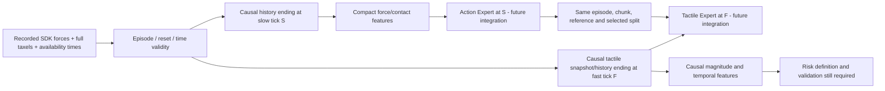

# TAPTIC adapter validation and native tactile interface review

Review scope: current branch **`mfincato/risk_gated`**, commit
`b068f70dacf383d75eb8421b77682d53d0c4d870`. No branch switches, merges or changes
to `feat/TAPTIC`. This review adds only two reproducible audit/diagnostic scripts
and the files in this directory. **No adapter, trainer, model, dataset or training
statistics were modified. No training was launched.**

The adapter is a working **data/shape compatibility baseline**, not yet an
end-to-end high-frequency policy. Native tactile data are preserved, but the
forward path still consumes one current observation at each dataset frame.
No compact contact input, risk scalar/label, adaptive split, or cache ladder is
implemented. There are important remaining numerical, metadata and validation
issues detailed below.

## 1. Evidence and provenance

Dataset: [mfincato/taptic_trex_style_midtrain_v1](https://huggingface.co/datasets/mfincato/taptic_trex_style_midtrain_v1/tree/31d33a627a70cff8752c621833fa07be7b71e25a),
verified revision `31d33a627a70cff8752c621833fa07be7b71e25a`.
It contains the version-2 export despite its repository name: LeRobot v3.0,
Panda EE, 10 FPS, **868 episodes / 213,507 frames / 59 captions**. The verified
local mirror is `/home/mfincato-iit.local/midtrain_merge/derived/taptic_trex_style_v2`.

Five representative sample/frame sidecar pairs, info JSONs, episode metadata
and the main data parquet were **downloaded directly from Hugging Face into
memory** using configured credentials, verified against Hub Git/LFS hashes, and
compared with the local mirror. All matched. A sixth episode and the extended
checks used local bytes verified against the same pinned Hub hashes. No data
were uploaded or rewritten.

Evidence:

- [Direct Hub inspection](sidecar_evidence.json): episodes 0, 48, 553, 771, 297;
  file hashes, exact Parquet schemas, timing, repetition and validity counts.
- [Extended inspection](sidecar_evidence_extended.json): adds adjacent cut episode
  554, within-episode repetition, scalar missingness and boundary overlap.
- [Executed pytest output](pytest_results.txt): **10 passed in 5.41 s**.
- [Numerical model/batch evidence](smoke_evidence.json): deterministic seed
  20261118; original expert-forward test plus a real nonzero-taxel frame.
- [Measured timeline example](timeline_example.json): episode 0's first interval.

These are sampled sidecar audits, not certification of every raw file. The
previous [whole-frame audit](../taptic_audit.json) checked all action/state rows
and all episode frame clocks/windows: 0 nonfinite action/state values, 0 invalid
frame-index/nominal-timestamp sequences, 196,645 valid 16-frame windows and
3,842 candidate windows excluded for real-time gaps. Those full-dataset results
were not recomputed in this review.

## 2. Files changed by the completed adaptation

The adaptation is commit `b068f70` relative to its parent `72c170f`:

| File(s) | Reason / reuse |
|---|---|
| `qwen_vla/taptic_dataset.py` | New isolated adapter; current images, 21D chunks, full taxels, native-rate stream, collation and baseline guards. Processor/padding/flow/FLARE structure adapted from the reference loader. |
| `taptic/actions.py` | Selectively copied from `feat/TAPTIC`; delta-base conversion, inverse conversion and SO(3) helpers. Only comments/docs differ from the reference. |
| `taptic/constants.py` | Copied source slices, joint/finger order and conventions; documentation link updated. |
| `taptic/video.py` | Exact reference-branch reuse: timestamped AV1 seek/decode and worker-safe container handling. |
| `taptic/data.py` | New schema checks, episode/source split validation, train-only statistics, causal current-sample and native interval access. |
| `taptic/inspect_dataset.py`, `taptic/__init__.py` | Read-only initial audit/statistics utility and package. |
| `scripts/midtrain.py` | Opt-in `taptic` format, existing tactile embedder width 360, config guards and TAPTIC checkpoint metadata. |
| `tests/taptic/test_adapter.py`, `scripts/smoke_taptic.sh` | Small real-data CPU validation and reproducible launcher. Tiny-model approach follows the reference tests; model construction is in memory. |
| `docs/taptic.md`, `docs/taptic_audit.json`, `docs/taptic_train_stats.json`, `docs/taptic_test_results.txt` | Original report, discovered schema, statistics and initial results. |

The older primitive NPZ converter, future-offset tactile loader, XHand VQ-VAE
and reference model modifications were **not ported**. The new loader uses this
LeRobot export and raw sidecars directly.

`qwen_vla/lerobot_dataset.py` and `utils/lerobot_common.py` are byte-identical to
`full-pipeline`. The current `modeling_vla.py` and `modeling_qwen3vl_mot.py`
contain explanatory comments/standalone strings added before the adaptation;
AST comparison against `full-pipeline`, ignoring those strings/docstrings,
found **identical executable structure**. The adaptation commit changes neither
model file. Thus the executed model classes have the original computation,
with the supported action/tactile dimensional arguments changed for TAPTIC.
The existing test comparing files to HEAD alone is weaker evidence; this review
also performed the older-baseline comparison explicitly.

## 3. Panda + XHand contract and actual numerical validation

Stored action `[18]`: absolute commanded flange xyz (m), gripper-down rotation
vector (rad), twelve absolute XHand joint targets (rad). Measured state `[40]`:
Panda joints in degrees, twelve measured hand joints in radians, fifteen SDK
force counts, measured flange xyz/rotation vector.

For anchor S, `R_S = Rx(pi) Rot(state[S,37:40])`; target k uses:

```
dp[k] = R_S.T (action[S+k,:3] - state[S,34:37])
dR[k] = R_S.T Rx(pi) Rot(action[S+k,3:6])
chunk[k] = [dp[k], dR[k][:,0], dR[k][:,1], action[S+k,6:18]]
```

This is **21D**, k=0..15, measured chunk-start flange frame for arm deltas,
absolute hand targets. The physical point is `panda_link8` in Panda base
coordinates, with no invented XHand tool offset. No action delta is inferred
from feature names alone: recorder code/provenance, independent FK and inverse
reconstruction support the convention.

Executed numerical checks:

| Check | Measured result |
|---|---:|
| Inverse reconstruction, 63 real chunks across 2 train + 1 val episodes | max xyz error **1.0344e-8 m** |
| Same chunks, rotation geodesic error | **2.8387e-8 rad** |
| Same chunks, absolute hand-target reconstruction | **0 rad** |
| Normalize→denormalize, float32 | max component error **1.1921e-7**, mixed action units |
| BF16 normalized batch round trip | max component error **0.00274169**, mixed action units; expected quantization, not exact inversion |
| Panda URDF FK, 97 frames from all 9 source tasks | max xyz error **8.2153e-8 m**, rotation **3.2141e-7 rad** |

The numerical diagnostic fits stats on its two selected training episodes, not
validation. The existing full statistics artifact records 782 selected training
episodes / 177,763 valid chunks; only 781 episodes yield a full chunk because
one selected episode has 15 frames. Source recordings are grouped across train
and validation; the split is 782/86 selected episodes. No clipping is applied
to normalized actions. The model must use the paired inverse and chunk-frame
reconstruction before any later hardware deployment.

### Executed batch shapes

The mixed native/legacy batch used episodes 0 and 297; its stream lengths were
**8 and 1**, not a resampled common frequency. Processor image size was 56×56;
actual Qwen preprocessing produced the following patch tensors (these patch
counts are processor-dependent):

| Field | Actual shape / dtype |
|---|---|
| `input_ids`, `attention_mask` | `[2,162]` int64, with actual left padding |
| `pixel_values`, `image_grid_thw` | `[1024,1536]` float32, `[4,3]` int64 |
| `norm_actions`, `noisy_actions`, `target`, `eps_r` | `[2,16,21]` BF16 |
| `timesteps`, `time_r` | `[2]` BF16 |
| `state_raw` | `[2,21]` BF16, measured pose/hand representation |
| `tactile_taxels`, `tactile_valid` | `[2,5,120,3]` float32, `[2,5]` bool |
| `tactile_f6s`, `tactile_f6s_delayed` | `[2,5,360]` float32; full scaled taxels, despite the historical key name |
| `sdk_force`, `sdk_force_valid` | `[2,5,3]` float32, `[2]` bool |
| `tactile_stream.taxels`, `.sdk_force` | `[2,8,5,120,3]`, `[2,8,5,3]` float32 |
| stream timestamps/counters | `[2,8]` int64 |
| stream `sample_mask`, `taxel_valid`, `lengths` | `[2,8]`, `[2,8,5]` bool; `[2]` int64 |
| `flare_pixel_values`, `flare_grid_thw` | `[1024,1536]` BF16, `[4,3]` int64, targets only |

All numerical tensors checked by the suite were finite. The legacy row's taxel
validity is false; padding is excluded by its stream mask. The unchanged
original LeRobot loader separately collated a synthetic official-format input
into `[2,16,62]`; **this was not a real official-dataset episode load**.

### Original expert forwards: scope and numbers

Executed the existing test with real episode 0/frame 1, and then again with
**episode 0/frame 65**, which has nonzero recorded taxels. Model: original
Qwen3-VL/MoT classes, random weights, text width 64/depth 1, vision width 32/depth 1,
CPU BF16 autocast. This is not a 2B pretrained checkpoint test.

Both runs produced finite `[1,16,21]` Action Expert training velocities, partial
Action flow states and Tactile Expert training velocities. For the nonzero-taxel
frame:

- Tactile input `[1,5,360]`: min -0.0078125, max 0.0156863, RMS 0.00120938.
- Action velocity: min/max/RMS **0/0/0**, as expected from its zero-initialized
  final head; normalized flow MSE **1.26970**. This proves execution/shape
  compatibility, not useful denoising or learning.
- Tactile velocity: min **-3.3125**, max **2.171875**, RMS **0.977669**;
  normalized flow MSE **2.41295**. These random-model losses are diagnostics,
  not performance metrics. No ablation established tactile sensitivity.
- The initial no-contact run had Action/Tactile MSE **1.58125 / 2.02176**,
  Tactile RMS **0.721586**; its taxel inputs were all zero.
- The nominal six-of-ten integration returned **τ=0.39453125**, not exactly 0.4,
  because the original integrator accumulates BF16 time increments. The current
  test permits 0.01 tolerance; exact-grid integration has **not** passed a test.

The expert test contains no FLARE prediction queries/loss, even though the
loader emits valid FLARE target tensors. It has B=1 and no backward/optimizer
step. Mixed batches are tested at collation, not through the model. A repeated
`tactile_flow_continue` inference replay is also not covered by this suite.

## 4. Actual tactile_raw schema

The Hub contains **1,737 sidecar paths**: `tactile_raw/info.json` plus 868 pairs:

```
tactile_raw/episode_000000_right.parquet
tactile_raw/episode_000000_frames.parquet
...
tactile_raw/episode_000867_right.parquet
tactile_raw/episode_000867_frames.parquet
```

Both tables are Apache Parquet. Episode IDs are those of the re-cut LeRobot
export, not the original task's local episode IDs. `meta/episodes/...` records
source task, source episode, source frame slice, split, video offsets and native
vs legacy provenance.

| Native sample-table field | Stored type / per-row shape | Meaning |
|---|---|---|
| `t_rel`, `t_mono` | float64 scalar | seconds, respectively source-recording start reference and monotonic read-end time |
| `frame_index` | int64 scalar | recorder's frame association; -1 for pre-roll; not a precise sensor acquisition timestamp |
| `frame_t_rel` | float64 scalar | associated frame observation time; NaN/null can be legitimate before the first frame |
| `is_frame_sample` | bool scalar | sample copied into frame state |
| `sequence` | int64 scalar | software successful-read counter, **not a hardware sample counter** |
| `read_start_ns`, `read_end_ns` | int64 scalar | host CLOCK_MONOTONIC bracket of each SDK read, in ns |
| `reset_sequence` | int64 scalar | cumulative tactile re-zero/reset identifier |
| `read_errors`, `dropped` | int64 scalar | cumulative failed-read and worker-queue-drop counters |
| `joints` | list<float64> `[12]` | measured XHand joint radians |
| `force` | list<float64> `[15]` | **recorded SDK calc_force**, five fingers × xyz |
| `values` | list<float64> `[1800]` | **recorded individual raw taxel components**, five fingers × 120 × xyz |
| `command_sequence`, `command_ns` | int64 scalar, nullable before commands | latest hand command sequence / host send time |
| `command_q`, `command_target` | list<float64> `[12]`, nullable | filtered commanded joint radians and unfiltered target |

Finger order is **thumb, index, middle, ring, little**. Taxel flattening is finger
→ taxel 000..119 → x,y,z. Joint order is the twelve feature names validated by
the adapter, matching the recorded action/state layout. The separate `force`
channel is used as recorded; no taxel aggregation was recomputed.

SDK `data_type.hpp` defines force components as int8 Fx/Fy and uint8 Fz before
serialization. Native inspected vectors are integer-valued counts. They are
**not calibrated newtons**. Physical axis directions, the transformation to
Panda/world coordinates, sensor surface normals and taxel geometry are not
verified. A nonnegative z component does not establish a physical surface-normal
force convention. No slip signal, contact-state label or contact-risk label was
found in the inspected schema.

Frame-table native schema:

| Field | Type | Meaning |
|---|---|---|
| `frame_index` | int64 | re-cut episode frame number |
| `timestamp` | float64 | nominal frame_index/10 seconds |
| `t_rel` | float64 | real source-recording observation time reference; not necessarily zero at re-cut start |
| `observation_ns`, `observation_unix_ns`, `add_frame_ns` | int64 | monotonic observation, wall-clock observation, monotonic write timing |
| `xhand_sequence` | int64 | frame's recorded SDK sample reference; reliable in inspected native episodes, inconsistent in inspected legacy metadata |

Legacy episode 297 differs: `joints`/`force` are list<float32>; command sequence/
time are float64 NaNs and command vectors are null; it adds `interpolated:bool`
and `available_ns:int64`. Its frame `observation_unix_ns`/`add_frame_ns` are
float64 NaNs. Read/observation times are **nominal**, not measured host acquisition
times. Its 1,800 taxel entries are zero placeholders, not recorded zero contact.

## 5. Concrete episode inspection

Rates use the median interval between recorded rows. Repetition rates below
exclude pre/post-roll and compare complete consecutive vectors within the episode.

| Episode / task | Frames | Recorded / synthetic rows | Recorded Hz | Max sample gap (ms), whole file | Max RGB gap (ms) | Same SDK vector / same taxel vector |
|---|---:|---:|---:|---:|---:|---:|
| 0 / wiping_table | 285 | 8161 / 0 | 76.438 | 544.005 | 2702.311 | 82.76% / 80.21% |
| 48 / dosing_pipette | 311 | 4362 / 0 | 76.401 | 547.253 | 1402.352 | 72.39% / 72.55% |
| 553 / clearing_table | 145 | 1250 / 0 | 76.343 | 15.793 | 103.495 | 63.78% / 64.05% |
| 554 / clearing_table | 125 | 1097 / 0 | 76.401 | 29.167 | 104.822 | 57.84% / 60.28% |
| 771 / insert_credit_card | 469 | 5785 / 0 | 76.422 | 17.061 | 9613.032 | 81.50% / 68.48% |
| 297 / insert_game_object_cylinder | 310 | 310 / 2163 | 10.000 | 100.000 | 100.000 | 71.20% / 100.00% |

**Native recordings contain actual SDK reads at ~76.4 Hz, but not 76 unique force
vectors per second.** All five native files have contiguous successful-read
sequences and zero logged read errors/queue drops. Joints change on every
consecutive read in all five files, so the rows are not wholesale duplicates.
Taxels and SDK vectors do repeat, including during nonzero readings. Static
contact, zero intervals, quantization and an unknown firmware refresh rate can
all contribute. With no sensor timestamp/hardware counter, fresh independent
physical acquisition at every read cannot be proven. Repeated values should be
preserved with their timestamps, not deduplicated or presented as missing reads.

Other measured findings:

- **0 / wiping:** median read interval 13.0825355 ms; median causal sample age
  6.339287 ms, max 13.555041 ms. Full-file pre-roll 73.4176 s and post-roll
  1.1920 s; these are not within-episode training observations. One reset and
  a 544 ms read gap exist in the file, outside the policy observation span. Nominal RGB time hides pauses up to 2.702 s.
- **48 / pipette:** median 13.088758 ms; age median/max 6.319507/13.247623 ms;
  one reset, max whole-file read gap 547.253 ms, RGB gap 1.402 s. Full-file
  pre/post-roll 21.9619/3.4673 s. The >50 ms read gap is outside the policy
  observation span, as recorded in the extended JSON.
- **553 and 554 / clearing:** adjacent cuts of source episode 502, source
  slices `[0,145)` and `[145,270)`, both in the same train split. They share
  **144 sidecar sample sequences**, all before episode 554's first observation,
  because its ~2 s history overlaps the previous cut. This is source pre-roll,
  not an instruction to carry policy/risk state across re-cut episode boundaries.
  The adapter only admits one causal initial observation and thereafter samples
  available after that episode's tick boundaries. Their sample/frame clocks are
  increasing; no reset or >50 ms sample gaps were observed.
- **771 / credit card:** median 13.0851725 ms; age median/max
  6.635793/13.877841 ms. No >50 ms read gaps, but RGB pauses reach **9.613 s**;
  tactile continues during those pauses. Pre/post-roll 14.4359/1.0820 s.
- **297 / cylinder:** **310 recorded 10 Hz** rows and **2,163 synthetic** rows.
  The apparent dense spacing is mostly 13.09 ms, with 8.37 ms residual gaps;
  this does not establish native 76 Hz measurement. Interpolated values depend
  on the next frame and become available 13.09–91.63 ms later than their nominal
  row time. The adapter excludes these rows. Recorded 10 Hz SDK forces match
  frame state exactly by timestamp; taxels remain entirely missing.

In native inspected files, all frame sequence references resolve and associated
SDK forces match `observation.state[19:34]` with **0 count error**. A latest
causal read can be newer than the sample copied into state; differences up to
107 counts in episode 0 are therefore not a failed same-sample consistency check.
They must not be paired with the older state's sample ID as if simultaneous.

**Legacy metadata bug:** in episode 297, frame 1 has `xhand_sequence=1`, while
its recorded sidecar row has sequence 8 at 100,000,000 ns; sequence 1 is a
synthetic row. **271/310 frame references point to synthetic rows**, and a
sequence-based force join gives max error 21 counts. Recorded-row timestamp
selection gives **0 count error**. The current adapter uses timestamps, so it
avoids this bug, but this metadata must be repaired/flagged before exposing
sequence IDs as universal frame join keys. No source dataset was edited here.

All inspected force/taxel arrays are finite. Metadata missingness is intentional
in places: native pre-roll `frame_t_rel` contains NaNs; legacy commands and some
clock fields are absent. These must not be treated as numerical observations.
No missing causal recorded observation at the 10 Hz frames was found in these
six files. Zero error/drop counters do not exclude unsampled physical events or
prove the whole dataset has no loss. The audit is not exhaustive.

## 6. Proposed causal alignment and two-clock interface — NOT implemented

### Physical time and diffusion time are separate

Native read spacing (~13.1 ms), policy fast-tick period, and Euler Δτ=-0.1 are
three different quantities. Choose a configurable physical fast-tick schedule
and benchmark it; **76 Hz acquisition does not demonstrate that 2/4/6 neural
forward passes fit within 13 ms**. The dataset supports real-time replay at its
recorded clocks; it does not contain a 76 Hz RGB stream or full Panda target
supervision at that rate.

At slow tick S:

1. Use the latest RGB/state that was actually available by S. Native replay uses
   frame `observation_ns`, not nominal `frame_index/10`, for tactile alignment.
   Exposure timestamps are unavailable, so camera capture-level alignment remains
   uncertain; preserve this limitation rather than treating write time as exposure.
2. Compute compact features only from **recorded SDK `force` samples available
   by S**, over a duration-based causal history ending at S. Never aggregate the
   whole forthcoming slow interval into S's contact/risk input.
3. Fix the chunk reference pose/frame at S. Cache episode, S, reference pose,
   sampled noise, τ_split, step count and cache identity together.

At physical fast tick F ≥ S:

1. Select the latest recorded tactile sample with
   `read_end_ns <= F` **and** `available_ns <= F`; use only same-episode causal
   history. For native rows availability defaults to read_end_ns. Do not query by
   nearest timestamp, interpolate using a future row, or advance the observation
   during the Euler steps of this one tick.
2. Supply its full `[5,120,3]` taxels and recorded `[5,3]` SDK forces separately.
   Preserve original measurement timestamps, sample age, reset IDs and validity.
   Reusing the latest sample at more frequent ticks is an explicit hold, not a
   new measurement. Thresholds for stale data must be specified/validated.
3. Derivatives use actual elapsed ns in seconds. Clear temporal derivative/risk
   state on episode change, reset change, read/drop counter increase, or a
   validated excessive-gap condition. Never difference across a reset or dedupe
   identical samples; zero derivative for repeated values is a legitimate result.
4. The slow cache must satisfy S <= F and belong to the same episode/chunk and
   τ_split. A future RGB/state or cache from the next slow tick cannot be used
   retrospectively for an earlier fast tick.

The current batch's `tactile_stream` contains `(previous_RGB_time, current_RGB_time]`.
It is causal **at current_RGB_time**, but cannot be fed wholesale to a fast tick
inside that interval. A replay dataset must anchor the cache at the previous
slow observation and mask the stream separately for every fast tick. Skipped
training anchors, short episodes and the last 15 frames also mean the current
sampled training batches are not a lossless export of the entire episode stream;
the complete raw recording remains in the sidecars.

### Timeline: actual data with an illustrative fast schedule

Episode 0, first RGB observation set to 0 ms. Measured next RGB observation:
**96.281188 ms**, although its nominal LeRobot timestamp is 100 ms. The latest
initial tactile sample is at **-11.137433 ms**; eight new native reads appear
before the next RGB observation.

```text
Host time (ms):  0    1.864  15.117  27.904  41.123  55.070  67.417  80.649  93.578  96.281
RGB/cache:      S0 -------------------------------------------------------------- S1
Native reads:        r1     r2      r3      r4      r5      r6      r7      r8
Fast ticks*:               F20          F40          F60          F80
Latest read*:              r2           r3           r5           r6
Cache used*:               S0           S0           S0           S0
```

`*` 20 ms fast ticks are illustrative, not a measured controller frequency.
At F40, r4 at 41.123 ms is still unavailable. At S0, none of r1..r8 may enter
Action Expert contact features or the split-selection decision. All Euler
substeps for F40 use the F40 snapshot; τ step count is unrelated to r3→r4 time.



### Compact features and risk: measured vs derived vs unavailable

Reuse the **recorded** SDK `force` directly. A proposed compact six-feature
vector per finger is `[Fx,Fy,Fz, norm(F), d norm(F)/dt, trailing max norm(F)]`.
Shape `[5,6]`; the last three are **derived raw-count features**, not recorded
physical contact/risk truth. Histories use real duration bounds and training-only
feature normalization. A contact flag requires a separately approved threshold/
hysteresis/noise model; it is currently unavailable. No assumption identifies z
as physical normal or x/y magnitude as friction/slip.

A scalar based on force magnitude/evolution can only be a **derived risk proxy**
until its definition and validation are provided. High force need not mean an
unsafe event. There is no justified label, threshold, supervision target or
probability calibration in this data. Keep `contact_risk=None`, validity false,
and `risk_target=None` until the definition is approved; do not silently convert
train percentiles into danger labels. The feature interface can be prepared
without inventing that scalar.

### Proposed additional DataLoader fields

B=batch; N=padded number of native rows in a causal history/replay window;
K=padded number of physical fast ticks; C=16 action steps; F=5 fingers.
This proposed schema excludes operator haptic feedback entirely. The existing
loader still returns an unused legacy `recorded_haptics` dictionary; removing it
from this workflow is an explicit pending data-interface task, not something
silently changed during this report-only review.

| Proposed field | Shape / dtype | Semantics / mask |
|---|---|---|
| `episode_id`, `source_recording_id`, `slow_time_ns` | `[B]` int64 | source identity and monotonic anchor; nominal provenance separate |
| `reference_position`, `reference_rotation` | `[B,3]`, `[B,3,3]` float32 | measured chunk-start base-frame flange pose; hold this frame for chunk |
| `stream.force` | `[B,N,5,3]` float32 | raw recorded SDK vectors, no recomputation |
| `stream.taxels` | `[B,N,5,120,3]` float32 | raw taxels, missing explicitly masked |
| `stream.read_start_ns`, `read_end_ns`, `available_ns` | `[B,N]` int64 | acquisition bracket and software availability |
| `stream.sequence`, `reset_sequence`, `read_errors`, `dropped` | `[B,N]` int64 | original counters; not hardware sample identity |
| `stream.sample_mask`, `force_valid`, `taxel_valid` | `[B,N]`, `[B,N,5]`, `[B,N,5]` bool | distinguish padding, missing force/taxels and invalid history |
| `stream.clock_is_nominal`, `is_interpolated` | `[B,N]` bool | provenance; synthetic rows excluded from observation eligibility |
| `slow_contact_features`, `slow_feature_valid` | `[B,5,6]` float32 / bool | proposed compact features from history <= S only |
| `slow_history_mask` | `[B,N]` bool | available <= S, correct episode/reset and causal history bounds |
| `fast_time_ns`, `fast_tick_mask` | `[B,K]` int64 / bool | physical schedule, independently configurable from native sampling |
| `fast_sample_index`, `fast_sample_age_ns` | `[B,K]` int64 | latest eligible recorded sample or -1; guard -1 before indexing |
| `fast_taxels`, `fast_force` | logical `[B,K,5,120,3]`, `[B,K,5,3]` | can gather lazily from stream rather than duplicate all data |
| `fast_history_mask` | `[B,K,N]` bool, or compressed ragged indices | available <= F for each tick; episode/reset/gap constrained |
| `fast_force_features`, `fast_feature_valid` | `[B,K,5,6]` float32 / bool | same causal features evaluated at F, for future risk definition |
| `slow_contact_risk`, `fast_contact_risk` | optional `[B,1]`, `[B,K,1]` | currently None; never invented labels |
| `risk_valid`, `risk_target` | logical slow/fast masks; target None | false until an approved definition/supervision exists |
| `action_target_times_ns`, `action_target_mask` | `[B,16]`, `[B,K,16]` | real 10 Hz target times; mask targets already in the past at each fast tick |
| `cache_anchor_ns`, `cache_id` | `[B]` int64 | cache identity and slow context availability |
| `tau_split`, `n_action_steps`, `n_tactile_steps` | `[B]` float32/int64 | proposed later controller output, currently baseline 0.4 / 6 / 4 |

No sample count is forced to exactly 7/8 per RGB interval; native jitter and
pauses produce variable counts. Native and legacy clock domains must not be
mixed. Fixed 10 Hz target actions remain the only full Panda+hand targets:
**76 Hz force acquisition does not supply 76 Hz complete action labels.** Any
fast-tick supervision, action shifting, loss masking or command-hold policy
needs an explicit definition and validation. Future training windows may include
later tick data as offline storage only if each expert's eligibility masks
exclude everything unavailable at its own inference time.

### Adaptive split schedule proposed for a later phase

| τ_split | Action steps (1→τ_split) | Tactile steps (τ_split→0) | Δτ |
|---:|---:|---:|---:|
| 0.2 | 8 | 2 | -0.1 |
| 0.4 | 6 | 4 | -0.1 |
| 0.6 | 4 | 6 | -0.1 |

Use an integer step index / FP32 time grid to represent these endpoints, rather
than repeated BF16 subtraction; cast embeddings only where needed. This is a
proposal, not a change to the original integrator in this review.

For the first adaptive implementation, selecting a split once per slow chunk
from information available at S keeps its cache consistent. Changing the split
later at a fast tick cannot safely reuse an action snapshot built for a different
handover state: it requires recomputation or an explicitly validated cache
strategy. No cache ladder is implemented/proposed as an automatic next step.
There is currently no approved mapping from risk to split values.

## 7. Remaining work and test coverage

Priorities before authorizing a training phase:

1. **Data correctness/interface:** repair or flag legacy frame sequence mapping;
   use timestamp-based recorded-row joins. Exclude synthetic/nominal legacy data
   from claims about native fast-tick training. Remove unused operator-haptic
   payload from this interface. Add explicit stale/gap/reset validity and a
   schema version; keep canonical sidecars untouched until a reviewed export fix.
2. **Causal replay:** implement episode/event windows with a slow anchor and
   independent fast ticks; per-expert timestamp masks; no shared pre-roll history
   across re-cut boundaries; define remaining-action targets at non-frame ticks.
   Current sampled batches preserve each returned interval but not all intervals
   of a complete replay. Keep a raw-stream access path independent of valid
   action-chunk anchors.
3. **Numerical baseline:** separately review exact τ endpoints/step arithmetic
   and test 0.2/0.4/0.6 schedules before enabling adaptation. The 0.4 baseline is
   currently nominal, with the measured BF16 drift documented. Do not hide it
   behind the existing loose test tolerance.
4. **Feature/risk definition:** approve compact feature/history bounds and
   normalization; establish calibrated units/axes if physical thresholds are
   needed. Define/validate a risk proxy or obtain labels; do not claim slip or
   risk ground truth. Define missing/invalid behavior and loss masks.
5. **Execution validation:** real mixed native/legacy batches through both experts,
   real FLARE loss, nonzero tactile perturbation tests, gradients and a tiny
   optimizer test only when authorized; full-size weight loading and 62D→21D head
   initialization/migration; pinned environment and distributed workers.
6. **Fast-tick feasibility, then adaptive logic:** replay multiple physical ticks
   from one immutable cache, full tactile continuation, cache/source/split checks,
   latency/memory profiling for 2/4/6 forwards on authorized hardware. Choose the
   actual fast frequency from that evidence. Only after review implement adaptive
   routing; no full training, cache ladder, risk tokens or early replanning now.

Executed tests (10/10): real episode/causal-window loading; mixed batch and
normalization/inverse reconstruction; future/missing sample handling; exact
native interval preservation and padding; synthetic/future interval rejection
and reset/error counter retention; leaking-stats/config rejection; independent
nine-task FK; original-source/schemas contract check; original Action/Tactile
training forwards; original 62D LeRobot collator regression. The diagnostic
runner additionally executed forwards at real nonzero taxels, measured errors
and compared model ASTs with `full-pipeline`.

Still required: full-size pretrained checkpoint forward; backward/optimizer
checks; nonzero input-vs-zero input sensitivity; mixed batch model/padding;
FLARE prediction/loss; worker/distributed loader behavior; repeated
`tactile_flow_continue`/cache immutability; causal event replay/masks at earlier
fast ticks; exact τ grid; per-fast-tick label semantics; exhaustive raw-file
validation; validated contact/risk definitions; on-device latency. The pinned
manifest is Python 3.10/torch 2.6, whereas this executed environment is Python
3.12.13, torch 2.10.0, transformers 4.57.1, PyAV 15.1.0, pytest 9.0.3; the pinned
environment remains untested.

## 8. Reproduction

From `/home/mfincato-iit.local/T-Rex`:

```bash
export TAPTIC_PYTHON=/home/mfincato-iit.local/trex-venv/bin/python
export TAPTIC_ROOT=/home/mfincato-iit.local/midtrain_merge/derived/taptic_trex_style_v2
export TAPTIC_PROCESSOR=/home/mfincato-iit.local/midtrain_merge/derived/tiny_qwen3vl_test
export TAPTIC_PANDA_URDF=/home/mfincato-iit.local/lerobot_plugins/lerobot_robot_panda/lerobot_robot_panda/urdf/panda.urdf
export OMP_NUM_THREADS=2 MKL_NUM_THREADS=2 OPENBLAS_NUM_THREADS=2 CUDA_VISIBLE_DEVICES=''

bash scripts/smoke_taptic.sh -v

"$TAPTIC_PYTHON" scripts/review_taptic_smoke.py \
  --out /tmp/taptic_smoke_evidence.json

# Fetch selected actual Hub files into memory, with hashes and local comparisons.
"$TAPTIC_PYTHON" scripts/review_taptic_sidecars.py --root "$TAPTIC_ROOT" \
  --episodes 0 48 553 771 297 --out /tmp/taptic_sidecar_evidence.json

# Extended six-episode audit; local reads only when bytes match Hub hashes.
"$TAPTIC_PYTHON" scripts/review_taptic_sidecars.py --root "$TAPTIC_ROOT" \
  --verified-local --out /tmp/taptic_sidecar_extended.json
```

The direct audit reads the shared ~44 MB data parquet once and selected small
sidecars in memory. Only JSON/text results are written. No GPU, large checkpoint,
training process, dataset copy/export or model architecture change is required.
