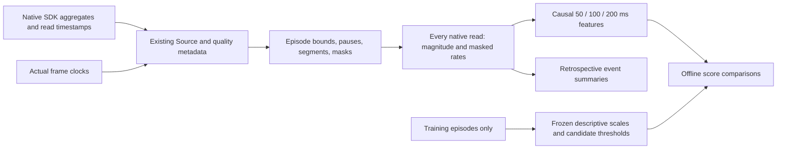
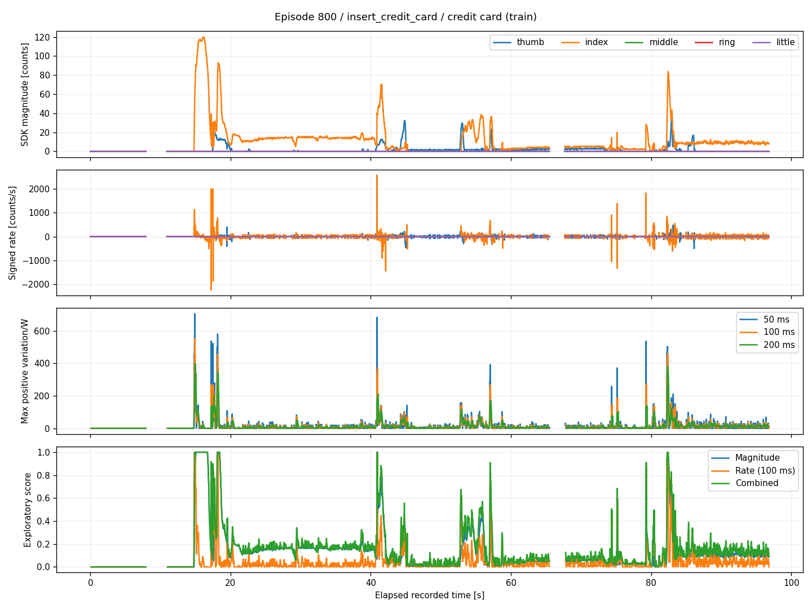
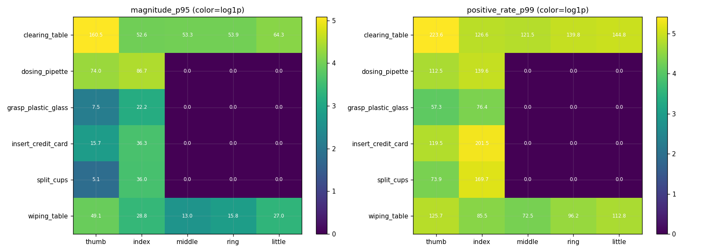

# TAPTIC native tactile contact-dynamics exploration

Analysis on `mfincato/risk_gated`, using the existing local dataset adapter and
timestamp-quality helpers. This task adds an offline analysis script, tests and
artifacts only. Existing uncommitted adapter/multi-split changes are preserved.
No gate, head, model forward, loss, architecture, sampling pipeline or training
configuration was modified. No network training was launched. WEART signals are
not read or included.

## Data and scope

Dataset: `mfincato/taptic_trex_style_midtrain_v1`. We read the existing local
mirror `/home/mfincato-iit.local/midtrain_merge/derived/taptic_trex_style_v2`;
this run does not claim a new comparison against the current remote Hub HEAD.
The previous dataset review pins that export to Hub revision
`31d33a627a70cff8752c621833fa07be7b71e25a`.
Source metadata/data identity from the adapter:
`1cb54e3dfd51811f0bdbebf64b0b2e8f532963a55c76b2a9355f0d80d71dc468`.

Actual metadata inventory, verified before feature extraction:

| Actual source_task | Episode IDs (inclusive range) | Native train / val | Legacy train / val | Annotated object examples |
|---|---|---:|---:|---|
| wiping_table | 0–47 | 43 / 5 | 0 / 0 | blue cloth |
| dosing_pipette | 48–97 | 45 / 5 | 0 / 0 | pipette |
| grasp_plastic_glass | 98–196 | 89 / 10 | 0 / 0 | plastic glass |
| split_cups | 197–296 | 90 / 10 | 0 / 0 | white plastic cup |
| insert_game_object_cylinder | 297–394 | 0 / 0 | 88 / 10 | elliptical cylinder |
| fruit_in_the_basket | 395–552 | 0 / 0 | 140 / 18 | apple, pear, orange, peach |
| clearing_table | 553–723 | 158 / 13 | 0 / 0 | 18 annotated object categories |
| unscrew_the_bottle | 724–770 | 0 / 0 | 42 / 5 | bottle cap |
| insert_credit_card | 771–867 | 87 / 10 | 0 / 0 | credit card |

Full episode IDs, source recording IDs, captions, objects and split assignments
are in [inventory.csv](inventory.csv). Object names are existing annotations,
not detected identities of the object actually touching a particular finger.
All 565 native episodes have `object_needs_review=False`; that flag is not an
independent validation of object/contact identity. In clearing_table, 171 exported
episodes belong to 49 source recordings; the other native tasks have one source
recording per episode. These are not 565 statistically independent trials.

All **565 native episodes** (512 train, 53 validation) were analyzed, not just
the illustrated examples. **303 legacy episodes** are inventoried separately.
Their 560,763 synthetic rows and 80,412 remaining legacy rows are excluded from
native distributions, derivatives, thresholds and normalization fitting.

## Verified recorded signal and limitations

Samples are `tactile_raw/episode_XXXXXX_right.parquet`; matching frame clocks are
`tactile_raw/episode_XXXXXX_frames.parquet`. The analysis uses recorded SDK
`force` vectors directly, reshaped from `[15]` to `[5,3]`, in order:
**thumb, index, middle, ring, little**, each with SDK x, y, z components.
It does not recompute fingertip forces from the 1,800 raw taxel components.

The sidecar identifies these as SDK `calc_force`. Native force components are
integer-valued in this audit (zero noninteger components), serialized as floats.
We retain the established **SDK count units**. No counts-to-newtons calibration,
surface-normal convention, sign-to-compression convention, per-finger axis
rotation, or transformation into the Panda/world frame is verified. Consequently
there are **no normal/shear features**, no conversion to N, and no inferred slip
labels. The Euclidean norm is a norm of the recorded SDK vector; it is not a
calibrated physical force or proof that axes have equal physical sensitivity.

`read_end_ns` is a CLOCK_MONOTONIC software-read timestamp. There is no hardware
tactile acquisition timestamp/counter. Equal payloads remain valid observations;
changing payloads are not proof of independent hardware acquisitions. Rates
below are rates of **observed payload magnitude**, not hardware-resolved force
derivatives. Tare/reset behavior can change the count baseline.

## Quality handling and causal alignment

The script calls `Source.tactile`, `Source.clocks` and the adapter's
`build_quality`, preserving the existing gap/counter/reset rules. It:

1. Separates legacy data before native feature fitting and removes explicit
   synthetic interpolation through the existing source loader.
2. Restricts native reads to the episode's first/last actual frame observation
   timestamps. Pre/post-roll is excluded, even when it overlaps another episode.
3. Excludes recorder-pause interiors with adjacent observations >150 ms apart.
4. Starts a new segment at resets, >50 ms read gaps, sequence discontinuities,
   error/drop counter changes, removed-row discontinuities and episode bounds.
5. Excludes nonfinite vectors, cutting derivatives around any excluded rows.
6. Defensively deduplicates identical timestamps within a source recording
   (source_repo, source_task, source_episode_index). **No duplicates remain
   inside episode bounds** in this export. Equal values at distinct timestamps
   are never deduplicated.
7. Requires full same-segment history for every rolling window. Invalid feature
   entries are zero placeholders accompanied by explicit masks.

There are no delayed `available_ns` values in these native files: the source
loader uses read completion as availability. The analysis rejects delayed arrival
streams rather than silently making arrival-order assumptions. Actual deployment
would additionally account for transport latency, sensor acquisition age and any
missing/late reads. Age since SDK read is not hardware freshness. No stale value
is held across a quality boundary during this analysis.

| Audit item | Result |
|---|---:|
| Native sidecar rows before episode/pause exclusions | 1,490,416 |
| Pre/post-roll rows excluded | 418,865 |
| Recorder-pause rows excluded | 53,518 |
| Retained native reads | **1,018,033** |
| Valid adjacent derivative pairs | 1,017,197 |
| Resulting segments | 836 |
| Sum of valid within-segment durations | **13,351.383 s / 3.709 h** |
| Nonfinite native SDK vectors | 0 |
| Reset-counter transitions in full native sidecar files | 34 |
| >50 ms read gaps in full native sidecar files | 48 |
| Read-error/drop counter transitions within files | 0 / 0 |
| Exact full-15-component repeats among valid retained pairs | **727,847 / 1,017,197 = 71.554%** |
| Valid read interval median / p95 / p99 / max | **13.089 / 13.765 / 14.614 / 35.653 ms** |

Reset/gap counts here are per-file diagnostics before exclusions; overlapping
pre-roll means they must not be interpreted as unique hardware/session events.
The median software polling interval corresponds to about 76.4 reads/s. We
retain every native read; there is no resampling to 10 Hz or another grid.

SHA-256 comparisons before/after confirm **all 1,739 inspected sidecar and
metadata files unchanged**. See [summary.json](summary.json) for hashes and
per-episode diagnostics; [quality.csv](quality.csv) for exclusions/counters.



## Feature definitions and tensor shapes

Let `F[i,f,:]` be the recorded SDK vector at read completion `t[i]`. Let
`m[i,f] = ||F[i,f,:]||₂`. For a valid adjacent pair:

```text
delta_m[i,f] = m[i,f] - m[i-1,f]
delta_plus  = max(delta_m, 0)
delta_minus = max(-delta_m, 0)
rate        = delta_m / ((t[i]-t[i-1])/1e9)
rate_plus   = max(rate, 0)
rate_minus  = max(-rate, 0)
```

This differs from `||F[i]-F[i-1]||/dt`, which can detect direction changes at
constant magnitude. The latter is a possible future complementary feature; it
is not substituted for the requested signed magnitude derivative here.

For each causal window `(t-W,t]`, W = 50, 100 or 200 ms:

- **mean_magnitude:** time integral of the past zero-order-held magnitude / W.
  It is duration-weighted, not the average of an arbitrary number of reads.
- **peak_magnitude:** maximum of the held magnitude over the window, including
  a value read before the left edge that persists inside it.
- **positive/negative_variation_rate:** sum of observed positive/negative
  magnitude increments with endpoints inside the window / W.
- **secant_rate:** `(m(t)-m_held(t-W))/W`, retaining its sign.
- **peak_positive_rate:** maximum already-observed positive read-pair rate in
  the window. A longer window can increase this maximum; it is not smoothing.

All are trailing features, without future interpolation. No derivative crosses
a segment boundary. A full 200 ms feature becomes valid only after 200 ms of
same-segment history; it does not borrow pre-roll or a preceding episode.

| Actual analysis field | Shape per episode | Meaning |
|---|---|---|
| sdk_force | `[N,5,3]` | Recorded SDK aggregates |
| read_end_ns, available_ns | `[N]`, int64 | Software times; identical here |
| magnitude | `[N,5]` | Derived SDK vector norms |
| magnitude_change, positive_change, negative_change | each `[N,5]` | Signed / positive / negative increments |
| signed_rate, positive_rate, negative_rate | each `[N,5]` | Increments / actual elapsed seconds |
| max_magnitude, max_positive_rate | each `[N]` | Maximum across five fingers |
| activity_q25 | `[N,5]`, bool | Threshold proxy, not contact ground truth |
| windows[50/100/200][feature] | each `[N,5]` | Six rolling features listed above |
| windows[50/100/200][valid] | each `[N]`, bool | Full-window same-segment validity |
| derivative_valid, break_before | each `[N]`, bool | Derivative eligibility / boundaries |
| M, R_W, C_W (computed for comparison) | each `[N]` | Uncalibrated scalar scores, with rolling-window masks |

There is no fixed N at native rate. A future padded batch would require `[B,T,...]`
with sample padding masks plus these quality masks; **no new DataLoader/model
interface is wired in this task**. The 13 illustrated episodes have compressed
feature arrays under [representative_features](representative_features/).
Other episodes are reproduced by running the same script; the analysis does not
duplicate the entire dataset into the repository.

## Native dataset-wide distributions

The following table gives equal-episode medians of per-episode percentiles of
the **maximum across fingers**. They are not pooled percentiles or means of
forces. All splits are included descriptively; normalization is train-only.

| Task | Episodes | Valid seconds | Median episode p95 max magnitude | Median episode p99 max positive rate | Observed max magnitude |
|---|---:|---:|---:|---:|---:|
| clearing_table | 171 | 2,320.24 | 82.56 | 410.10 | 288.10 |
| dosing_pipette | 50 | 1,804.11 | 66.35 | 155.19 | 130.39 |
| grasp_plastic_glass | 99 | 1,651.32 | 11.58 | 97.46 | 312.31 |
| insert_credit_card | 97 | 3,223.47 | 35.40 | 243.02 | 238.56 |
| split_cups | 100 | 2,485.99 | 29.82 | 167.44 | 171.68 |
| wiping_table | 48 | 1,866.25 | 31.92 | 384.89 | 255.76 |

Magnitude is in SDK counts; rates are counts/s. The largest observed positive
magnitude rate is 11,877.41 counts/s in insertion. This is a read-pair statistic,
not a calibrated impact severity. Large tail values should be inspected in context.

Finger participation differs strongly. For example, pooled magnitude p95 for
clearing_table is **160.52 thumb, 52.63 index, 53.35 middle, 53.86 ring, 64.33
little**. For pipette it is **74.01 thumb, 86.75 index, and 0 for the other three
fingers**. Zero at p95 means at least 95% of samples are zero, not that a finger
never has a nonzero measurement. Glass/insertion/cup tasks also have zero p95 on
middle/ring/little. We do not infer that those fingers are physically unloaded
or malfunctioning solely from these quantiles.

Within clearing_table, the maximum of the five per-finger pooled p95 magnitudes
ranges from **10.49 for plush toy** to **260.53 for softball**; examples include
tea box 65.40, screwdriver 114.32 and orange cup 130.61. This is an object-group
description, not a controlled experiment: grasps, recording sessions, task phase,
tare state and contact geometry can confound the difference. Most object types
occur in only one task, so cross-task object effects cannot be separated here.

Exact distributions: [by_task_finger.csv](by_task_finger.csv),
[by_object_finger.csv](by_object_finger.csv),
[per_episode_finger.csv](per_episode_finger.csv), [episodes.csv](episodes.csv).
Pooled tables weight reads; episode summaries allow episode-level comparisons.
The task CDF plot conditions on positive values and therefore does not show the
mass at zero. The tabular summaries and participation fractions retain it.

## Representative episodes and timelines

Selection is deterministic: longest training episode and a typical-force episode
among the longer half of training episodes for each task; clearing_table uses
the three longest examples with distinct objects. The quiet longest wiping
episode is retained to avoid hiding a case with little recorded activity.

| Episode | Task / object | Reads | Valid s | p95 max magnitude | Peak magnitude | p99 max positive rate |
|---:|---|---:|---:|---:|---:|---:|
| 10 | wiping / blue cloth | 7,030 | 92.30 | 0.00 | 40.85 | 0.00 |
| 37 | wiping / blue cloth | 3,055 | 40.04 | 21.23 | 72.35 | 681.47 |
| 76 | pipette | 2,922 | 38.31 | 63.41 | 69.36 | 150.69 |
| 85 | pipette | 5,252 | 68.95 | 46.09 | 63.31 | 129.76 |
| 102 | plastic glass | 1,250 | 16.39 | 19.34 | 22.05 | 149.34 |
| 159 | plastic glass | 2,424 | 31.82 | 25.98 | 29.60 | 104.32 |
| 231 | split cups | 6,082 | 79.77 | 42.25 | 98.08 | 232.71 |
| 257 | split cups | 1,809 | 23.72 | 31.16 | 56.92 | 167.75 |
| 601 | clearing / screwdriver | 2,279 | 29.91 | 97.31 | 157.05 | 273.50 |
| 647 | clearing / tea box | 2,130 | 27.94 | 87.59 | 235.72 | 1,009.04 |
| 649 | clearing / orange cup | 2,327 | 30.53 | 70.78 | 288.10 | 750.35 |
| 799 | insertion / credit card | 3,570 | 46.85 | 32.27 | 84.69 | 514.98 |
| 800 | insertion / credit card | 6,977 | 91.60 | 36.64 | 120.28 | 229.35 |

Each `figures/episode_XXXXXX.png` contains five-finger magnitude and signed-rate
timelines, 50/100/200 ms positive-variation features, and three candidate scores.
Time axes retain real elapsed gaps; lines break at invalid boundaries.





Other figures: [task distributions](figures/task_distributions.png),
[object comparison](figures/clearing_objects.png),
[event examples](figures/contact_event_examples.png),
[feature sensitivity](figures/feature_sensitivity.png),
[score comparison](figures/candidate_score_comparison.png).

## Activity thresholds and retrospective events

There is no verified unloaded/no-contact calibration subset. We therefore use
positive-magnitude training quantiles q10/q25/q50 as **candidate activity
thresholds**, not learned/verified contact boundaries. The q25 on thresholds are:

| Finger | q10 | q25 | q50 |
|---|---:|---:|---:|
| thumb | 1.732 | 3.162 | 12.207 |
| index | 5.099 | 8.775 | 17.378 |
| middle | 6.164 | 11.045 | 19.647 |
| ring | 5.099 | 8.602 | 15.297 |
| little | 6.083 | 12.207 | 23.664 |

For event diagnostics, onset is a crossing of the on threshold while inactive;
release is magnitude <= half the on threshold. This hysteresis is a transparent
engineering heuristic, not a physical fact. Events touching segment boundaries
are marked left/right censored, never joined across gaps or resets.

Across all native episodes, q10/q25/q50 produce **4,977 / 4,508 / 2,653 candidate
onsets**, respectively. Equal-episode means of duration-weighted any-finger
instantaneous-threshold occupancy are **42.26% / 36.78% / 25.19%**. These occupancy
indicators do not include hysteretic persistence. The strong sensitivity rules
out treating one arbitrary threshold as verified contact ground truth.

At q25 there are 4,735 finger-event intervals, including 4,092 complete events.
For complete events only:

| Task | Complete finger events | Median peak counts | Median duration s | Median observed 10–90% rise s |
|---|---:|---:|---:|---:|
| clearing_table | 916 | 26.010 | 0.7408 | 0.1178 |
| dosing_pipette | 324 | 13.469 | 0.3211 | 0.0856 |
| grasp_plastic_glass | 283 | 10.050 | 0.2229 | 0.0402 |
| insert_credit_card | 878 | 12.609 | 0.5507 | 0.0923 |
| split_cups | 719 | 11.358 | 0.4213 | 0.0661 |
| wiping_table | 972 | 13.096 | 0.2372 | 0.0389 |

Rise uses the previous observed magnitude as baseline and the first observed
10%/90% crossings of the excursion to the eventual event peak, without temporal
interpolation. **32.67%** of complete events have zero observed 10–90% rise:
both levels are crossed in the same read. That means temporally unresolved rise,
not an instantaneous physical transition. Duration is from observed onset to
observed release and is similarly quantized by software polling.

Event peak, final duration and rise-to-eventual-peak are **retrospective**, using
later observations. They are for analysis only and must never enter a policy
input at the onset timestamp. Online rolling peaks/variations use only history.
Events are not success, failure, slip, damage, collision or unsafe-contact labels.
See [events.csv](events.csv) and [threshold_sensitivity.csv](threshold_sensitivity.csv).

## Window and normalization sensitivity

The medians across episodes of p95 **maximum-across-fingers** positive variation/W
are **59.35 / 58.41 / 58.95 counts/s** for 50/100/200 ms. This apparent global
stability hides task differences:

| Task | 50 ms | 100 ms | 200 ms |
|---|---:|---:|---:|
| clearing_table | 109.71 | 105.95 | 105.05 |
| dosing_pipette | 55.55 | 50.34 | 48.60 |
| grasp_plastic_glass | 25.87 | 25.78 | 25.10 |
| insert_credit_card | 59.37 | 61.50 | 65.00 |
| split_cups | 42.71 | 42.02 | 43.02 |
| wiping_table | 101.46 | 95.58 | 77.70 |

In contrast, the median episode p95 of **window peak positive read-pair rate**
increases **142.75 → 207.83 → 343.55 counts/s**, as longer windows retain old
spikes. These are different feature definitions with different temporal memory.
Neither should be described as a hardware acquisition rate or new measurement.

An exact-plateau proxy (any finger above q25 while all positive window increments
are zero) has median episode occupancy **7.44% / 2.76% / 0.50%**. It distinguishes
some sustained recorded magnitudes from recent increases; low-noise sustained
contacts can still have nonzero increments, so it is not a verified sustained
contact label. Raw per-pair rates are sensitive to read intervals and staircase
payload refresh. Variation/W spreads the observed increment over a known causal
memory window without inventing intermediate sensor readings.

All fitted quantities use **512 native training episodes only**. The existing
source loader checks source-recording train/validation separation. Example
per-finger training q99 magnitude scales are:
`[154.793, 88.690, 51.478, 49.810, 63.403]` counts. A single pooled scale is
83.271 counts. Equal-episode-weight q99 alternatives are
`[177.059, 85.930, 61.262, 64.969, 75.756]`.

For rate scores, we fit a separate per-finger q99 of **positive** variation/W
values for each window; zero-heavy inactive fingers otherwise produce
uninformative zero quantiles. At 100 ms the scales are
`[220.228, 314.037, 253.969, 282.321, 430.285]` counts/s. A denominator floor of
1 count (or count/s) is an explicit fallback, not a calibrated noise floor.

Validation-only sensitivity of normalized max magnitude, equal weight per episode:

| Normalization | Mean episode fraction score >= 0.5 | Mean episode saturated fraction |
|---|---:|---:|
| Pooled q99, linear/clipped | 11.54% | 4.95% |
| Per-finger q99, linear/clipped | 11.97% | 4.79% |
| Per-finger q99, log1p/clipped | 33.53% | 4.79% |
| Equal-episode per-finger q99, linear/clipped | 11.02% | 4.27% |

The 0.5 cutoff here is purely a sensitivity diagnostic, **not a recommended risk
or tau threshold**. Log scaling greatly expands small magnitudes; it would
change score occupancy even with identical recorded data. Clipping hides tail
amplitude, so raw values and an unclipped score should remain available for
scientific inspection. Episode-balanced scaling reduces duration weighting but
still overweights source recordings exported into many episodes. Recording- or
task-balanced fitting is a useful next ablation, not an implemented result here.

## Candidate contact-risk formulations

These are offline **uncalibrated contact-intensity/change scores**, proposed as
ingredients for later risk experiments. No candidate is validated as danger.

Define `s(x;q)=clip(x/q,0,1)` with frozen train-only scales. Let `u[f,W]` be
positive variation/W, `qM[f]` the per-finger magnitude q99, and `qU[f,W]` the
per-finger positive-only window-variation q99.

1. **Magnitude only:** `M(t)=max_f s(m[f,t];qM[f])`. Captures sustained recorded
   loads and ignores whether force is growing. Sensitive to tare, object/task,
   grip geometry and saturation; high M is not evidence of dangerous contact.
2. **Rate only:** `R_W(t)=max_f s(u[f,W,t];qU[f,W])`. Highlights recent positive
   increments while being zero on an exact plateau. Cannot recognize a sustained
   high load after W without a new increase. It remains sensitive to SDK payload
   refresh/quantization; 50 ms retains shorter memory, 200 ms retains changes longer.
3. **Combined:** `C_W(t)=1-(1-M(t))*(1-R_W(t))`. A transparent monotone OR-like
   combination that can respond to either signal. It is **not a probability** and
   assumes no statistical independence. It can amplify correlated evidence and
   inherit saturation. A convex sum or max is a reasonable future ablation;
   neither has been selected as a learned gate here.
4. **Normal/shear:** not computed; axis/normal/calibration evidence is missing.

At 100 ms, equal-episode medians of each episode's score p95 are:

| Task | M | R_100 | Combined |
|---|---:|---:|---:|
| clearing_table | 0.980 | 0.415 | 1.000 |
| dosing_pipette | 0.752 | 0.197 | 0.773 |
| grasp_plastic_glass | 0.153 | 0.093 | 0.225 |
| insert_credit_card | 0.352 | 0.229 | 0.506 |
| split_cups | 0.336 | 0.145 | 0.424 |
| wiping_table | 0.361 | 0.333 | 0.572 |

The combined score often inherits high clearing-table magnitude and adds more
to insertion/wiping. That is a feature-distribution observation, not evidence
that clearing_table is less safe or that these scores predict intervention needs.
Across all episodes, median within-episode Spearman correlation of M and R is
0.687 / 0.788 / 0.822 at 50/100/200 ms (episodes without variance are undefined).
Zero inflation and shared contact episodes can drive these correlations; these
are not causal or outcome correlations. Window-specific rate normalization also
means score values across windows are not interchangeable physical thresholds.

Exact score and window distributions: [windows.csv](windows.csv).
Normalization alternatives: [normalization_comparison.csv](normalization_comparison.csv).
Fitted training IDs/scales: [train_normalization.json](train_normalization.json).

## Reproduction and executed validation

From the repository root, use the existing environment (numpy, pandas, pyarrow,
matplotlib and the repository's adapter dependencies). No download is needed:

```bash
export TAPTIC_PYTHON=/home/mfincato-iit.local/trex-venv/bin/python
export TAPTIC_ROOT=/home/mfincato-iit.local/midtrain_merge/derived/taptic_trex_style_v2
export OMP_NUM_THREADS=1 MKL_NUM_THREADS=1 OPENBLAS_NUM_THREADS=1 CUDA_VISIBLE_DEVICES=''

nice -n 10 "$TAPTIC_PYTHON" scripts/analyze_taptic_risk.py \
  --root "$TAPTIC_ROOT" --out docs/taptic_risk_analysis

export TAPTIC_PROCESSOR=/home/mfincato-iit.local/midtrain_merge/derived/tiny_qwen3vl_test
export TAPTIC_PANDA_URDF=/home/mfincato-iit.local/lerobot_plugins/lerobot_robot_panda/lerobot_robot_panda/urdf/panda.urdf
export OMP_NUM_THREADS=2 MKL_NUM_THREADS=2 OPENBLAS_NUM_THREADS=2
"$TAPTIC_PYTHON" -m pytest tests/taptic/test_adapter.py \
  tests/taptic/test_multisplit.py tests/taptic/test_risk_analysis.py -q --tb=short
```

**Executed: 26 passed in 15.48 s**, comprising the 20 existing adapter/multi-split
tests and six scientific feature tests. See [test_results.txt](test_results.txt).
New checks cover actual irregular dt, equal-payload valid zero derivatives,
prefix causality, reset/gap exclusion, full-window validity, held-left-edge peak
and integral correctness, event censoring/rise descriptors, train-only fitting,
and rejection of bad clocks/nonfinite force. The full analysis executed on real
data; [execution.txt](execution.txt) records its coverage and hash result.
An additional artifact check loaded all 13 representative NPZ archives and
verified force/feature shapes, monotonic and causal timestamps, vector-norm
consistency and finiteness of every saved array; see
[artifact_checks.json](artifact_checks.json).

Existing model tests use small random CPU models and real adapter data. This
task adds no pretrained-checkpoint performance validation, no GPU experiment,
and no outcome/risk-label accuracy test. No risk labels exist in this analysis.
The existing validation split was included in exploratory distributions and
normalization sensitivity, so it is not an untouched scientific test set after
this analysis. Reserve separate source recordings for the eventual final
evaluation of any selected gate or feature configuration.

Added files are `scripts/analyze_taptic_risk.py`,
`tests/taptic/test_risk_analysis.py`, and `docs/taptic_risk_analysis/`. Production
adapter, multi-split code and all existing modifications were preserved.

## Recommended next experiment

1. Review force/timeline/video examples together and annotate a small,
   recording-disjoint calibration set: unloaded intervals, intended sustained
   contact, contact onset/release and task phases. Separately define what would
   warrant extra tactile computation; do not reuse high-force heuristics as
   ground-truth danger, success/failure or slip labels.
2. Obtain SDK calibration and per-finger frame/normal documentation, investigate
   firmware refresh behavior, tare state and possible recovery after resets.
   Until then retain SDK magnitudes/rates and explicit quality/age metadata.
3. Freeze training-only normalization, compare sample/recording/task-balanced
   q99 schemes, and evaluate the three scores and all 50/100/200 ms windows on
   held-out source recordings. Retain raw and unclipped tails. Quantify onset
   latency, plateau response, false activity in annotated unloaded intervals and
   stability under repeated reads; use bootstrap units at source-recording level.
4. Keep the multi-split model unchanged while comparing these features offline.
   Consider 100 ms as a middle ablation, not a scientifically established optimum;
   use 50 and 200 ms to measure transient/temporal-memory tradeoffs. A packed
   multi-window feature set can preserve those distinctions without committing
   to a scalar too early.

No tau thresholds are proposed. Linking a scalar to computational benefit or
danger requires an independent target and held-out evaluation before implementing
the adaptive gate. Current observations characterize contact dynamics and data
quality, not the value or safety of changing the handover.
