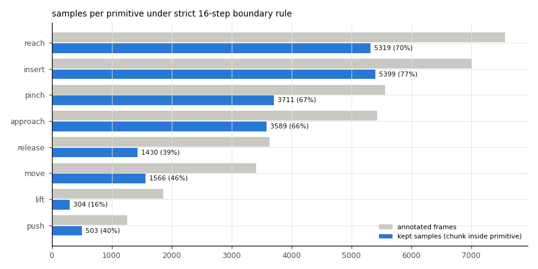

# Primitive annotation validation and sample construction — `insert_credit_card`

Code: `taptic/annotations.py` (`load_segments`, `validate`) and `taptic/convert.py`. Tests: `tests/taptic/test_a_dataset.py`.

## 1. Sources and the authoritative boundary

| Source | Unit | Role |
|---|---|---|
| per-frame `subtask_index` in the LeRobot data | frame | **authoritative** (what loaders see) |
| `meta/sources/insert_credit_card/meta/segments.csv` | `[start_frame, end_frame_exclusive)` | cross-check |
| `reviewed_segments.csv` | frames + `review_required`, notes | per-segment review flag (kept) |
| `lerobot_annotations.json` (LeRobot Annotate v1) | seconds | cross-check (× fps) |
| `language_persistent` (per-frame timeline) | seconds | cross-check |
| `boundary_review.csv`, `ambiguous_intervals.csv` | frames | boundary uncertainty / ambiguity flags (kept) |
| `subtasks.json` | label ↔ source index | label-set check; merged index remap reach 0, pinch 6, lift 2, move 4, approach 10, insert 11, release 5, push 12 |

**Result:** 100 episodes, **896 segments, 0 errors, 0 warnings**. All five sources agree on every boundary and label. Segments partition every episode: no gaps, no overlaps, ordered, starting at 0 and ending at the episode length. Episodes 646 and 684 (local 44 and 82) contain only `reach`.

## 2. Segment statistics

| primitive | segments | frames | length min / p25 / median / max | `review_required` |
|---|---|---|---|---|
| reach | 123 | 7,567 | 5 / 40 / 61 / 130 | 51 |
| pinch | 123 | 5,566 | 6 / 27.5 / 40 / 155 | 57 |
| lift | 106 | 1,866 | 10 / 14 / 17 / 35 | 32 |
| move | 100 | 3,413 | 9 / 23 / 31 / 80 | 19 |
| approach | 110 | 5,426 | 15 / 30 / 40 / 200 | 66 |
| insert | 107 | 7,015 | 18 / 38 / 56 / 213 | 103 |
| release | 175 | 3,637 | 3 / 10 / 15 / 109 | 173 |
| push | 52 | 1,256 | 11 / 16.75 / 23 / 57 | 52 |

The most frequent transitions are reach→pinch (121), approach→insert (106), pinch→lift (103), lift→move (99), move→approach (99), insert→release (97) and release↔push (52 each). Failed attempts and recoveries (release→reach 23, pinch→release 19, insert→approach 7) are preserved, not re-ordered.

## 3. Primitive samples (strict boundary rule)

A sample anchored at frame *t* has the action target `action[t..t+15]`, and all 16 frames must lie in **one** segment. Incomplete chunks are **dropped, not padded**. Real-time pauses > 150 ms inside the chunk also drop the sample (1,095 samples). Tactile history is not limited to the segment (§4).

| primitive | frames | valid chunks | kept (train / val) | frames lost | segments with ≥1 chunk | if the chunk tail could cross the boundary |
|---|---|---|---|---|---|---|
| reach | 7,567 | 5,761 | 5,319 (4,781 / 538) | 29.7 % | 114 / 123 | 7,537 |
| pinch | 5,566 | 3,750 | 3,711 (3,374 / 337) | 33.3 % | 118 / 123 | 5,566 |
| lift | 1,866 | 349 | **304 (287 / 17)** | **83.7 %** | 66 / 106 | 1,866 |
| move | 3,413 | 1,937 | 1,566 (1,378 / 188) | 54.1 % | 89 / 100 | 3,413 |
| approach | 5,426 | 3,776 | 3,589 (3,254 / 335) | 33.9 % | 108 / 110 | 5,422 |
| insert | 7,015 | 5,410 | 5,399 (4,976 / 423) | 23.0 % | 107 / 107 | 6,925 |
| release | 3,637 | 1,430 | 1,430 (1,387 / 43) | 60.7 % | 82 / 175 | 2,386 |
| push | 1,256 | 503 | 503 (427 / 76) | 60.0 % | 41 / 52 | 1,131 |
| **total** | 35,746 | 22,916 | **21,821 (19,864 / 1,957)** | 39.0 % | | |

**Class imbalance is substantial.** The largest/smallest kept ratio is **17.8×** (insert 5,399 vs lift 304). `lift` keeps only 16 % of its frames, and 40 of its 106 segments are shorter than 16 frames. The validation split has only 17 `lift` and 43 `release` samples, so per-primitive val metrics for those classes are noisy.

Options, in increasing deviation from strict exclusion. **None is implemented as the default**, because each changes the data semantics and needs your decision:

1. *Keep strict exclusion and re-weight sampling per primitive* (e.g. a weighted sampler). The targets are unchanged, but the official `EpisodeGroupedSampler` would need replacing.
2. *Anchor-in-primitive, tail may cross.* All 34,226 anchors become usable, but the target then mixes two primitives under one instruction.
3. *Hold-last-target padding.* This creates artificial "freeze" motion, which the task asked to avoid.

## 4. Observation history across boundaries

The tactile history (16 native samples ≈ 209 ms) is defined in time up to the anchor. It may contain samples from the preceding primitive (e.g. `insert` sees the end of `approach`). It never contains future samples or the sidecar pre-roll before the episode's first frame, and it never crosses a tactile re-zero or an episode boundary. The delayed tactile observation at *t+k* (k ∈ {0, 4, 8, 12}) satisfies *t+k* < `seg_end`, so it is always inside the primitive. This is tested.

## 5. Instructions

Written in the style of the official T-REX midtrain captions (https://huggingface.co/datasets/zekaiwang/trex_dataset: action + object + target + hand, e.g. "Place the knife into the cup with your left hand."), with objects from the annotation guide and no invented distractors (`taptic/instructions.py`; unknown task/primitive pairs raise instead of generating text):

| primitive | instruction |
|---|---|
| reach | Move your right hand toward the credit card. |
| pinch | Pinch the credit card with your right hand. |
| lift | Lift the credit card with your right hand. |
| move | Move the credit card toward the wallet with your right hand. |
| approach | Align the credit card with the wallet slot with your right hand. |
| insert | Insert the credit card into the wallet with your right hand. |
| release | Release the credit card with your right hand. |
| push | Push the credit card into the wallet with your right hand. |

Caveats from the guide: `release` also covers card loss and the final retreat, and `move` also covers carrying the card back to the support during recoveries.

## 6. Provenance kept per sample (`samples.parquet`)

Each sample records `episode`, `local_episode`, `frame`, `seg_id`, `primitive`, `instruction`, `seg_start/seg_end`, `review_required`, `frac_frames_flagged`, `overlaps_ambiguous`, `split`, `chunk_row` (row in `episodes/episode_XXXXXX.npz:chunks21`) and `max_delay_frame`. `manifest.json` stores the source path, revision, parameters and code git revision.
