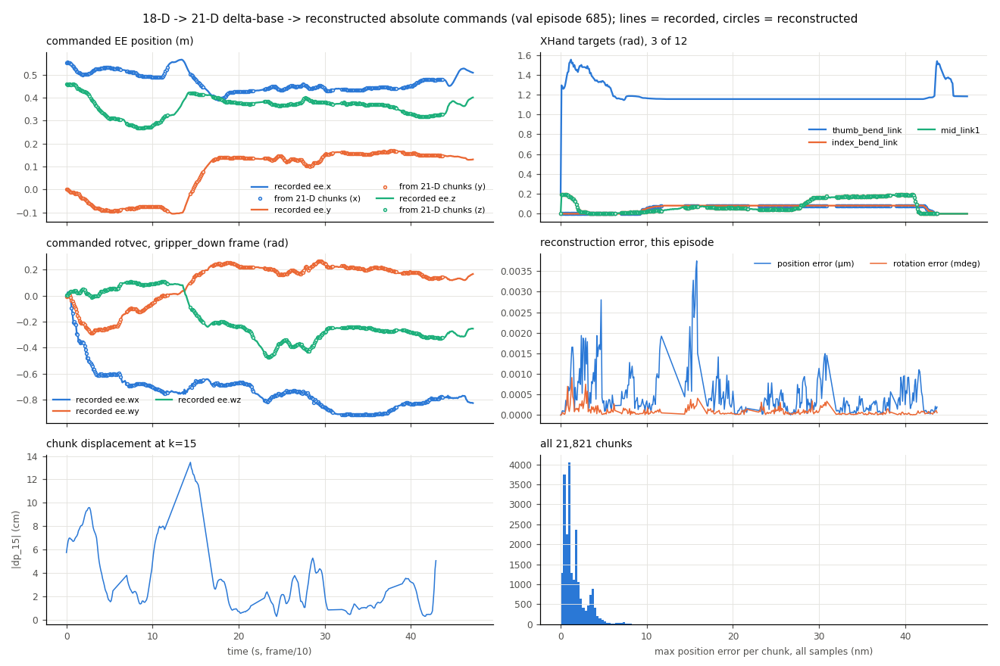

# Compatibility report — Panda + XHand adaptation vs. official T-REX (`full-pipeline`, b23eafe)

**Unchanged:** the Qwen3-VL backbone, the three-expert MoT and its attention routing, cascaded flow matching (10 total / split 6 → τ_split = 0.4), all loss definitions and weights (action flow, tactile flow, FLARE cosine 0.5), tactile dropout 0.1, delayed-tactile sampling {0, 4, 8, 12}, KV-cache slow/fast inference (`forward_flow_action_partial` / `tactile_flow_continue`), hidden size, VQ-VAE architecture and losses, the optimizer, the LR schedule and the DeepSpeed config.

## A. Changes to official files (all marked `[XHand adaptation]` in code)

| File | Change | Why |
|---|---|---|
| `qwen_vla/modeling_vla.py` | New `n_tactile_fingers` arg (default 10 = official). The VQ-VAE stats buffers are sized `n_tactile_fingers × tacf6_dim` (official: hard-coded 60). `encode_tactile_f6_history` takes fingers-per-hand from the VQ-VAE config (official: hard-coded 5) and raises on layout mismatch. `load_tactile_vqvae` checks the stats width. | The official code assumes `[B,T,10,6]`, two hands and 60-channel buffers. XHand is `[B,T,5,3]` with 15 channels. Changing only `in_channels` would silently fail. |
| `tactile_vqvae/models/decoder.py` | `F6Decoder` reshapes to `[n_fingers, per_finger_dim]` (official: hard-coded `5, 6`). | 5 × 3 output. |
| `tactile_vqvae/models/tactile_vqvae.py` | Passes `n_fingers`/`per_finger_dim` to the decoder and validates `in_channels == n_fingers·per_finger_dim`. | Same. |
| `tactile_vqvae/data/stats.py` | `TacF6Stats.dim` from the stats array (official: hard-coded 60). | 15-channel stats. |
| `tactile_vqvae/train.py` | `--data_format taptic`, `--taptic_dir`, `--n_fingers`, `--per_finger_dim`; `in_channels` derived (official: hard-coded 30); `--weight_tau ≤ 0` → automatic. | XHand data and units (B2). |
| `scripts/midtrain.py` | (1) `--tacf6_dim`, `--n_tactile_fingers` passed to the model. (2) `--data_format taptic` + `--taptic_dirs/--taptic_stats`. (3) Full checkpoint-loading report (`checkpoint_load_report.json`) next to the unchanged official load. (4) Single-process guards (DeepSpeed batch keys, `dist` calls, sampler rank/world size from accelerate). Without DeepSpeed: fp32 weights + bf16 autocast per step. (5) `--max_train_steps`, `--debug_checks` (smoke tests only; off by default). (6) `--tactile_norm_init` (default `zeros` = official, see B1). (7) Extra fields in `training_args.json`. | Interfaces, testability, non-silent loading. Under DeepSpeed (the real run) items 4–5 are no-ops. |

New files: `taptic/` (source reader, annotations, instructions, actions, tactile, converter, stats, video, ckpt report, remote ckpt index, figures), `qwen_vla/taptic_dataset.py`, `tactile_vqvae/data/taptic_windows.py`, `tactile_vqvae/eval_taptic.py`, `tactile_vqvae/config/vqvae_xhand_f3.yaml`, `tactile_vqvae/scripts/train_vqvae_xhand.sh`, `scripts/midtrain_xhand.sh`, `tests/taptic/*`, `docs/xhand/*`.

## B. Behavioural deviations / decisions (please review)

| # | Item | Official | Here | Reason |
|---|---|---|---|---|
| B1 | Tactile-expert RMSNorm re-init | every 1-D `_tactile` param → **0** | unchanged by default; `--tactile_norm_init ones` available | **Finding.** With zero `post_attention_layernorm_tactile`, every `mlp_tactile` receives input 0. That is an exact zero-gradient point (`silu(0)·up(0)=0` and its derivative is 0), so **264 M tactile-MLP parameters never train**. Measured on the tiny model over 6 steps: `mlp_tactile.up_proj` grad = 0.000 (zeros) vs 2.5 (ones); `tacf6_embedder` grad 1e-9 vs 0.17. The tactile attention path still learns via V and the final norm. The choice is yours. |
| B2 | VQ-VAE loss weight τ | 4.0 (F6 in N) | median raw magnitude of training contact windows = **50.76 counts** | Forces are raw counts. τ = 4 would saturate the weight for every contact window. |
| B3 | Codebook size | 1024 default / **64 in the shipped midtrain ckpt** | 64, `granularity="hand"` | matches the official midtrain VQ-VAE (`…_k64_…`) |
| B4 | Tactile normalization of degenerate channels | q01/q99 (divides by ~1e-8 if constant) | channels with q99−q01 < 1 count → [median−1, median+1] | middle/ring/little never touch the card; otherwise any 1-count blip → ±1 |
| B5 | Tactile stats source | midtrain: frames; VQ-VAE ckpt: manifest pool | **one** set fitted on native samples of **train episodes only**, shared by the VLA vector input and the VQ-VAE (same as official `--tactile_f6_stats_ckpt = VQVAE_CKPT`) | no leakage; train/inference identical |
| B6 | Tactile history time base | dataset frames | native sidecar samples (~76.4 Hz, 16 ≈ 209 ms), left-padded with oldest valid sample | the requested high-rate history; 10 Hz windows are never mixed (legacy 10 Hz tasks are refused by the converter) |
| B7 | "Current" tactile | the frame's stored value | freshest sample with `read_end_ns ≤ observation_ns` (median age 6.7 ms) | the state copy is up to 50 ms stale; this is what a real-time robot reads |
| B8 | Fast images | 2 (right + left wrist) | 1 (`wrist`); slow = `left` overhead | the robot has one close camera; nothing is duplicated |
| B9 | Train/val split | random 2 % of episodes at launch | fixed episode-level split from `split.json` (10 %, seed 42); `--val_ratio` only enables val | reproducible, no leakage |
| B10 | Samples | every frame, chunk clamped/padded at episode end | only chunks fully inside one primitive and with no teleop pause | primitive-level data; no artificial motion |
| B11 | Video decoding | whole episode decoded into RAM per worker | lazy seek+decode (AV1 GOP 2, ~2 ms/frame) | memory; identical pixels |
| B12 | Smoke-path precision | DeepSpeed bf16 | fp32 master + bf16 autocast when DeepSpeed is absent | only for local tests (no `nvcc` here to install DeepSpeed) |

Retained: FLARE futures at *t* + 4·(k+1), k < 8 (up to 3.2 s), clamped at the episode end as in the official code (4.0 % of samples are clamped). These may cross primitive boundaries. They are prediction targets, not inputs.

## C. Action representation

`a_k = [R_tᵀ(p_{t+k} − p_t) (3), first two columns of R_tᵀR_{t+k} (6), q_XHand,t+k (12)]`, k = 0..15. The reference (p_t, R_t) is the **measured** flange pose at *t* and the targets are **commanded** poses, as in the official `gen_json_tac_deltabase_eef_bimanual_parallel.py`. Hand values are **absolute** targets, as in the official preprocessing. Normalization: per-(step, dim) q01/q99 over train chunks, as in official midtrain. Inverse error over all 21,821 chunks: ≤ 1.4e-8 m and 4.0e-8 rad. Deployment must reconstruct absolute commands with `taptic.actions.reconstruct_chunk` and the measured pose at the chunk start.

## D. Dimensions

| Tensor | Official | XHand |
|---|---|---|
| `x_embedder` | ActionEmbedder(62 → 2048) | ActionEmbedder(**21** → 2048) |
| `final_layer`, `final_layer_tactile` | FinalLayer(2048 → 62) | FinalLayer(2048 → **21**) |
| `tacf6_embedder` | ActionEmbedder(6 → 2048), 10 tokens | ActionEmbedder(**3** → 2048), **5** tokens |
| VQ-VAE | `[B,16,5,6]` per hand × 2 hands, `in_channels` 30 | `[B,16,5,3]`, 1 hand, `in_channels` **15** |
| VQ code tokens | 2 (hand) / 10 (finger) | **1** (hand) |
| tactile observation tokens | 2 + 10 + 10 deform | **1 + 5** (no deform) |
| tactile expert sequence per fast tick | n_obs + 1 + 16 | **6 + 1 + 16 = 23** (verified via KV-cache length) |
| `state_embedder` | 62 → 2048 (pretrain) | not built (`use_robot_state=0`) |

## E. Checkpoint initialisation (`miniFranka/T-Rex_pretrain_mecka22k_epoch1`)

The 10 GB `model.pt` was **not downloaded** (8.3 GB free disk). Its exact tensor index (1,272 tensors, bf16) was read remotely from the zip directory (`taptic/remote_ckpt_index.py`). It was then classified against the 21-D model built on the meta device (`taptic/ckpt_report.py`), using the official resume rules. Full list: `~/midtrain_merge/derived/trex_pretrain_meta/checkpoint_load_report_21d.json`.

| Status | Params | What |
|---|---|---|
| **loaded unchanged** | 3,562.7 M | vision tower (407 M), token embeddings, latent expert (all layers), **action expert** (attention + MLP, all layers), `norm`, `norm_action`, `t_embedder`, FLARE queries + projector, `x_embedder.fc1.bias` + `fc2`, `final_layer.fc1`, `tacf6_embedder.fc1.bias` + `fc2` |
| shape mismatch → fresh init | 0.09 M | `x_embedder.mlp.fc1.weight` [2048,62]→[2048,21]; `final_layer.mlp.fc2.{weight,bias}` 62→21 (zero init, official); `final_layer_tactile.mlp.fc2.*`; `tacf6_embedder.mlp.fc1.weight` [2048,6]→[2048,3]; 84 `mlp_tactile` tensors 6144→1536 |
| re-initialised tactile expert (official, `resume_source=pretrain`) | 620.9 M | all `*_tactile` attention / MLP / norms + `final_layer_tactile` |
| missing in ckpt → init | 0.13 M | `tactile_code_embedder` (64 × 2048, N(0, 0.02)) |
| from the XHand VQ-VAE ckpt | 0.94 M | `tactile_vqvae.*`, `tacf6_vqvae_{min,max,mask}` [15] (frozen) |
| unexpected (ignored) | — | `state_embedder.*` (pretrain used robot state) |

Mixed-tensor note (official behaviour, kept): in `x_embedder`, `final_layer` and `tacf6_embedder` the matching tensors load while the mismatched ones re-initialise. `training_args.json` of new checkpoints records `action_dim=21, tacf6_dim=3, n_tactile_fingers=5, vqvae_config` and the data source. The pretrain `stats_data.json` (62-D egodex) is not used.

## F. High-frequency tactile synchronization

| Question | Answer |
|---|---|
| 10 Hz ↔ tactile relation | ≈ 7.6 tactile samples per frame. Both streams share `CLOCK_MONOTONIC`; `observation_ns` (frame) and `read_end_ns` (sample) are compared directly. |
| Official delayed-tactile simulation | `k ~ U{0,4,8,12}` frames after the chunk anchor *t*. The tactile expert sees the observation at *t+k*, standing in for a fast tick fired *k* frames into chunk execution. Preserved; here the observation is the freshest native sample at `observation_ns[t+k]`. |
| Fast-inference refresh | Unchanged mechanism: one slow tick (action expert, 6/10 Euler steps, KV cached), then a fast tick (`tactile_flow_continue`, 4 steps) with a fresh `[5,3]` reading + 16-sample window. |
| Effective update rate | **Training:** tactile inputs sampled at frames *t*+{0,4,8,12} (0–1.2 s after the anchor). **Evaluation (official protocol):** the tactile expert receives a new observation at every fast tick, i.e. every 4 control frames = **2.5 Hz**, and each observation summarizes the last ≈ 209 ms at 76 Hz. Acquisition at 76 Hz does **not** mean 76 Hz inference. |

Source for the cadence: `scripts/test.py` docstring ("slow every 16 robot steps, fast at offsets 0, 4, 8, 12").

## G. Not adapted (known blockers for robot evaluation)

- `scripts/test.py` (ZeroMQ inference server) still assumes `[10,6]` F6 inputs, a `[W,10,6]` rolling buffer and 62-D outputs. It must be adapted the same way before closed-loop evaluation: `[5,3]` forces, the 16-sample native-rate buffer built with `taptic.tactile.EpisodeTactile`, and 21-D outputs denormalized with `stats_data.json` and converted with `taptic.actions.reconstruct_chunk`. This was not done here.
- `scripts/train.py` (post-train) and `utils/merge_vqvae_into_ckpt.py` are untouched.
- Full-size training was not run locally. The 5 B-parameter model needs multi-GPU DeepSpeed (official: 8 × GPU, batch 16/GPU), and this machine has one 8 GB GPU. Tests F and G run the real code paths on a reduced-size Qwen3-VL (`tests/taptic/tiny_qwen3vl.py`).
