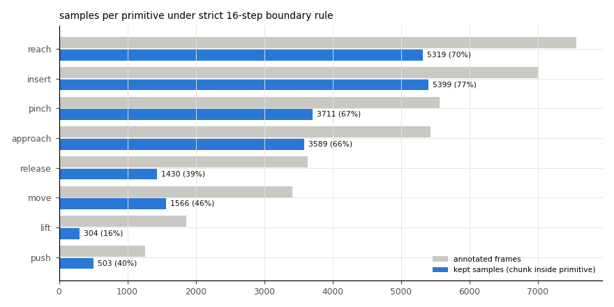
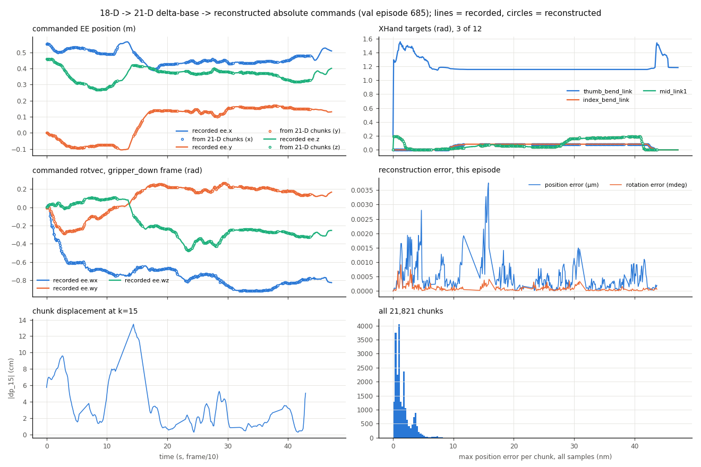
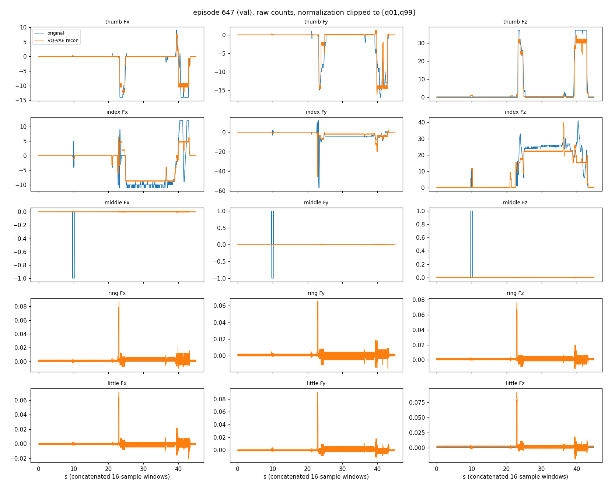

# T-REX su Panda + RobotEra XHand — guida completa

Questa guida spiega **cosa è stato fatto, perché, dove si trova nel codice** e **come addestrare e testare** la baseline T-REX sui dati TAPTIC annotati per primitive.

Tutti i link puntano ai file del repository; i numeri di riga si riferiscono allo stato attuale (non ancora committato) del branch `full-pipeline`.

Report di approfondimento (in inglese):
- [DATASET_AUDIT.md](DATASET_AUDIT.md): cosa contengono i dati, campo per campo.
- [ANNOTATION_REPORT.md](ANNOTATION_REPORT.md): validazione delle primitive e numero di esempi.
- [COMPATIBILITY.md](COMPATIBILITY.md): elenco formale di ogni differenza rispetto a T-REX ufficiale.

---

## Indice

1. [In una pagina](#1-in-una-pagina)
2. [Glossario minimo](#2-glossario-minimo)
3. [I dati: cosa ho scoperto](#3-i-dati-cosa-ho-scoperto)
4. [Dalle dimostrazioni alle primitive](#4-dalle-dimostrazioni-alle-primitive)
5. [Azioni: da 18 a 21 numeri](#5-azioni-da-18-a-21-numeri)
6. [Tatto: 5 dita × 3 forze](#6-tatto-5-dita--3-forze)
7. [Il VQ-VAE tattile riaddestrato](#7-il-vq-vae-tattile-riaddestrato)
8. [Il DataLoader per T-REX](#8-il-dataloader-per-t-rex)
9. [Modifiche al modello e allo script di training](#9-modifiche-al-modello-e-allo-script-di-training)
10. [Checkpoint pre-addestrato: cosa si riusa](#10-checkpoint-pre-addestrato-cosa-si-riusa)
11. [Test](#11-test)
12. [Come addestrare (passo per passo)](#12-come-addestrare-passo-per-passo)
13. [Come testare in inferenza](#13-come-testare-in-inferenza)
14. [Decisioni aperte e limiti](#14-decisioni-aperte-e-limiti)
15. [Mappa di tutti i file](#15-mappa-di-tutti-i-file)

---

## 1. In una pagina

**Obiettivo.** Addestrare T-REX (Qwen3-VL + 3 esperti Mixture-of-Transformers + cascaded flow matching) sul robot Panda + mano XHand **senza cambiare l'algoritmo**. Si cambiano solo:

| | T-REX ufficiale | Questo adattamento |
|---|---|---|
| Azione | 62 numeri (2 braccia + 2 mani a 22 giunti) | **21** = spostamento (3) + rotazione 6D (6) + 12 giunti XHand |
| Tatto attuale | `[10, 6]` (10 dita, forza+momento) | **`[5, 3]`** (5 polpastrelli, Fx Fy Fz) |
| Storia tattile per il VQ-VAE | `[16, 10, 6]` | **`[16, 5, 3]`**, a ~76 Hz (≈ 0,2 s) |
| Mappe di deformazione | sì | **no** |
| Stato del robot come input | (pretrain sì) | **no** |
| Camere | 1 lenta + 2 veloci (polsi) | **1 lenta (`left`) + 1 veloce (`wrist`)** |
| Dati | dimostrazioni intere | **primitive annotate** (reach, pinch, lift, …) |

**Cosa è rimasto identico:** backbone Qwen3-VL, i 3 esperti (latent, action, tactile), cascaded flow matching 10 passi con split al passo 6 (τ_split = 0,4), tutte le loss (action, tactile, FLARE), tactile dropout 0,1, ritardi tattili {0,4,8,12}, KV-cache e inferenza lenta/veloce, ottimizzatore, scheduler, config DeepSpeed.

**Risultati principali:**
- 21.821 esempi di training (19.864 train / 1.957 val), split per episodio.
- Conversione delle azioni invertibile: errore ≤ 1,4·10⁻⁸ m e 4·10⁻⁸ rad su tutti i blocchi.
- VQ-VAE XHand addestrato (1 minuto): errore 4,6× più basso di una baseline costante, nessun collasso del codebook.
- 29 test automatici, tutti superati.
- Del checkpoint pre-addestrato si riusano **3,56 miliardi di parametri**.

---

## 2. Glossario minimo

- **Primitiva:** una fase della manipolazione (reach = avvicinarsi, pinch = afferrare a pinza, lift = sollevare, move = trasportare, approach = allinearsi alla fessura, insert = inserire, release = rilasciare, push = spingere).
- **Chunk (blocco):** T-REX non predice un'azione alla volta ma 16 azioni future insieme (`[16, 21]`).
- **Delta-base:** le azioni del blocco sono espresse *relative* alla posa misurata della mano all'inizio del blocco.
- **Flow matching:** il modello parte da rumore e lo "pulisce" in 10 passi fino a ottenere il blocco di azioni.
- **Cascaded:** i primi 6 passi li fa l'**Action Expert** (vede immagini e testo), gli ultimi 4 il **Tactile Expert** (vede anche il tatto fresco).
- **Tick lento / tick veloce:** in inferenza il tick lento (immagini, costoso) gira una volta ogni 16 passi; il tick veloce (tatto, leggero) gira ai passi 0, 4, 8, 12.
- **VQ-VAE:** piccola rete che comprime gli ultimi 16 campioni tattili in **un numero intero** (un "codice" tra 64 possibili). Il codice diventa un token per il Tactile Expert.
- **FLARE:** loss ausiliaria in cui il modello predice caratteristiche di frame futuri della camera.
- **Sidecar:** file separati (`tactile_raw/`) con il flusso tattile ad alta frequenza, accanto al dataset LeRobot a 10 Hz.

---

## 3. I dati: cosa ho scoperto

Dettagli completi in [DATASET_AUDIT.md](DATASET_AUDIT.md). Ogni affermazione è stata verificata sui dati, non dedotta dai nomi.

### 3.1 Due copie equivalenti dei dati

| Copia | Percorso | Episodi |
|---|---|---|
| Download completo dall'Hub | `~/midtrain_merge/src/insert_credit_card` (722 MB) | 0–99 |
| Dataset "merged" multi-task | `~/midtrain_merge/TAPTIC/midtrain_dataset` | 602–701 |

Sono identiche (stessi dati alla revisione `c3f6701`), e la conversione da entrambe produce esattamente lo stesso risultato (test [test_a2_hub_layout.py](../../tests/taptic/test_a2_hub_layout.py)). La copia nella cache `~/.cache/huggingface/...` invece è **incompleta** (scaricati solo metadati e parquet).

Il lettore che riconosce automaticamente i due formati è [`TapticSource`](../../taptic/source.py#L57).

### 3.2 Convenzioni verificate

| Domanda | Risposta | Come l'ho verificato |
|---|---|---|
| Cosa sono `ee.wx, wy, wz`? | **Vettore di rotazione** (asse-angolo, rad) nel frame "gripper_down": `R_base = Rx(π) · Rot(rotvec)` | Cinematica diretta sui giunti registrati: errore < 2·10⁻⁷ rad; con l'ipotesi alternativa l'errore è 3,14 rad |
| Punto e frame della posizione | flangia `panda_link8`, frame base URDF, metri | stessa verifica (errore < 7·10⁻⁸ m) |
| Giunti Panda nello stato | **gradi** (non radianti) | cinematica diretta |
| `action` è misurata o comandata? | **comandata** | `action[t]` è più vicina a `stato[t+1]` (4,5 mm) che a `stato[t]` (7,2 mm) |
| Giunti XHand nell'azione | target **assoluti** in radianti | dati + codice del recorder |

Test corrispondente: [`test_orientation_convention_by_forward_kinematics`](../../tests/taptic/test_b_actions.py).

### 3.3 Tatto e tempi

- Il flusso tattile va a **76,4 Hz** (intervallo mediano 13,09 ms), non a 80 Hz.
- Le forze sono **conteggi grezzi** del SDK (interi; Fx, Fy con segno, Fz ≥ 0). Non esiste una calibrazione in newton documentata, quindi non converto unità.
- In `insert_credit_card` toccano la carta **solo pollice e indice**; medio, anulare e mignolo sono sempre a zero.
- I timestamp LeRobot sono uniformi (0,1 s), ma i tempi reali hanno circa **una pausa di teleoperazione per episodio** (0,7–9,6 s).
- In un episodio (606) il sensore viene ri-azzerato a metà.
- `observation.haptics.*` è il guanto WEART dell'operatore, non il tatto del robot: non viene usato.

---

## 4. Dalle dimostrazioni alle primitive

Codice: [taptic/annotations.py](../../taptic/annotations.py), [taptic/convert.py](../../taptic/convert.py), [taptic/instructions.py](../../taptic/instructions.py). Report: [ANNOTATION_REPORT.md](ANNOTATION_REPORT.md).

### 4.1 Lettura e validazione delle annotazioni

[`load_segments`](../../taptic/annotations.py#L56) ricostruisce i segmenti dal `subtask_index` per-frame (la fonte che usano i loader). [`validate`](../../taptic/annotations.py#L82) li confronta con le altre 4 fonti:

- `segments.csv`
- `reviewed_segments.csv`
- `lerobot_annotations.json`
- la timeline `language_persistent`

**Risultato:** 896 segmenti, **0 discrepanze**, nessun buco, nessuna sovrapposizione. Per ogni segmento si conservano i flag di revisione (`review_required`, incertezza dei confini, intervalli ambigui).

### 4.2 Istruzioni per primitiva

In [instructions.py](../../taptic/instructions.py). Lo stile copia le `caption` del dataset ufficiale di midtrain di T-REX ([zekaiwang/trex_dataset](https://huggingface.co/datasets/zekaiwang/trex_dataset)): lì ogni episodio è una primitiva con una frase imperativa in inglese che nomina azione, oggetto, eventuale destinazione e mano (es. episodio 93, `lift_and_place`: *"Place the knife into the cup with your left hand."*). L'etichetta della primitiva non arriva al modello: arriva solo la frase.

Regole usate:

- solo verbi presenti nelle loro caption (move … toward, pinch, grasp, lift, place … onto/into, insert, push, squeeze, wipe, unscrew, release, align);
- sempre *"with your right hand"* (l'unica mano del robot);
- oggetti e destinazioni presi dalle guide di annotazione e dalla frase del task;
- gli oggetti di disturbo (*"past the mug"*, *"leaving the cup in place"*) non sono annotati in TAPTIC, quindi non vengono aggiunti.

Le frasi per tutti i 9 task del midtrain_dataset sono già nel file. Se una coppia task/primitiva manca la conversione si ferma: non vengono generate frasi.

| primitiva | istruzione (`insert_credit_card`) |
|---|---|
| reach | Move your right hand toward the credit card. |
| pinch | Pinch the credit card with your right hand. |
| lift | Lift the credit card with your right hand. |
| move | Move the credit card toward the wallet with your right hand. |
| approach | Align the credit card with the wallet slot with your right hand. |
| insert | Insert the credit card into the wallet with your right hand. |
| release | Release the credit card with your right hand. |
| push | Push the credit card into the wallet with your right hand. |

### 4.3 Regole per creare gli esempi

Un esempio parte dal frame *t* e il suo obiettivo sono le azioni *t…t+15*. Viene tenuto ([`convert`](../../taptic/convert.py#L66)) solo se:

1. tutti i 16 frame stanno **nella stessa primitiva** (mai a cavallo di due primitive o due episodi; nessun padding artificiale);
2. non c'è una **pausa** > 150 ms dentro il blocco;
3. esiste una lettura tattile disponibile al frame *t*.

La **storia tattile invece può guardare indietro nella primitiva precedente** (es. `insert` vede la fine di `approach`), perché quell'informazione era davvero disponibile in quel momento. Non usa mai campioni futuri e non esce dall'episodio.

### 4.4 Quanti esempi restano

| primitiva | frame | esempi (train / val) | frame persi |
|---|---|---|---|
| reach | 7.567 | 5.319 (4.781 / 538) | 30 % |
| pinch | 5.566 | 3.711 (3.374 / 337) | 33 % |
| lift | 1.866 | **304 (287 / 17)** | **84 %** |
| move | 3.413 | 1.566 (1.378 / 188) | 54 % |
| approach | 5.426 | 3.589 (3.254 / 335) | 34 % |
| insert | 7.015 | 5.399 (4.976 / 423) | 23 % |
| release | 3.637 | 1.430 (1.387 / 43) | 61 % |
| push | 1.256 | 503 (427 / 76) | 60 % |

Le primitive brevi (lift ha mediana 17 frame) perdono quasi tutto: lo **sbilanciamento è 17,8×**. Vedi [§14](#14-decisioni-aperte-e-limiti).



### 4.5 Train / validation

[`episode_split`](../../taptic/convert.py#L51) divide per **episodio** (seed 42, 10 % val), quindi nessun episodio sta in entrambi gli insiemi. Episodi val (numerazione Hub): 0, 10, 22, 39, 44, 45, 53, 70, 80, 83. Lo split è salvato in `split.json` e riusato identico da VQ-VAE e T-REX.

### 4.6 Cosa produce il convertitore

```
<out>/insert_credit_card/
  episodes/episode_XXXXXX.npz   stato, azioni, tempi, flusso tattile, blocchi 21-D
  samples.parquet               un esempio per riga (episodio, frame, primitiva, istruzione, split, flag)
  segments.parquet              tutti i segmenti + conteggi
  split.json                    split per episodio
  norm_stats.json               statistiche di normalizzazione (solo train)
  conversion_report.json        conteggi, perdite, tempi
  manifest.json                 sorgente, revisione, parametri, versione del codice
```

---

## 5. Azioni: da 18 a 21 numeri

Codice: [taptic/actions.py](../../taptic/actions.py).

**Formula** (identica a quella ufficiale in `utils/gen_json_tac_deltabase_eef_bimanual_parallel.py`), implementata in [`chunk_21d`](../../taptic/actions.py#L59). Per k = 0…15:

- `Δp_k = R_tᵀ (p_{t+k} − p_t)`, dove `p_t, R_t` = posa **misurata** al frame t e `p_{t+k}` = posa **comandata** a t+k;
- `ΔR_k = R_tᵀ R_{t+k}`, di cui si tengono le prime 2 colonne (6 numeri);
- giunti XHand = target **assoluti** a t+k (come nell'originale, nessun delta).

**Trappola evitata:** la rotazione relativa è uguale nei due frame (gripper_down o assoluto), ma la posizione no. Per questo uso la rotazione vera della flangia, [`rotvec_gd_to_matrix`](../../taptic/actions.py#L37).

**Inversa:** [`reconstruct_chunk`](../../taptic/actions.py#L80) riporta un blocco 21-D a comandi assoluti 18-D. **È la funzione da usare in inferenza.**

**Normalizzazione:** quantili 1 % / 99 % per ogni (passo del blocco, dimensione), calcolati solo sul train (come il midtrain ufficiale).



---

## 6. Tatto: 5 dita × 3 forze

Codice: [taptic/tactile.py](../../taptic/tactile.py).

- **Fonte:** `calc_force` del SDK XHand dal flusso a 76 Hz. È lo stesso valore che il recorder copia nello stato (verificato), ma più fresco.
- **Ordine:** pollice, indice, medio, anulare, mignolo × (x, y, z).
- **Lettura attuale `[5,3]`:** [`latest_index`](../../taptic/tactile.py#L53) prende l'ultimo campione con `read_end_ns ≤ observation_ns` del frame, quindi mai dal futuro. Età mediana 6,7 ms; quella copiata nello stato può essere vecchia fino a ~50 ms.
- **Storia `[16,5,3]`:** [`window_indices`](../../taptic/tactile.py#L58) prende i 16 campioni più recenti (~209 ms). Se mancano campioni completa ripetendo il più vecchio, come fa l'originale.
  - non entra nel pre-roll registrato prima dell'episodio;
  - non attraversa un ri-azzeramento del sensore.
- **Normalizzazione:** [`TactileNorm`](../../taptic/tactile.py#L84) è identica a T-REX: `2·(x − q01)/(q99 − q01) − 1`, limitata a [−1, 1], con q01/q99 calcolati solo sugli episodi di train.
  - Unica aggiunta: i canali praticamente costanti (medio, anulare, mignolo, dove q99 − q01 < 1) usano l'intervallo [mediana − 1, mediana + 1]. Altrimenti si dividerebbe per ~0 e un singolo conteggio diventerebbe ±1.
  - Le stesse statistiche servono al vettore tattile e al VQ-VAE (come fa l'originale).

---

## 7. Il VQ-VAE tattile riaddestrato

Architettura ufficiale invariata (encoder convoluzionale temporale, quantizzazione EMA, decoder, loss di ricostruzione + commitment). Cambiano solo le dimensioni.

**Modifiche al codice ufficiale:**
- [decoder.py#L45-L56](../../tactile_vqvae/models/decoder.py#L45) e [#L109](../../tactile_vqvae/models/decoder.py#L109): l'uscita era fissa a `5, 6`, ora è `n_fingers, per_finger_dim`.
- [tactile_vqvae.py#L56-L60](../../tactile_vqvae/models/tactile_vqvae.py#L56) e [#L97](../../tactile_vqvae/models/tactile_vqvae.py#L97): passa le dimensioni al decoder e controlla che `in_channels = 5 × 3 = 15`.
- [stats.py#L28](../../tactile_vqvae/data/stats.py#L28): la larghezza delle statistiche era fissa a 60, ora viene dai dati.
- [train.py#L50-L56](../../tactile_vqvae/train.py#L50), [#L127](../../tactile_vqvae/train.py#L127), [#L232-L245](../../tactile_vqvae/train.py#L232): formato dati `taptic`, `in_channels` calcolato, `weight_tau` automatico.

**File nuovi:**
- [taptic_windows.py](../../tactile_vqvae/data/taptic_windows.py): finestre `[16,5,3]` dagli episodi di train, con la **stessa regola** del DataLoader T-REX.
- [eval_taptic.py](../../tactile_vqvae/eval_taptic.py): valutazione completa.
- [vqvae_xhand_f3.yaml](../../tactile_vqvae/config/vqvae_xhand_f3.yaml): configurazione.
- [train_vqvae_xhand.sh](../../tactile_vqvae/scripts/train_vqvae_xhand.sh): script di lancio.

**Configurazione:** finestra 16, 15 canali, `granularity="hand"` (1 codice per mano), codebook 64 (come il VQ-VAE ufficiale del midtrain).

Unico iper-parametro cambiato: `weight_tau`, il peso extra alle finestre con contatto. L'originale (4,0) era pensato per forze in newton; con conteggi grezzi saturerebbe sempre. Viene quindi impostato automaticamente alla mediana della magnitudine delle finestre con contatto (50,76).

**Risultati sui 10 episodi di validazione:**

| metrica | valore |
|---|---|
| errore di ricostruzione (normalizzato) | 0,0087 (contatto 0,0150, aria libera 0,00008); baseline costante 0,040 |
| per dito | pollice 0,021, indice 0,021, gli altri ≈ 0 (nessun contatto nel task) |
| codebook | 28/64 codici usati, perplessità 8,6; tutte le finestre in aria → 1 codice (45 %) |
| allineamento temporale | ritardo 0 tra originale e ricostruzione |



Durante il midtraining il VQ-VAE è **congelato** (come nell'originale).

---

## 8. Il DataLoader per T-REX

Codice: [qwen_vla/taptic_dataset.py](../../qwen_vla/taptic_dataset.py) ([`TRexTapticDataset`](../../qwen_vla/taptic_dataset.py#L52)).

Sostituisce `MidtrainTacFlareDataset` con la stessa interfaccia, quindi il loop di training ufficiale non cambia. Per ogni esempio ([`__getitem__`](../../qwen_vla/taptic_dataset.py#L159)):

1. legge il blocco `[16,21]` precalcolato;
2. sceglie un ritardo k ∈ {0,4,8,12} e prende il tatto al tempo reale del frame t+k (simula il tick veloce, come l'originale). t+k resta sempre dentro la primitiva;
3. costruisce la storia `[16,5,3]` che termina in quel momento;
4. decodifica al volo (~2 ms/frame): immagine lenta (`left`, frame t), immagine veloce (`wrist`, frame t) e 8 frame futuri per FLARE (`left`, t+4, t+8, …, t+32; limitati alla fine dell'episodio come nell'originale);
5. usa come testo **l'istruzione della primitiva**.

[`collate_fn`](../../qwen_vla/taptic_dataset.py#L198) produce esattamente le chiavi del codice ufficiale:

| chiave | forma |
|---|---|
| `input_ids`, `attention_mask` | `[B, L]` (prompt: immagine lenta, testo, immagine veloce) |
| `pixel_values`, `image_grid_thw` | 2 immagini per esempio |
| `noisy_actions`, `target`, `norm_actions`, `eps_r` | `[B,16,21]` |
| `timesteps`, `time_r` | `[B]` |
| `tactile_f6s`, `tactile_f6s_delayed` | `[B,5,3]` normalizzati |
| `tactile_f6_history` | `[B,16,5,3]` grezzi (li normalizza il modello) |
| `flare_pixel_values`, `flare_grid_thw` | 8 frame futuri per esempio |
| `state_raw`, `tactile_deforms`, `tactile_codes` | `None` |

La seconda camera del polso **non esiste** su questo robot e **non viene duplicata**. Lo split val viene da `split.json` ([`create_val_split`](../../qwen_vla/taptic_dataset.py#L128)).

---

## 9. Modifiche al modello e allo script di training

### 9.1 [qwen_vla/modeling_vla.py](../../qwen_vla/modeling_vla.py)

Le teste si adattano già da sole con `action_dim=21` e `tacf6_dim=3`:
- [`x_embedder`, `final_layer`, `final_layer_tactile`, `tacf6_embedder`](../../qwen_vla/modeling_vla.py#L105);
- il Tactile Expert riceve 1 token-codice + 5 token-dito = 6 token.

Il codice ufficiale però presupponeva 2 mani × 5 dita × 6 valori in tre punti, e li ho resi generici:

| Dove | Prima | Dopo |
|---|---|---|
| [L73](../../qwen_vla/modeling_vla.py#L73), [L80](../../qwen_vla/modeling_vla.py#L80) | — | nuovo parametro `n_tactile_fingers` (default 10 = originale, qui 5) |
| [L144-L160](../../qwen_vla/modeling_vla.py#L144) | buffer di normalizzazione VQ-VAE fissi a 60 | dimensione `n_tactile_fingers × tacf6_dim` (= 15) + controlli |
| [L339](../../qwen_vla/modeling_vla.py#L339) | — | errore se le statistiche del VQ-VAE non hanno la larghezza giusta |
| [L355-L395](../../qwen_vla/modeling_vla.py#L355) `encode_tactile_f6_history` | `n_hands = NF // 5` fisso, forma `[B,T,10,6]` | dita per mano dal config del VQ-VAE; forma `[B,T,5,3]` → 1 codice; errore se la forma non torna |

Nessuna modifica a MoT, attenzione, flow matching, loss o inferenza.

### 9.2 [scripts/midtrain.py](../../scripts/midtrain.py)

| Riga | Modifica | Perché |
|---|---|---|
| [L1377-L1380](../../scripts/midtrain.py#L1377) | passa `tacf6_dim`, `n_tactile_fingers` al modello | dimensioni XHand |
| [L1405-L1440](../../scripts/midtrain.py#L1405) | dopo il caricamento ufficiale (invariato) scrive `checkpoint_load_report.json` | nessun mismatch silenzioso |
| [L1448-L1458](../../scripts/midtrain.py#L1448) | opzione `--tactile_norm_init` (default = originale) | vedi [§14](#14-decisioni-aperte-e-limiti) |
| [L1507-L1510](../../scripts/midtrain.py#L1507) | `--data_format taptic` → `TRexTapticDataset` | nuovi dati |
| [L1320-L1324](../../scripts/midtrain.py#L1320), [L1114](../../scripts/midtrain.py#L1114), [L1290](../../scripts/midtrain.py#L1290), [L1539](../../scripts/midtrain.py#L1539) | funziona anche con 1 processo senza DeepSpeed | test locali |
| [L1470-L1482](../../scripts/midtrain.py#L1470), [L1607](../../scripts/midtrain.py#L1607) | senza DeepSpeed: pesi fp32 + autocast bf16 | test locali (con DeepSpeed non fa nulla) |
| [L1828-L1870](../../scripts/midtrain.py#L1828) | `--debug_checks`: verifica loss/gradienti finiti e aggiornamento dei pesi | smoke test (spento di default) |
| [L1907-L1915](../../scripts/midtrain.py#L1907) | `--max_train_steps` | smoke test |
| [L1090](../../scripts/midtrain.py#L1090) | `training_args.json` salva le nuove dimensioni | tracciabilità |
| [L1932-L1950](../../scripts/midtrain.py#L1932) | nuovi argomenti da riga di comando | — |

Ogni modifica nel codice è marcata con il commento `[XHand adaptation]`. Per vedere tutte le differenze rispetto all'originale: `git diff` (sono stati modificati solo 6 file ufficiali).

---

## 10. Checkpoint pre-addestrato: cosa si riusa

Checkpoint: `miniFranka/T-Rex_pretrain_mecka22k_epoch1` (10 GB, non scaricato per spazio disco).

L'elenco esatto dei suoi 1.272 tensori l'ho letto **da remoto** ([remote_ckpt_index.py](../../taptic/remote_ckpt_index.py)). Poi li ho confrontati con il modello 21-D con le stesse regole dello script ufficiale ([ckpt_report.py](../../taptic/ckpt_report.py)).

| Stato | Parametri | Cosa |
|---|---|---|
| **caricati invariati** | 3.562,7 M | visione, embedding, esperto latent, **esperto action completo**, FLARE, timestep embedder, parti compatibili delle teste |
| dimensione diversa → ri-inizializzati | 0,09 M | `x_embedder.fc1.weight` (62→21), `final_layer.fc2` (62→21), `final_layer_tactile.fc2`, `tacf6_embedder.fc1.weight` (6→3) |
| Tactile Expert ri-inizializzato (regola ufficiale) | 620,9 M | tutto `*_tactile` |
| non presenti → nuovi | 0,13 M | `tactile_code_embedder` (64 codici) |
| dal checkpoint VQ-VAE | 0,94 M | VQ-VAE congelato + statistiche `[15]` |
| ignorati | — | `state_embedder` (lo stato non è usato) |

Report completo: `~/midtrain_merge/derived/trex_pretrain_meta/checkpoint_load_report_21d.json`. Lo stesso report viene scritto a ogni training in `<run>/checkpoint_load_report.json`.

---

## 11. Test

```bash
cd ~/T-Rex
PYTEST_DISABLE_PLUGIN_AUTOLOAD=1 ~/trex-venv/bin/python -m pytest -q -p no:cacheprovider tests/taptic
# 29 test, ~35 s
```

`PYTEST_DISABLE_PLUGIN_AUTOLOAD=1` serve perché i plugin pytest di ROS presenti nel `PYTHONPATH` rompono l'avvio.

| Test | File | Cosa verifica |
|---|---|---|
| A | [test_a_dataset.py](../../tests/taptic/test_a_dataset.py) | episodi contigui; 5 fonti di annotazione coerenti; nessun esempio attraversa primitive, episodi o pause; split per episodio e riproducibile |
| A2 | [test_a2_hub_layout.py](../../tests/taptic/test_a2_hub_layout.py) | download Hub ≡ copia merged; il loader legge i video dell'Hub |
| B | [test_b_actions.py](../../tests/taptic/test_b_actions.py) | tutti i 21.821 blocchi `[16,21]` ricalcolati; inversa < 10⁻⁵; rot6D ortonormale; riferimento = posa misurata; convenzione dimostrata con cinematica diretta; ordine dei giunti |
| C | [test_c_tactile.py](../../tests/taptic/test_c_tactile.py) | forza sidecar = forza nello stato; nessun campione dal futuro; finestre senza pre-roll e senza ri-azzeramenti; statistiche solo dal train |
| D | [test_d_vqvae.py](../../tests/taptic/test_d_vqvae.py) | VQ-VAE `[B,16,5,3]`; ricostruisce finestre reali; nessun collasso; codifica nel modello = codifica standalone; vecchio formato rifiutato |
| E | [test_e_dataloader.py](../../tests/taptic/test_e_dataloader.py) | batch reale: tutte le forme, posizione dell'istruzione, 1+1 immagini, 8 frame FLARE |
| F | [test_f_model_forward.py](../../tests/taptic/test_f_model_forward.py) | forward Action Expert; tick lento (τ = 0,4); passo di training tattile; due tick veloci che riusano la stessa cache; sequenza tattile 6+1+16 |
| G | [test_g_training_smoke.py](../../tests/taptic/test_g_training_smoke.py) | `midtrain.py` reale, ripreso da un checkpoint finto in formato pretrain 62-D: 3 passi con loss/gradienti finiti, pesi aggiornati, VQ-VAE congelato, validazione, salvataggio, report di caricamento |

I test F e G usano le **vere classi** Qwen3-VL/MoT e il vero processor, ma a dimensioni ridotte ([tiny_qwen3vl.py](../../tests/taptic/tiny_qwen3vl.py)). Il modello completo (~5 miliardi di parametri) non entra nella GPU da 8 GB.

---

## 12. Come addestrare (passo per passo)

### 12.0 Ambiente

Il repository fissa `transformers==4.53.1`, che non supporta Qwen3-VL; il checkpoint è stato prodotto con la 4.57.

```bash
python -m venv --system-site-packages ~/trex-venv          # riusa torch già installato
~/trex-venv/bin/pip install "transformers==4.57.1" timm h5py pydantic av scipy pandas pyarrow
~/trex-venv/bin/pip install --ignore-installed --no-deps opencv-python-headless==4.12.0.88
# sul cluster, in più: pip install deepspeed==0.15.4   (richiede CUDA toolkit / nvcc)
```

### 12.1 Scaricare e convertire i dati

```bash
python -c "from huggingface_hub import snapshot_download as d; d('TAPTIC/insert_credit_card', repo_type='dataset', local_dir='$HOME/midtrain_merge/src/insert_credit_card')"
cd ~/T-Rex
python -m taptic.convert --root ~/midtrain_merge/src/insert_credit_card --out ~/midtrain_merge/derived/trex_xhand_v1
python -m taptic.report_figures --taptic_dir ~/midtrain_merge/derived/trex_xhand_v1/insert_credit_card --out docs/xhand/figures
```

In alternativa, dalla copia merged: `--root ~/midtrain_merge/TAPTIC/midtrain_dataset --task insert_credit_card`.

### 12.2 Addestrare il VQ-VAE (~1 minuto)

```bash
TAPTIC_DIR=~/midtrain_merge/derived/trex_xhand_v1/insert_credit_card \
OUT=~/midtrain_merge/derived/vqvae_xhand PY=~/trex-venv/bin/python \
bash tactile_vqvae/scripts/train_vqvae_xhand.sh
# → vqvae_xhand_f3_w16_k64_hand/latest.pt  + eval/eval.json + grafici
```

### 12.3 Eseguire i test

Vedi [§11](#11-test). Tutti devono passare prima di lanciare un training costoso.

### 12.4 Midtraining (cluster multi-GPU)

Servono Qwen3-VL-2B-Instruct (4,3 GB) e il checkpoint pretrain (10 GB). Lo script [midtrain_xhand.sh](../../scripts/midtrain_xhand.sh) è identico a `midtrain.sh` ufficiale tranne le opzioni del robot.

```bash
ORIGIN_MODEL_PATH=/ckpts/Qwen3-VL-2B-Instruct \
RESUME_CHECKPOINT=/ckpts/T-Rex_pretrain_mecka22k_epoch1/checkpoint-0-610000 \
TAPTIC_DIRS=~/midtrain_merge/derived/trex_xhand_v1/insert_credit_card \
VQVAE_CKPT=~/midtrain_merge/derived/vqvae_xhand/vqvae_xhand_f3_w16_k64_hand/latest.pt \
OUTPUT_DIR=/ckpts/trex_xhand GPUS_PER_NODE=8 TRAIN_BSZ=16 N_EPOCHS=10 \
TACTILE_NORM_INIT=zeros \
bash scripts/midtrain_xhand.sh
```

- Con 8 GPU × 16 esempi: 155 passi per epoca, 1.550 in 10 epoche.
- **Prima** di un run lungo, fai una prova di 5 passi aggiungendo `--max_train_steps 5 --debug_checks 1` e leggi le righe `[ckpt]` del log.
- Da monitorare: `action_loss`, `tactile_loss`, `flare_loss` e `val/action_loss`, `val/tactile_loss` (ogni 200 passi).

### 12.5 Aggiungere altri task TAPTIC

1. Aggiungi le istruzioni del task in [instructions.py](../../taptic/instructions.py).
2. Scarica il repo e convertilo come in 12.1. I task con tatto solo a 10 Hz (insert_game_object_cylinder, fruit_in_the_basket, unscrew_the_bottle) vengono rifiutati.
3. Calcola statistiche comuni: `python -m taptic.stats --dirs <out>/A <out>/B --out joint_stats.json` ([stats.py](../../taptic/stats.py)).
4. Al training passa `TAPTIC_DIRS="<out>/A <out>/B" TAPTIC_STATS=joint_stats.json`.

---

## 13. Come testare in inferenza

> ⚠️ Il server di inferenza ufficiale [scripts/test.py](../../scripts/test.py) **non è ancora adattato**: usa ancora tatto `[10,6]` e azioni a 62 numeri. Il procedimento sotto descrive cosa deve fare la versione adattata.

### 13.1 Input da dare al modello

| Input | Da dove |
|---|---|
| immagine lenta | camera `left` (dall'alto) |
| immagine veloce | camera `wrist` |
| testo | l'istruzione della **primitiva corrente** (tabella in §4.2) |
| tatto `[5,3]` | ultima lettura `calc_force` XHand, conteggi grezzi |
| storia `[16,5,3]` | ultimi 16 campioni a ~76 Hz (stessa regola di [`window_indices`](../../taptic/tactile.py#L58)) |

Nessuno stato del robot. La normalizzazione del tatto e il VQ-VAE sono dentro il checkpoint: basta passare i valori grezzi. Usa lo stesso azzeramento del sensore della registrazione.

### 13.2 Il ciclo (robot a 10 Hz, come l'originale)

```
ogni 16 passi (tick lento, t0):
    salva posa EE misurata (p_t0, rotvec_t0)          ← serve dopo!
    immagini + istruzione → forward_flow_action_partial   (6 passi su 10, mette in cache)
ai passi t0+0, t0+4, t0+8, t0+12 (tick veloce):
    tatto fresco + storia → tactile_flow_continue          (ultimi 4 passi)
    → blocco [16,21] normalizzato
    1. de-normalizza con stats_data.json del checkpoint (q01/q99 per passo e dimensione)
    2. reconstruct_chunk(blocco, p_t0, rotvec_t0) → 16 × [x,y,z, wx,wy,wz (gripper_down), 12 giunti]
    3. esegui il passo corrispondente al tempo attuale; il nuovo blocco sostituisce il precedente
```

- Il tatto entra nel modello 4 volte per blocco (**2,5 Hz**), e ogni volta riassume gli ultimi ~200 ms a 76 Hz.
- I comandi vanno inviati come in registrazione: `PandaEE` con `ee_rotation_frame="gripper_down"`, giunti XHand in radianti.
- Usa sempre la posa **di inizio blocco** (t0) per la ricostruzione, non quella attuale.

### 13.3 Chi sceglie la primitiva?

Il modello è addestrato con istruzioni per primitiva, quindi a test qualcuno deve dirgli "ora Reach", "ora Pinch", ecc. Opzioni:

- **manuale** (un tasto per passare alla primitiva successiva): la più semplice per la baseline;
- **regole** (es. passare a "Lift" quando pollice e indice superano una soglia di forza);
- **pianificatore separato** (non incluso in T-REX).

La frase del task intero ("Take the credit card and insert it in the wallet") non è mai stata vista in training.

### 13.4 Prima del robot: valutazione offline

1. Loss di validazione sui 10 episodi di val, già calcolate durante il training.
2. Replay open-loop: dare al modello gli input registrati degli episodi val e confrontare il blocco predetto con le azioni vere, primitiva per primitiva. **Script non ancora scritto.**

### 13.5 Cosa manca da scrivere

1. Script di replay offline (si può provare subito, senza robot).
2. `scripts/test.py` adattato: tatto `[5,3]`, buffer di 16 campioni, uscita 21-D.
3. Client per il robot: camere + XHand, tick lenti/veloci, ricostruzione, invio comandi, cambio primitiva da tastiera.

---

## 14. Decisioni aperte e limiti

### 14.1 Inizializzazione del Tactile Expert (importante)

Il codice ufficiale, quando riparte dal pretrain, ri-inizializza a **zero** tutti i pesi 1-D del Tactile Expert ([midtrain.py#L1448](../../scripts/midtrain.py#L1448)), cioè le RMSNorm.

Con `post_attention_layernorm_tactile = 0` ogni MLP tattile riceve ingresso 0. Lì il gradiente è esattamente zero (`silu(0)·up(0) = 0`, e anche la sua derivata), quindi **264 milioni di parametri non imparano mai**.

Misurato sul modello ridotto:

| | gradiente `mlp_tactile` | gradiente `tacf6_embedder` |
|---|---|---|
| `zeros` (originale) | **0** | 10⁻⁹ |
| `ones` (init standard RMSNorm) | 2,5 | 0,17 |

Il default resta l'originale. Puoi scegliere con `TACTILE_NORM_INIT=ones`.

### 14.2 Sbilanciamento delle primitive

Con l'esclusione rigida, `lift` ha solo 304 esempi (17 in val) contro 5.399 di `insert`. Alternative possibili (nessuna attiva):
- campionamento pesato per primitiva;
- permettere che la coda del blocco esca dalla primitiva;
- padding (sconsigliato).

### 14.3 Altri limiti

- Forze in conteggi grezzi: manca la calibrazione in newton e l'orientamento degli assi del sensore.
- Una sola camera veloce.
- Il training completo non è stato eseguito qui (serve il cluster).
- Non adattati: `scripts/test.py`, `scripts/train.py` (post-train), `utils/merge_vqvae_into_ckpt.py`.
- Senza DeepSpeed (solo test locali) si usa fp32 + autocast bf16 invece del motore DeepSpeed.

---

## 15. Mappa di tutti i file

### File ufficiali modificati

| File | Cosa cambia |
|---|---|
| [qwen_vla/modeling_vla.py](../../qwen_vla/modeling_vla.py) | layout tattile generico (§9.1) |
| [scripts/midtrain.py](../../scripts/midtrain.py) | dati taptic, report checkpoint, opzioni, guard (§9.2) |
| [tactile_vqvae/models/decoder.py](../../tactile_vqvae/models/decoder.py) | uscita `[5,3]` |
| [tactile_vqvae/models/tactile_vqvae.py](../../tactile_vqvae/models/tactile_vqvae.py) | dimensioni al decoder + controllo |
| [tactile_vqvae/data/stats.py](../../tactile_vqvae/data/stats.py) | larghezza statistiche generica |
| [tactile_vqvae/train.py](../../tactile_vqvae/train.py) | formato taptic, `weight_tau` automatico |

### File nuovi

| File | Ruolo |
|---|---|
| [taptic/constants.py](../../taptic/constants.py) | indici dei campi, dimensioni, convenzioni verificate |
| [taptic/source.py](../../taptic/source.py) | lettore del dataset (Hub o merged) |
| [taptic/annotations.py](../../taptic/annotations.py) | segmenti + validazione delle 5 fonti |
| [taptic/instructions.py](../../taptic/instructions.py) | frasi per primitiva |
| [taptic/actions.py](../../taptic/actions.py) | 18→21 e inversa |
| [taptic/tactile.py](../../taptic/tactile.py) | lettura causale, finestre, normalizzazione |
| [taptic/convert.py](../../taptic/convert.py) | convertitore (CLI) |
| [taptic/stats.py](../../taptic/stats.py) | statistiche comuni a più task |
| [taptic/video.py](../../taptic/video.py) | decodifica video al volo |
| [taptic/ckpt_report.py](../../taptic/ckpt_report.py) | report di caricamento del checkpoint |
| [taptic/remote_ckpt_index.py](../../taptic/remote_ckpt_index.py) | elenco tensori di un checkpoint remoto senza scaricarlo |
| [taptic/report_figures.py](../../taptic/report_figures.py) | grafici dei report |
| [qwen_vla/taptic_dataset.py](../../qwen_vla/taptic_dataset.py) | DataLoader T-REX |
| [tactile_vqvae/data/taptic_windows.py](../../tactile_vqvae/data/taptic_windows.py) | finestre per il VQ-VAE |
| [tactile_vqvae/eval_taptic.py](../../tactile_vqvae/eval_taptic.py) | valutazione VQ-VAE |
| [tactile_vqvae/config/vqvae_xhand_f3.yaml](../../tactile_vqvae/config/vqvae_xhand_f3.yaml) | config VQ-VAE |
| [tactile_vqvae/scripts/train_vqvae_xhand.sh](../../tactile_vqvae/scripts/train_vqvae_xhand.sh) | lancio VQ-VAE |
| [scripts/midtrain_xhand.sh](../../scripts/midtrain_xhand.sh) | lancio midtraining |
| [tests/taptic/](../../tests/taptic/) | test A–G + modello ridotto |
| [docs/xhand/](.) | questa guida, report e figure |

### Dati prodotti (fuori dal repository)

| Percorso | Contenuto |
|---|---|
| `~/midtrain_merge/src/insert_credit_card` | download completo dall'Hub |
| `~/midtrain_merge/derived/trex_xhand_v1/insert_credit_card` | dataset di primitive convertito |
| `~/midtrain_merge/derived/vqvae_xhand/vqvae_xhand_f3_w16_k64_hand` | VQ-VAE addestrato + valutazione |
| `~/midtrain_merge/derived/trex_pretrain_meta` | metadati e report del checkpoint pretrain |
| `~/trex-venv` | ambiente Python |
